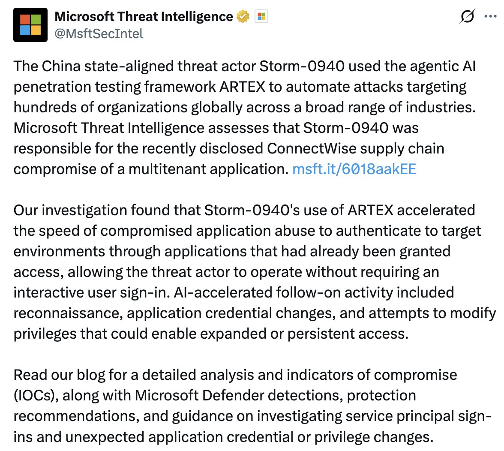
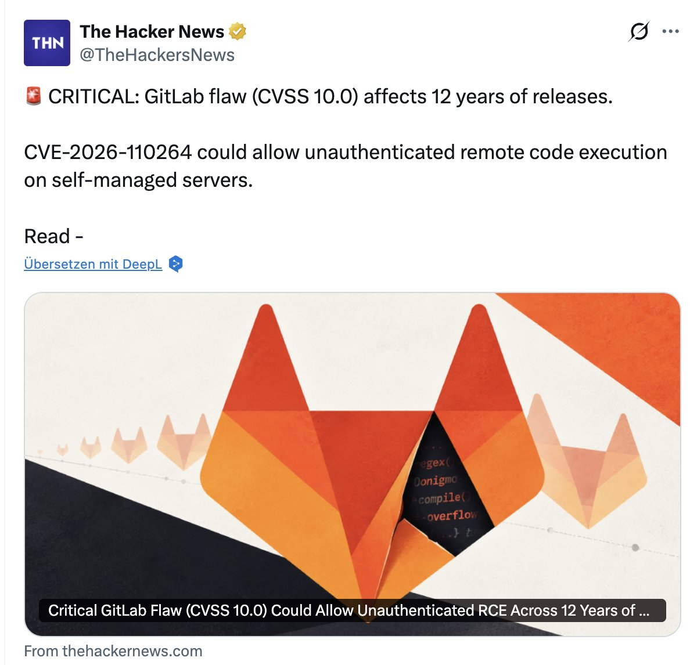
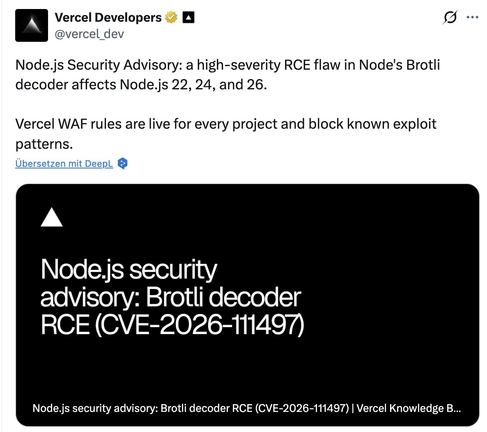
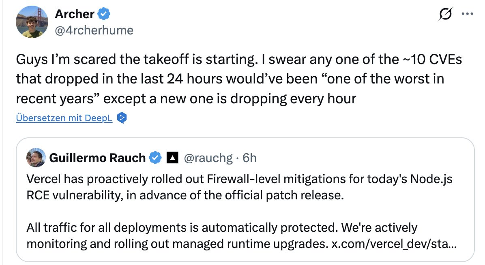

# Chubby♨️ (@kimmonismus)

> Automatisch per `npm run ingest:x` erfasst. Quelle: [x.com/kimmonismus/status/2113141875368468508](https://x.com/kimmonismus/status/2113141875368468508)

## Bilder

<!-- Reihenfolge wie von der API geliefert (Cover zuerst). Die Position im Artikeltext gibt die API nicht mit. -->

**photo**

**photo**

**photo**

**photo**

## Post-Text

Whats happening right now is probably way worse than the Hugging Face incident. 

AI-powered attacks are hitting real organizations while major platforms disclose breaches and critical flaws.

- Microsoft reports AI agents targeting hundreds of organizations, reaching privileged cloud access in under three hours in multiple cases. It attributes the ConnectWise compromise to the same group.

- CrowdStrike documented four operators running successful AI-agent campaigns. One compromised at least 15 Argentine healthcare organizations.

- PHP2Shell: AI helped turn longstanding PHP flaws into working exploits. Cloudflare’s CEO reports millions of exploitation attempts. Their AI involvement is unknown.

- Railway disclosed possible access to customer secrets. LiteLLM shipped a backdoored release. Zeabur confirmed another breach and is shutting down.

- GitLab patched a maximum-severity flaw affecting 12 years of releases. Node.js patched a serious code-execution vulnerability, with Vercel deploying firewall protections.

Feels like a turningpoint.

## Links

- [pic.x.com/CrEssqUunn](https://x.com/kimmonismus/status/2113141875368468508/photo/1)

## Thread

### 1/4

Whats happening right now is probably way worse than the Hugging Face incident. 

AI-powered attacks are hitting real organizations while major platforms disclose breaches and critical flaws.

- Microsoft reports AI agents targeting hundreds of organizations, reaching privileged cloud access in under three hours in multiple cases. It attributes the ConnectWise compromise to the same group.

- CrowdStrike documented four operators running successful AI-agent campaigns. One compromised at least 15 Argentine healthcare organizations.

- PHP2Shell: AI helped turn longstanding PHP flaws into working exploits. Cloudflare’s CEO reports millions of exploitation attempts. Their AI involvement is unknown.

- Railway disclosed possible access to customer secrets. LiteLLM shipped a backdoored release. Zeabur confirmed another breach and is shutting down.

- GitLab patched a maximum-severity flaw affecting 12 years of releases. Node.js patched a serious code-execution vulnerability, with Vercel deploying firewall protections.

Feels like a turningpoint.

### 2/4

https://t.co/G5A5DbNRHR

### 3/4

https://t.co/SRb0INbsoN

### 4/4

https://t.co/NJRZ8udiJq

## Erfassungsnachweis

Angefragter Post: https://x.com/kimmonismus/status/2113141875368468508

Im API-Abruf enthalten: 4 Post(s). Diese Zahl ist kein Nachweis eines vollständigen Threads.

- [Post 2113141875368468508](https://x.com/kimmonismus/status/2113141875368468508)
- [Post 2113141912655790492](https://x.com/kimmonismus/status/2113141912655790492)
- [Post 2113141936001368145](https://x.com/kimmonismus/status/2113141936001368145)
- [Post 2113141975088349583](https://x.com/kimmonismus/status/2113141975088349583)
