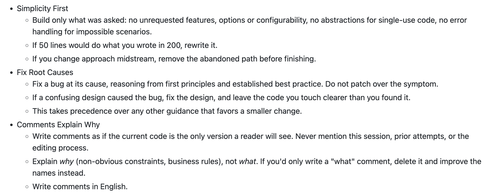

# Zihua (@luinlee)

> Automatisch per `npm run ingest:x` erfasst. Quelle: [x.com/luinlee/status/2113085361836744764](https://x.com/luinlee/status/2113085361836744764)

## Post-Text

最近用 Opus 和 Astra 写了不少 UI，发现一个避免 AI slop 并且让界面更好看的秘诀：

在 AGENTS.md 里加上 “Avoid unnecessary secondary labels and descriptions. Let the layout do the explaining.”

## Thread

### 1/28

最近用 Opus 和 Astra 写了不少 UI，发现一个避免 AI slop 并且让界面更好看的秘诀：

在 AGENTS.md 里加上 “Avoid unnecessary secondary labels and descriptions. Let the layout do the explaining.”

### 2/28

不加这个的话，这两个模型（尤其是 Opus）生成的页面经常有各种莫名其妙的 slogan 类似的文字，而且界面很容易变得和说明书一样。大部分时候这些说明性文字是可以用更好的设计来避免的。这句话可以让模型把时间花在思考 UI/UX 上，而不是把所有含糊的问题都加上说明

### 3/28

@maxbbn AI 太轻视人类了！

### 4/28

@jxdwinter 哈哈说不定 Fable 5.5 就又可以把这个去掉了

### 5/28

@Trojanking123 是的，几乎每个页面每个对话框他都要详细解释一下。有时还会把我嘱咐他的事情也写上去了😂

### 6/28

@sleepwalk_otm 6.1 sol 可能没这么听指令？语气强硬点试试，或者更明确试试？

### 7/28

@Griffin76gc 这个好！

### 8/28

@Invouxly 是的，我记得 Opus 4 时就会这样了。不过不知道为什么感觉 Opus 5.5 更明显了。有可能是其他问题都解决了，所以这个问题就显出来了

### 9/28

@silic2023 好！我试试看

### 10/28

@nicle_qingfeng 口号+鸡汤🥲

### 11/28

@threeaus 不知道怎么学的，感觉之前人工设计的网站也不这样呀...

### 12/28

@juryxiong 哈哈不断学习中！

### 13/28

@choose_to_slam 是的，有时他是懒了，不想优化 UI，直接在界面上把文档写上了...其实很多内容根本没必要，都是很显而易见的东西

### 14/28

@Jaminz 对。元素少的时候还能忍（尽管这种说明性文字完全没啥用），元素一多界面就眼花缭乱了

### 15/28

@hammercha1n 哈哈哈我的 AGENTS.md 也有第一性原理：Fix a bug at its cause, reasoning from first principles and established best practice. Do not patch over the symptom
就是观察到 AI 修 bug 时经常打补丁...

### 16/28

也可以试试我们做的 https://t.co/nJOKqvvAcZ 这个 AI code review 工具来约束：创建一个 check file 来要求 review 时避免 secondary labels and descriptions 即可（具体可以让你的 coding agent 看看 https://t.co/DfFRAvONud）。

### 17/28

@yawngaff 哈哈哈不愧是 gpt

### 18/28

@notesbyfloat didn't know that 👍

### 19/28

@lgs1520 Opus 5.5 好点但是还不够好。。

### 20/28

@guoxiaoyang0925 厉害了...

### 21/28

@JustinBao_ 对，info icon with tooltip 是个解决方法

### 22/28

@JayD2778 @hammercha1n 非常明显。修一个 bug 时，有的场景是需要打补丁的（比如修复一个线上问题），但我感觉 AI 对打补丁的倾向性太明显。尤其是你的产品还没上线或者团队比较小（没有这么多代码冲突）时，感觉非常重要

### 23/28

@WEEXAILabs 哈哈哈你

### 24/28

@ashleyrae36 感谢！

### 25/28

@JZennm 英雄所见略同！

### 26/28

@RaoTeng 😂

### 27/28

@yan5xu 可以的，就是有点慢。现在就是 code review 时通过 https://t.co/ncXHF0djGL 来约束了

### 28/28

@tuyussr @hammercha1n yup! double check if they are needed every time you switch a model ;-) https://t.co/BDBQs3xYmJ

## Erfassungsnachweis

Angefragter Post: https://x.com/luinlee/status/2113085361836744764

Im API-Abruf enthalten: 28 Post(s). Diese Zahl ist kein Nachweis eines vollständigen Threads.

- [Post 2113085361836744764](https://x.com/luinlee/status/2113085361836744764)
- [Post 2113085363606765963](https://x.com/luinlee/status/2113085363606765963)
- [Post 2113099853257720059](https://x.com/luinlee/status/2113099853257720059)
- [Post 2113099954084524389](https://x.com/luinlee/status/2113099954084524389)
- [Post 2113102158208082093](https://x.com/luinlee/status/2113102158208082093)
- [Post 2113118156273406268](https://x.com/luinlee/status/2113118156273406268)
- [Post 2113118206034649181](https://x.com/luinlee/status/2113118206034649181)
- [Post 2113118389321584748](https://x.com/luinlee/status/2113118389321584748)
- [Post 2113118508833976408](https://x.com/luinlee/status/2113118508833976408)
- [Post 2113119395899998458](https://x.com/luinlee/status/2113119395899998458)
- [Post 2113119496940687663](https://x.com/luinlee/status/2113119496940687663)
- [Post 2113119564695515513](https://x.com/luinlee/status/2113119564695515513)
- [Post 2113119790428721369](https://x.com/luinlee/status/2113119790428721369)
- [Post 2113122878245965920](https://x.com/luinlee/status/2113122878245965920)
- [Post 2113123496549347762](https://x.com/luinlee/status/2113123496549347762)
- [Post 2113140731066077465](https://x.com/luinlee/status/2113140731066077465)
- [Post 2113190089484620191](https://x.com/luinlee/status/2113190089484620191)
- [Post 2113190376924406018](https://x.com/luinlee/status/2113190376924406018)
- [Post 2113190539013366262](https://x.com/luinlee/status/2113190539013366262)
- [Post 2113190610685567266](https://x.com/luinlee/status/2113190610685567266)
- [Post 2113190812129648788](https://x.com/luinlee/status/2113190812129648788)
- [Post 2113191314720493954](https://x.com/luinlee/status/2113191314720493954)
- [Post 2113211983248105662](https://x.com/luinlee/status/2113211983248105662)
- [Post 2113269644689870925](https://x.com/luinlee/status/2113269644689870925)
- [Post 2113269786134356045](https://x.com/luinlee/status/2113269786134356045)
- [Post 2113299102377373726](https://x.com/luinlee/status/2113299102377373726)
- [Post 2113624355574071450](https://x.com/luinlee/status/2113624355574071450)
- [Post 2113637889036935588](https://x.com/luinlee/status/2113637889036935588)

### Medien aus Post 2113637889036935588

