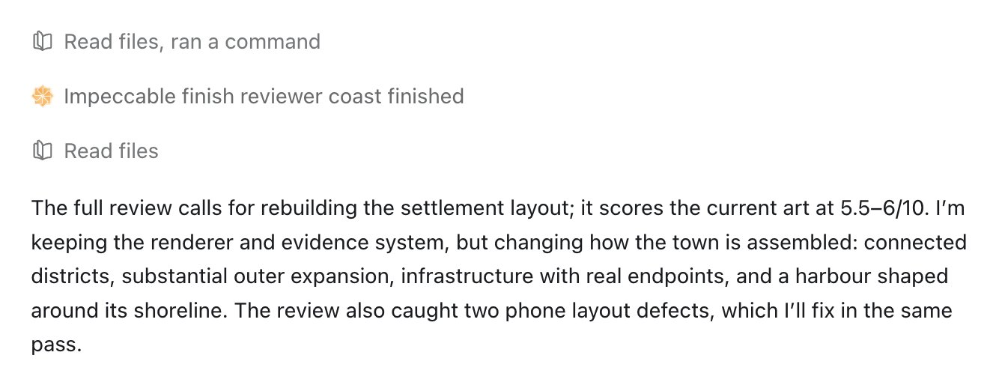

# Paul Bakaus (@pbakaus)

> Automatisch per `npm run ingest:x` erfasst. Quelle: [x.com/pbakaus/status/2113065895069368804](https://x.com/pbakaus/status/2113065895069368804)

## Bilder

<!-- Reihenfolge wie von der API geliefert (Cover zuerst). Die Position im Artikeltext gibt die API nicht mit. -->

**photo**

## Post-Text

Impeccable now has a sub-agent that hillclimbs and polishes all your frontend work *automatically*

it's one of those quiet wins that just make things work better: kicks in after a build out, then hillclimbs with your agent, usually leading to vastly superior finish and polish in any web project (not just sites)

here, codex used it to polish a 3D scene:

## Links

- [pic.x.com/jHGqsHLRnF](https://x.com/pbakaus/status/2113065895069368804/photo/1)

## Thread

### 1/15

Impeccable now has a sub-agent that hillclimbs and polishes all your frontend work *automatically*

it's one of those quiet wins that just make things work better: kicks in after a build out, then hillclimbs with your agent, usually leading to vastly superior finish and polish in any web project (not just sites)

here, codex used it to polish a 3D scene:

### 2/15

@hnshah 🫡

### 3/15

@mickeybighouse ty!

### 4/15

@ADLXBT not really possible yet, but you can always tell your agent to stop after one review or not use the agent in your session. will think about how to do this in the future

### 5/15

@not_sacke cool! yeah, claude will often do this on its own. codex...not always.

### 6/15

@khuxsal we've all been there

### 7/15

yeah i can prep something - importantly, this agent has two modes:

1) when doing new work in impeccable (a special run mode), it uses pretty sophisticated gates to not thrash
2) when used like in my screenshot, it does a generic deep review in the browser (also useful but your mileage might vary

### 8/15

yes, it does not rethink the site. importantly, this agent has two modes:

1) when doing new work in impeccable (a special run mode), it uses pretty sophisticated gates to not thrash
2) when used like in my screenshot, it does a generic deep review in the browser (also useful but your mileage might vary

but even for the new-work mode, it does not pivot to better UX, it simply holds the agent accountable.

### 9/15

@laozhang_ai yep agree. depends on the model though. gemini definitely needs a 2x stop gate. opus will stop on its own.

### 10/15

@keleftheriou It will try as well but mileage might vary

### 11/15

@interplato @hnshah yes definitely! that’s its primary use case

### 12/15

@thisishars sorry to hear :( sol isn’t very good at design, but imo impeccable makes it a bit better. are hooks enabled?

### 13/15

@designertom will see what I can do - when are you going live?

### 14/15

@rachelnabors 🫡

### 15/15

@abulhasanx yeah! this one has silently been optimizing hundreds of thousands of sites for while, I just suck talking about it 🫠

## Erfassungsnachweis

Angefragter Post: https://x.com/pbakaus/status/2113065895069368804

Im API-Abruf enthalten: 15 Post(s). Diese Zahl ist kein Nachweis eines vollständigen Threads.

- [Post 2113065895069368804](https://x.com/pbakaus/status/2113065895069368804)
- [Post 2113074424979358012](https://x.com/pbakaus/status/2113074424979358012)
- [Post 2113074500757840168](https://x.com/pbakaus/status/2113074500757840168)
- [Post 2113074661835907287](https://x.com/pbakaus/status/2113074661835907287)
- [Post 2113074911803761076](https://x.com/pbakaus/status/2113074911803761076)
- [Post 2113075504844767316](https://x.com/pbakaus/status/2113075504844767316)
- [Post 2113090720743698887](https://x.com/pbakaus/status/2113090720743698887)
- [Post 2113090986813563313](https://x.com/pbakaus/status/2113090986813563313)
- [Post 2113091166891905171](https://x.com/pbakaus/status/2113091166891905171)
- [Post 2113097644885393573](https://x.com/pbakaus/status/2113097644885393573)
- [Post 2113138384713691269](https://x.com/pbakaus/status/2113138384713691269)
- [Post 2113138615966732487](https://x.com/pbakaus/status/2113138615966732487)
- [Post 2113274146524426310](https://x.com/pbakaus/status/2113274146524426310)
- [Post 2113274602046755112](https://x.com/pbakaus/status/2113274602046755112)
- [Post 2113274916053393868](https://x.com/pbakaus/status/2113274916053393868)
