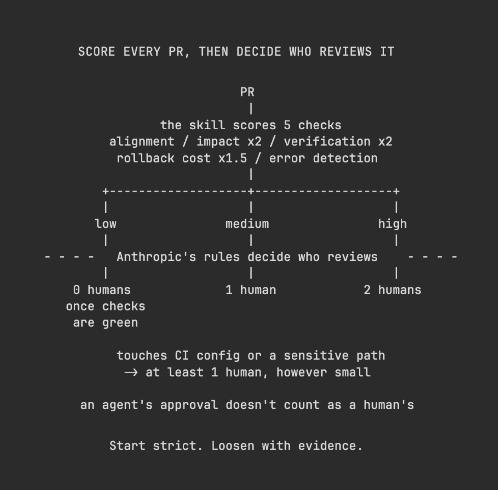

# Vox (@Voxyz_ai)

> Automatisch per `npm run ingest:x` erfasst. Quelle: [x.com/Voxyz_ai/status/2113314439294570515](https://x.com/Voxyz_ai/status/2113314439294570515)

## Bilder

<!-- Reihenfolge wie von der API geliefert (Cover zuerst). Die Position im Artikeltext gibt die API nicht mit. -->

**photo**

## Post-Text

Claude Code's low-risk PRs merge with 𝗻𝗼 𝗵𝘂𝗺𝗮𝗻 𝗮𝗽𝗽𝗿𝗼𝘃𝗮𝗹 once automated review and security checks are green. From June to September, merged PRs to Claude Code more than doubled, yet the share that had to be reverted 𝗳𝗲𝗹𝗹 𝗯𝘆 𝗺𝗼𝗿𝗲 𝘁𝗵𝗮𝗻 𝟰𝟬%.

Anthropic sorts every PR into three tiers based on what it changes: low risk needs zero approvals, medium needs one person, high needs two. Claude writes about 90% of the code this process reviews. The tiers are one layer; the same process also runs bug-hunting agents in parallel and a security review that can block the merge.

A free, open-source skill grades every PR in your repo low / medium / high. It only scores; how many people review is up to the rules above. It looks at 5 things:
→ The code has to match the PR description and the linked issue, and drive-by changes have to be written down
→ Anything touching auth, permissions, payments, personal data, secrets, data migrations, dependency bumps or infra config gets flagged, however small the diff
→ UI changes need screenshots or a recording, ideally before and after; unit tests alone don't count
→ How hard is it to undo after merging? Anything like deleting data, which can't be walked back, gets called out
→ Will you hear about a failure before users report it? Are exceptions swallowed, or is a fallback hiding the problem?

A few more Anthropic rules worth copying. Only trusted authors get the low-risk path. CI config files and paths owners mark as sensitive always need a person. An agent's approval doesn't count as a person's. Start strict and loosen with evidence.

npx skills add warpdotdev/common-skills --skill merge-risk

To see how many reviewers each PR in your repo needs, install it and send this to Claude Code 👇
"Use merge-risk to score the last 10 open PRs in this repo; if there are fewer than 10, fill in with the most recently merged ones. For each, give low / medium / high and the items that push the risk up. Then suggest how many people should review it: low risk with all automated checks passing, 0; medium, 1; high, 2; anything touching CI config or a sensitive path, at least 1 however small. Put it all in one table. Read-only: don't comment, approve, merge or change any code."

## Links

- [pic.x.com/JBwpGxrGpk](https://x.com/Voxyz_ai/status/2113314439294570515/photo/1)

## Thread

### 1/1

Claude Code's low-risk PRs merge with 𝗻𝗼 𝗵𝘂𝗺𝗮𝗻 𝗮𝗽𝗽𝗿𝗼𝘃𝗮𝗹 once automated review and security checks are green. From June to September, merged PRs to Claude Code more than doubled, yet the share that had to be reverted 𝗳𝗲𝗹𝗹 𝗯𝘆 𝗺𝗼𝗿𝗲 𝘁𝗵𝗮𝗻 𝟰𝟬%.

Anthropic sorts every PR into three tiers based on what it changes: low risk needs zero approvals, medium needs one person, high needs two. Claude writes about 90% of the code this process reviews. The tiers are one layer; the same process also runs bug-hunting agents in parallel and a security review that can block the merge.

A free, open-source skill grades every PR in your repo low / medium / high. It only scores; how many people review is up to the rules above. It looks at 5 things:
→ The code has to match the PR description and the linked issue, and drive-by changes have to be written down
→ Anything touching auth, permissions, payments, personal data, secrets, data migrations, dependency bumps or infra config gets flagged, however small the diff
→ UI changes need screenshots or a recording, ideally before and after; unit tests alone don't count
→ How hard is it to undo after merging? Anything like deleting data, which can't be walked back, gets called out
→ Will you hear about a failure before users report it? Are exceptions swallowed, or is a fallback hiding the problem?

A few more Anthropic rules worth copying. Only trusted authors get the low-risk path. CI config files and paths owners mark as sensitive always need a person. An agent's approval doesn't count as a person's. Start strict and loosen with evidence.

npx skills add warpdotdev/common-skills --skill merge-risk

To see how many reviewers each PR in your repo needs, install it and send this to Claude Code 👇
"Use merge-risk to score the last 10 open PRs in this repo; if there are fewer than 10, fill in with the most recently merged ones. For each, give low / medium / high and the items that push the risk up. Then suggest how many people should review it: low risk with all automated checks passing, 0; medium, 1; high, 2; anything touching CI config or a sensitive path, at least 1 however small. Put it all in one table. Read-only: don't comment, approve, merge or change any code."

## Erfassungsnachweis

Angefragter Post: https://x.com/Voxyz_ai/status/2113314439294570515

Im API-Abruf enthalten: 1 Post(s). Diese Zahl ist kein Nachweis eines vollständigen Threads.

- [Post 2113314439294570515](https://x.com/Voxyz_ai/status/2113314439294570515)
