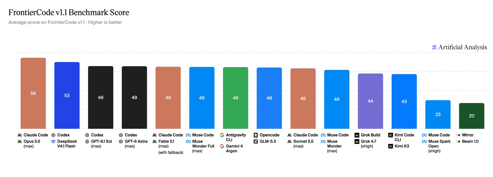
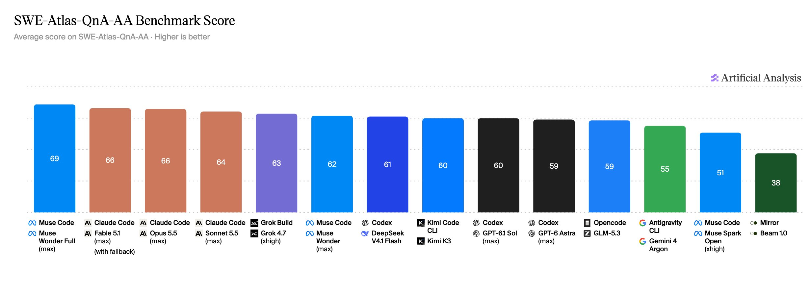
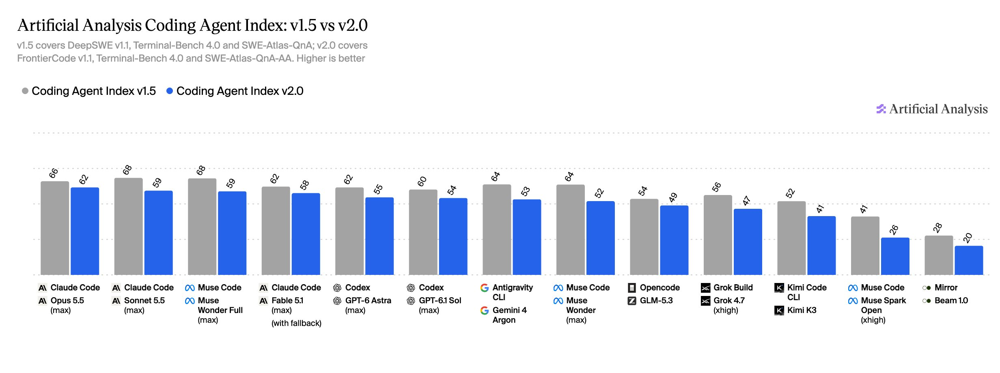

# Artificial Analysis (@ArtificialAnlys)

> Automatisch per `npm run ingest:x` erfasst. Quelle: [x.com/ArtificialAnlys/status/2113424551396934134](https://x.com/ArtificialAnlys/status/2113424551396934134)

## Bilder

<!-- Reihenfolge wie von der API geliefert (Cover zuerst). Die Position im Artikeltext gibt die API nicht mit. -->

**photo**

## Post-Text

Announcing Artificial Analysis Coding Agent Index v2.0: FrontierCode v1.1 from Cognition replaces DeepSWE, SWE-Atlas-QnA grading is revised, and Claude Opus 5.5 in Claude Code leads at 61.7

Today we are launching v2.0 of the Coding Agent Index. The Index evaluates models together with their agent harnesses, now across 290 tasks covering software engineering, terminal use, and repository Q&A, with the three benchmarks weighted equally.

Changelog (Index v1.5 → Index v2.0):

→ FrontierCode v1.1 replaces DeepSWE v1.1. FrontierCode is a benchmark from @cognition with a private test set: 100 software engineering tasks on real open-source repositories, graded on whether a maintainer would merge the change. An attempt that fails a blocking check scores zero, and one that passes them all scores between 70% and 100% depending on the non-blocking checks it meets. We also scan each trajectory with a modified version of Cognition's rule-based scanner, and any attempt flagged for accessing solution material scores zero.

→ Revised SWE-Atlas-QnA grading, now SWE-Atlas-QnA-AA. Scale AI's 124 repository Q&A tasks are unchanged. We reworded 127 of the 1,306 rubric criteria for more consistent verdicts and moved to GPT-6 Luna (xhigh) as the judge, with five votes per criterion. The dataset and judge configuration are published on Hugging Face.

Key results:

➤ Claude Opus 5.5 leads the Index: Claude Code with Claude Opus 5.5 (max) scores 61.7, followed by Claude Code with Claude Sonnet 5.5 (max) at 59.3, Muse Code with Muse Wonder Full (max) at 58.9 and Claude Code with Claude Fable 5.1 (max with fallback) at 57.6.

➤ FrontierCode v1.1 is where Opus 5.5 pulls ahead: Opus 5.5 scores 56.0% on FrontierCode, ahead of Codex with DeepSeek V4.1 Flash (max) at 52.6%, Codex with GPT-6.1 Sol (max) at 49.4% and Codex with GPT-6 Astra (max) at 49.3%. Below the top, FrontierCode scores are tightly packed: 15 of the 24 configurations on the Index score between 43% and 49%.

➤ SWE-Atlas-QnA-AA grading is stricter and more consistent: across the 21 configurations evaluated on both Index versions, the mean score falls 1.7 points, from 58.8% to 57.1%, with 14 of 21 moving down. Individual configurations move by up to 7 points: Muse Code with Muse Spark Open (xhigh) falls 7.0, Kimi K3 in Kimi Code CLI and Codex with GPT-6 Luna (max) 6.2, and Muse Code with Muse Wonder (max) 5.6, while Codex with GPT-6.1 Sol (max) gains 2.1.

➤ Four configurations sit on the cost frontier: Codex with DeepSeek V4.1 Flash (max) scores 47.3 at $0.39 per task, Codex with GPT-6.1 Sol (max) 54.1 at $1.50, Codex with GPT-6 Astra (max) 54.7 at $7.04 and Claude Code with Claude Opus 5.5 (max) 61.7 at $11.42. Costs are pay-per-token API costs, not subscription prices.

We will keep updating the Coding Agent Index incrementally, with more evaluations and agents to come.

## Thread

### 1/5

Announcing Artificial Analysis Coding Agent Index v2.0: FrontierCode v1.1 from Cognition replaces DeepSWE, SWE-Atlas-QnA grading is revised, and Claude Opus 5.5 in Claude Code leads at 61.7

Today we are launching v2.0 of the Coding Agent Index. The Index evaluates models together with their agent harnesses, now across 290 tasks covering software engineering, terminal use, and repository Q&A, with the three benchmarks weighted equally.

Changelog (Index v1.5 → Index v2.0):

→ FrontierCode v1.1 replaces DeepSWE v1.1. FrontierCode is a benchmark from @cognition with a private test set: 100 software engineering tasks on real open-source repositories, graded on whether a maintainer would merge the change. An attempt that fails a blocking check scores zero, and one that passes them all scores between 70% and 100% depending on the non-blocking checks it meets. We also scan each trajectory with a modified version of Cognition's rule-based scanner, and any attempt flagged for accessing solution material scores zero.

→ Revised SWE-Atlas-QnA grading, now SWE-Atlas-QnA-AA. Scale AI's 124 repository Q&A tasks are unchanged. We reworded 127 of the 1,306 rubric criteria for more consistent verdicts and moved to GPT-6 Luna (xhigh) as the judge, with five votes per criterion. The dataset and judge configuration are published on Hugging Face.

Key results:

➤ Claude Opus 5.5 leads the Index: Claude Code with Claude Opus 5.5 (max) scores 61.7, followed by Claude Code with Claude Sonnet 5.5 (max) at 59.3, Muse Code with Muse Wonder Full (max) at 58.9 and Claude Code with Claude Fable 5.1 (max with fallback) at 57.6.

➤ FrontierCode v1.1 is where Opus 5.5 pulls ahead: Opus 5.5 scores 56.0% on FrontierCode, ahead of Codex with DeepSeek V4.1 Flash (max) at 52.6%, Codex with GPT-6.1 Sol (max) at 49.4% and Codex with GPT-6 Astra (max) at 49.3%. Below the top, FrontierCode scores are tightly packed: 15 of the 24 configurations on the Index score between 43% and 49%.

➤ SWE-Atlas-QnA-AA grading is stricter and more consistent: across the 21 configurations evaluated on both Index versions, the mean score falls 1.7 points, from 58.8% to 57.1%, with 14 of 21 moving down. Individual configurations move by up to 7 points: Muse Code with Muse Spark Open (xhigh) falls 7.0, Kimi K3 in Kimi Code CLI and Codex with GPT-6 Luna (max) 6.2, and Muse Code with Muse Wonder (max) 5.6, while Codex with GPT-6.1 Sol (max) gains 2.1.

➤ Four configurations sit on the cost frontier: Codex with DeepSeek V4.1 Flash (max) scores 47.3 at $0.39 per task, Codex with GPT-6.1 Sol (max) 54.1 at $1.50, Codex with GPT-6 Astra (max) 54.7 at $7.04 and Claude Code with Claude Opus 5.5 (max) 61.7 at $11.42. Costs are pay-per-token API costs, not subscription prices.

We will keep updating the Coding Agent Index incrementally, with more evaluations and agents to come.

### 2/5

FrontierCode v1.1 replaces DeepSWE v1.1 in the Index. Cognition's benchmark has 100 software engineering tasks on real open-source repositories with a private test set, graded on whether a maintainer would merge the change.

Claude Code with Claude Opus 5.5 (max) scores 56.0%, ahead of Codex with DeepSeek V4.1 Flash (max) at 52.6%, Codex with GPT-6.1 Sol (max) at 49.4% and Codex with GPT-6 Astra (max) at 49.3%. Below the top, scores are tightly packed: 15 of the 24 configurations on the Index score between 43% and 49%.

### 3/5

SWE-Atlas-QnA grading is revised, now SWE-Atlas-QnA-AA. Scale AI's 124 repository Q&A tasks are unchanged. We reworded 127 of the 1,306 rubric criteria for more consistent verdicts and moved to GPT-6 Luna (xhigh) as the judge, with five votes per criterion.

Muse Code with Muse Wonder Full (max) leads at 68.8%, followed by Claude Code with Claude Fable 5.1 (max with fallback) at 66.4%, Claude Code with Claude Opus 5.5 (max) at 65.9% and Claude Code with Claude Sonnet 5.5 (max) at 64.2%. Across the 21 configurations evaluated on both Index versions, the mean score falls 1.7 points, with 14 of 21 moving down.

### 4/5

Coding Agent Index v2.0 scores are lower than v1.5 for almost every configuration measured on both. Across the 21 configurations evaluated on both Index versions, the mean Index score moves from 54.8 to 47.4, with 20 of 21 moving down.

The shift comes from FrontierCode v1.1, where the same configurations average 45.1% against 65.6% on DeepSWE v1.1, with a smaller contribution from stricter SWE-Atlas-QnA-AA grading. Terminal-Bench 4.0 is unchanged. Scores on the two Index versions reflect different evaluation setups.

### 5/5

Explore the Coding Agent Index v2.0, with scores by benchmark, Cost per Task and token usage:
https://t.co/Nr1BHDEE6F

Methodology and version history:
https://t.co/rrjpXMuHFh

FrontierCode v1.1 on Artificial Analysis:
https://t.co/K6lW7P2YEt

SWE-Atlas-QnA-AA dataset and judge configuration on Hugging Face:
https://t.co/fRPzeOSBlE

## Erfassungsnachweis

Angefragter Post: https://x.com/ArtificialAnlys/status/2113424551396934134

Im API-Abruf enthalten: 5 Post(s). Diese Zahl ist kein Nachweis eines vollständigen Threads.

- [Post 2113424551396934134](https://x.com/ArtificialAnlys/status/2113424551396934134)
- [Post 2113424556069372203](https://x.com/ArtificialAnlys/status/2113424556069372203)

### Medien aus Post 2113424556069372203

- [Post 2113424559684870621](https://x.com/ArtificialAnlys/status/2113424559684870621)

### Medien aus Post 2113424559684870621

- [Post 2113424563774312931](https://x.com/ArtificialAnlys/status/2113424563774312931)

### Medien aus Post 2113424563774312931

- [Post 2113424566362284496](https://x.com/ArtificialAnlys/status/2113424566362284496)
