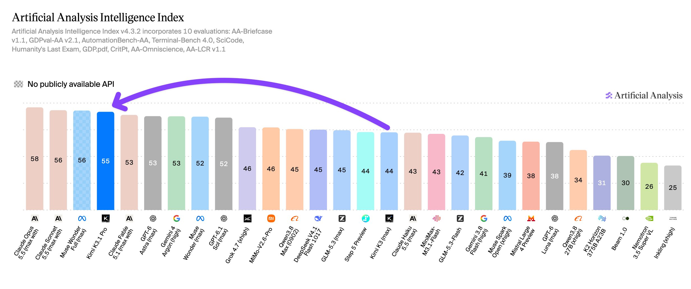
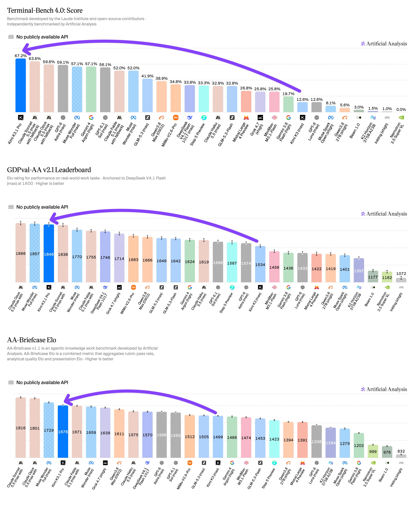
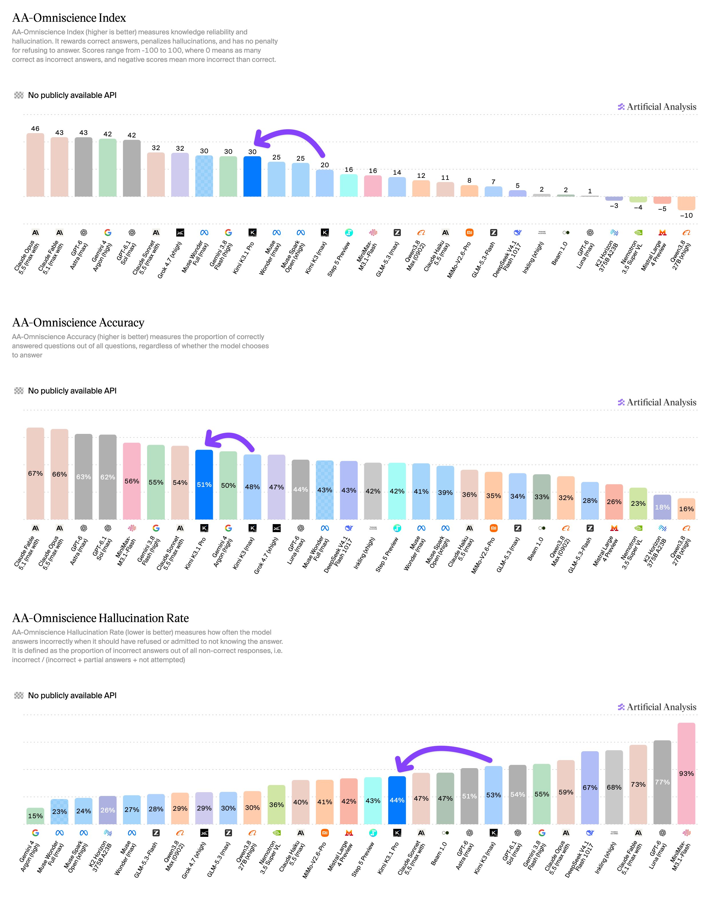
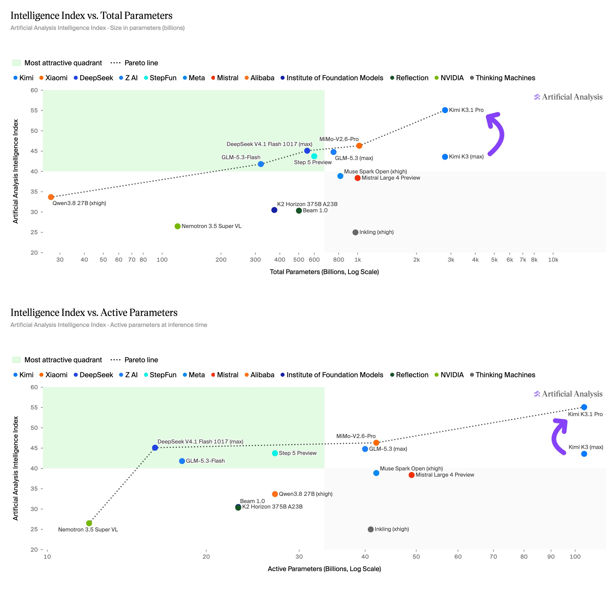
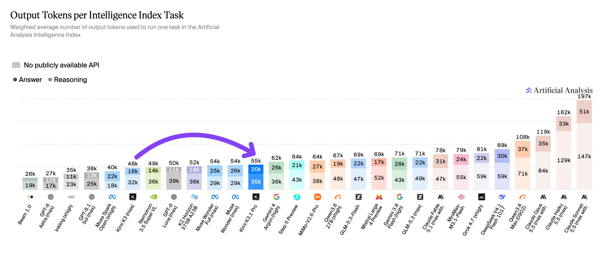
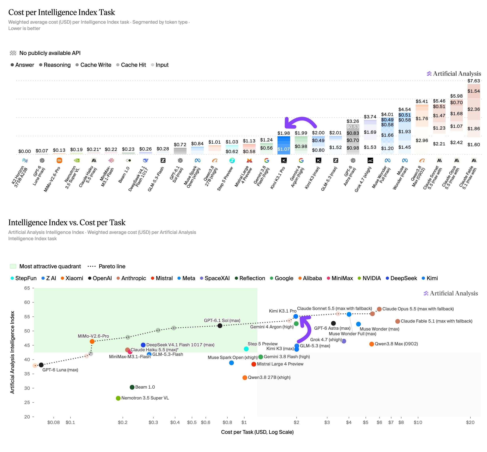
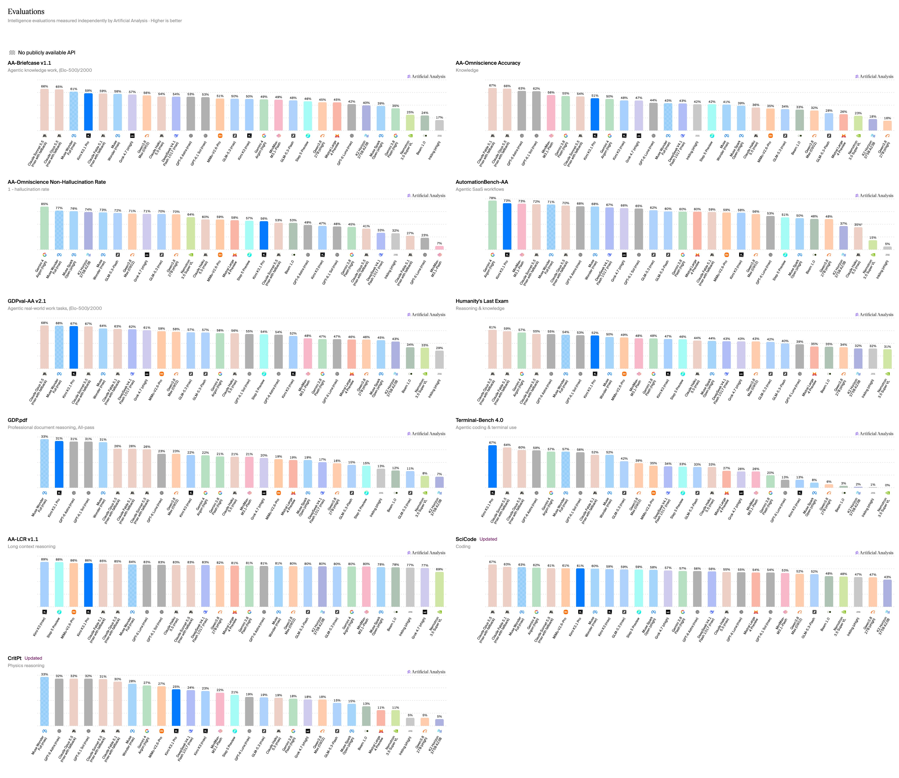

# Artificial Analysis (@ArtificialAnlys)

> Automatisch per `npm run ingest:x` erfasst. Quelle: [x.com/ArtificialAnlys/status/2113688083145314416](https://x.com/ArtificialAnlys/status/2113688083145314416)

## Bilder

<!-- Reihenfolge wie von der API geliefert (Cover zuerst). Die Position im Artikeltext gibt die API nicht mit. -->

**photo**

## Post-Text

Kimi K3.1 Pro launches at 4th on the Artificial Analysis Intelligence Index scoring 55, making large gains in agentic performance; it will be the leading open-weights model once its weights are published

@Kimi_Moonshot's new reasoning model gains 11 points over Kimi K3 (max, 44). It trails only Claude Opus 5.5 (max with fallback, 58), Claude Sonnet 5.5 (max with fallback, 56), and Muse Wonder Full (max, 56) on the Intelligence Index.

Once the weights for K3.1 Pro are released it will be the highest-scoring open weights model and the gap between the leading open weights and proprietary models on the Intelligence Index will narrow from 12 points to 3.

Key results:
➤ Large gains in agentic performance: Kimi K3.1 Pro scores 3rd on GDPval-AA with 1,846 Elo, up 312 Elo from Kimi K3, behind only Claude Opus 5.5 (1,866 Elo) and Muse Wonder Full (1,857 Elo). Kimi K3.1 Pro also achieves the highest score of any model on Terminal-Bench 4.0. K3.1 Pro scores 67%, up from 13% for Kimi K3 and ahead of Claude Sonnet 5.5 (64%). AutomationBench-AA, which tests agentic SaaS workflows, rises from 58% to 73%.

➤ Gains in other evals are more moderate: Humanity's Last Exam rises from 47% to 52%, CritPt from 23% to 25%, and SciCode from 59% to 61%. AA-Omniscience Index rises from 20 to 30, as the hallucination rate falls from 53% to 44% and accuracy rises from 48% to 51%.

➤ Cost per Task roughly equal to Kimi K3 at $1.98 per Task: K3.1 Pro uses 55K output tokens per Intelligence Index task, 14% more than Kimi K3 at 48K, while its first-party token prices are 33% lower.

Additional model details:
➤ Context window: 1M tokens.
➤ Size: 2.8T total, 104B active parameters
➤ Input modalities: Text and image
➤ Weights and license: Weights currently not published, Moonshot is expected to release the weights soon after launch
➤ Pricing: $2/$10/$0.20 per 1M input/output/cache hit tokens, 33% lower than Kimi K3 on all three rates.

Congratulations to the team at @Kimi_Moonshot on the release!

## Thread

### 1/9

Kimi K3.1 Pro launches at 4th on the Artificial Analysis Intelligence Index scoring 55, making large gains in agentic performance; it will be the leading open-weights model once its weights are published

@Kimi_Moonshot's new reasoning model gains 11 points over Kimi K3 (max, 44). It trails only Claude Opus 5.5 (max with fallback, 58), Claude Sonnet 5.5 (max with fallback, 56), and Muse Wonder Full (max, 56) on the Intelligence Index.

Once the weights for K3.1 Pro are released it will be the highest-scoring open weights model and the gap between the leading open weights and proprietary models on the Intelligence Index will narrow from 12 points to 3.

Key results:
➤ Large gains in agentic performance: Kimi K3.1 Pro scores 3rd on GDPval-AA with 1,846 Elo, up 312 Elo from Kimi K3, behind only Claude Opus 5.5 (1,866 Elo) and Muse Wonder Full (1,857 Elo). Kimi K3.1 Pro also achieves the highest score of any model on Terminal-Bench 4.0. K3.1 Pro scores 67%, up from 13% for Kimi K3 and ahead of Claude Sonnet 5.5 (64%). AutomationBench-AA, which tests agentic SaaS workflows, rises from 58% to 73%.

➤ Gains in other evals are more moderate: Humanity's Last Exam rises from 47% to 52%, CritPt from 23% to 25%, and SciCode from 59% to 61%. AA-Omniscience Index rises from 20 to 30, as the hallucination rate falls from 53% to 44% and accuracy rises from 48% to 51%.

➤ Cost per Task roughly equal to Kimi K3 at $1.98 per Task: K3.1 Pro uses 55K output tokens per Intelligence Index task, 14% more than Kimi K3 at 48K, while its first-party token prices are 33% lower.

Additional model details:
➤ Context window: 1M tokens.
➤ Size: 2.8T total, 104B active parameters
➤ Input modalities: Text and image
➤ Weights and license: Weights currently not published, Moonshot is expected to release the weights soon after launch
➤ Pricing: $2/$10/$0.20 per 1M input/output/cache hit tokens, 33% lower than Kimi K3 on all three rates.

Congratulations to the team at @Kimi_Moonshot on the release!

### 2/9

Large gains in agentic performance: Kimi K3.1 Pro scores 3rd on GDPval-AA with 1,846 Elo, up 312 Elo from Kimi K3, behind only Claude Opus 5.5 (1,866 Elo) and Muse Wonder Full (1,857 Elo). Kimi K3.1 Pro also achieves the highest score of any model on Terminal-Bench 4.0. K3.1 Pro scores 67%, up from 13% for Kimi K3 and ahead of Claude Sonnet 5.5 (64%). AutomationBench-AA, which tests agentic SaaS workflows, rises from 58% to 73%.

### 3/9

Kimi K3.1 Pro's AA-Omniscience Index rises to 30 from 20 for Kimi K3. Accuracy improves slightly to 51% from 48%, while the hallucination rate falls to 44% from 53%, driving most of the index gain. AA-Omniscience rewards models for correct answers while penalizing incorrect answers.

### 4/9

At 2.8T total and 104B active parameters, Kimi K3.1 Pro is the same size as Kimi K3 but scores 11 points higher on the Intelligence Index, placing it at the top of the Pareto frontier on both Intelligence Index vs. Total and Active Parameters. For comparison, MiMo-V2.6-Pro (46) has 1.02T total and 42B active parameters, and GLM-5.3 (max, 45) has 753B total and 40B active.

### 5/9

Kimi K3.1 Pro uses 14% more output tokens per Intelligence Index task than Kimi K3: 55K vs. 48K. Output tokens rise on agentic evaluations such as AutomationBench-AA and GDPval-AA but fall by more than half on AA-Omniscience. https://t.co/fWR8IB0fEu

### 6/9

Kimi K3.1 Pro's first-party token prices are 33% lower than Kimi K3's: $2 vs. $3 per million input tokens, $10 vs. $15 per million output tokens, and $0.20 vs. $0.30 per million cached input tokens. Kimi K3.1 Pro costs $1.98 per Intelligence Index task, versus $2.00 for Kimi K3. https://t.co/rPEAjv0GYx

### 7/9

Full results for Kimi K3.1 Pro across the Artificial Analysis Intelligence Index https://t.co/XA2RO8IIUs

### 8/9

Compare Kimi K3.1 Pro to other models:
https://t.co/TM4v7FH0Z2

### 9/9

@teortaxesTex @Kimi_Moonshot Completion of the switch just a few days away!

## Erfassungsnachweis

Angefragter Post: https://x.com/ArtificialAnlys/status/2113688083145314416

Im API-Abruf enthalten: 9 Post(s). Diese Zahl ist kein Nachweis eines vollständigen Threads.

- [Post 2113688083145314416](https://x.com/ArtificialAnlys/status/2113688083145314416)
- [Post 2113688085385097251](https://x.com/ArtificialAnlys/status/2113688085385097251)

### Medien aus Post 2113688085385097251

- [Post 2113688088287600841](https://x.com/ArtificialAnlys/status/2113688088287600841)

### Medien aus Post 2113688088287600841

- [Post 2113688091064184882](https://x.com/ArtificialAnlys/status/2113688091064184882)

### Medien aus Post 2113688091064184882

- [Post 2113688093547233380](https://x.com/ArtificialAnlys/status/2113688093547233380)

### Medien aus Post 2113688093547233380

- [Post 2113688095602491627](https://x.com/ArtificialAnlys/status/2113688095602491627)

### Medien aus Post 2113688095602491627

- [Post 2113688097959633140](https://x.com/ArtificialAnlys/status/2113688097959633140)

### Medien aus Post 2113688097959633140

- [Post 2113688100358791485](https://x.com/ArtificialAnlys/status/2113688100358791485)
- [Post 2113701474798858715](https://x.com/ArtificialAnlys/status/2113701474798858715)
