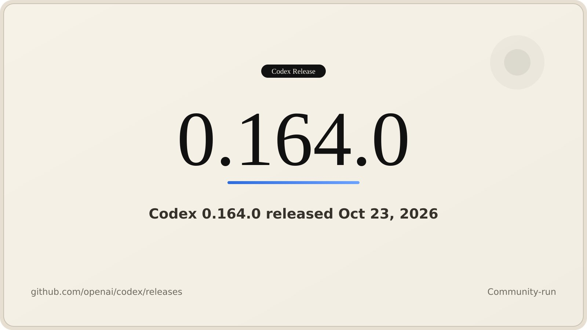

# Codex Releases (@CodexReleases)

> Automatisch per `npm run ingest:x` erfasst. Quelle: [x.com/CodexReleases/status/2113499625571188984](https://x.com/CodexReleases/status/2113499625571188984)

## Bilder

<!-- Reihenfolge wie von der API geliefert (Cover zuerst). Die Position im Artikeltext gibt die API nicht mit. -->

**photo**

## Post-Text

Codex CLI 0.164.0 is out!

Highlights:
- /presets adds 10 numbered slots for reusable prompts and slash commands, with a keyboard shortcut menu for quick access
- Enterprise MCP connections now authenticate using Codex account grants or dedicated sign-in, including OAuth clients requiring secrets
- /model and /permissions now accept inline arguments for model, reasoning effort, speed, and permission profiles
- Credential masking now covers remote Bash commands and Zsh snapshot sessions, including credentials from custom providers

Complete details in thread ↓

## Links

- [pic.x.com/tI3W3zYugV](https://x.com/CodexReleases/status/2113499625571188984/photo/1)

## Thread

### 1/7

Codex CLI 0.164.0 is out!

Highlights:
- /presets adds 10 numbered slots for reusable prompts and slash commands, with a keyboard shortcut menu for quick access
- Enterprise MCP connections now authenticate using Codex account grants or dedicated sign-in, including OAuth clients requiring secrets
- /model and /permissions now accept inline arguments for model, reasoning effort, speed, and permission profiles
- Credential masking now covers remote Bash commands and Zsh snapshot sessions, including credentials from custom providers

Complete details in thread ↓

### 2/7

Presets and inline config:
- /presets stores reusable prompts and slash commands in 10 numbered slots, with a keyboard shortcut menu for quick access
- /model and /permissions now accept inline arguments to set model, reasoning effort, speed, and permission profiles directly

### 3/7

Enterprise MCP auth:
- Enterprise MCP connections can now authenticate using eligible Codex account grants or dedicated sign-in
- Confidential OAuth clients requiring secrets are supported

### 4/7

Credential masking and Bedrock:
- Credentials are masked during supported remote Bash commands and Zsh snapshot sessions, including credentials from custom providers
- The Amazon Bedrock setup wizard is enabled by default, with API key entry grouped alongside other AWS sign-in methods when credentials are detected

### 5/7

Added:
- Image previews now appear in the fullscreen transcript on terminals supporting Kitty or Sixel graphics

### 6/7

Fixed:
- Failed compaction no longer leaves partial summaries in conversation history; background compaction failures fall back without panicking
- Resuming sessions now finds compressed histories and restores saved thread settings instead of replacing them with global defaults

### 7/7

Release notes:
- https://t.co/pYkbAEkKrF

## Erfassungsnachweis

Angefragter Post: https://x.com/CodexReleases/status/2113499625571188984

Im API-Abruf enthalten: 7 Post(s). Diese Zahl ist kein Nachweis eines vollständigen Threads.

- [Post 2113499625571188984](https://x.com/CodexReleases/status/2113499625571188984)
- [Post 2113499627165016327](https://x.com/CodexReleases/status/2113499627165016327)
- [Post 2113499628242977121](https://x.com/CodexReleases/status/2113499628242977121)
- [Post 2113499629706719519](https://x.com/CodexReleases/status/2113499629706719519)
- [Post 2113499630822388098](https://x.com/CodexReleases/status/2113499630822388098)
- [Post 2113499631862657057](https://x.com/CodexReleases/status/2113499631862657057)
- [Post 2113499632974069821](https://x.com/CodexReleases/status/2113499632974069821)
