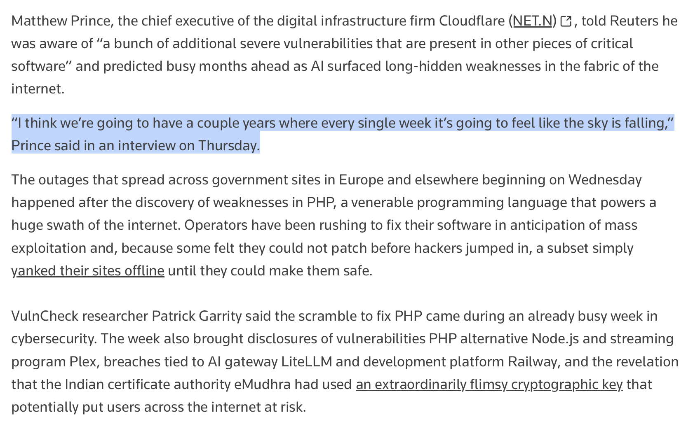

# Chubby♨️ (@kimmonismus)

> Automatisch per `npm run ingest:x` erfasst. Quelle: [x.com/kimmonismus/status/2113657408060825672](https://x.com/kimmonismus/status/2113657408060825672)

## Bilder

<!-- Reihenfolge wie von der API geliefert (Cover zuerst). Die Position im Artikeltext gibt die API nicht mit. -->

**photo**

## Post-Text

Looks like this really is just the beginning: Cloudflare CEO Matthew Prince warns that AI is uncovering long-hidden software vulnerabilities, potentially triggering years of weekly security crises.

"he was aware of “a bunch of additional severe vulnerabilities that are present in other pieces of critical software” and predicted busy months ahead as AI surfaced long-hidden weaknesses in the ​fabric of the internet."

## Links

- [pic.x.com/y8WY84Zynp](https://x.com/kimmonismus/status/2113657408060825672/photo/1)

## Thread

### 1/2

Looks like this really is just the beginning: Cloudflare CEO Matthew Prince warns that AI is uncovering long-hidden software vulnerabilities, potentially triggering years of weekly security crises.

"he was aware of “a bunch of additional severe vulnerabilities that are present in other pieces of critical software” and predicted busy months ahead as AI surfaced long-hidden weaknesses in the ​fabric of the internet."

### 2/2

Source: https://t.co/AzvSXZx74T

## Erfassungsnachweis

Angefragter Post: https://x.com/kimmonismus/status/2113657408060825672

Im API-Abruf enthalten: 2 Post(s). Diese Zahl ist kein Nachweis eines vollständigen Threads.

- [Post 2113657408060825672](https://x.com/kimmonismus/status/2113657408060825672)
- [Post 2113657676777328734](https://x.com/kimmonismus/status/2113657676777328734)
