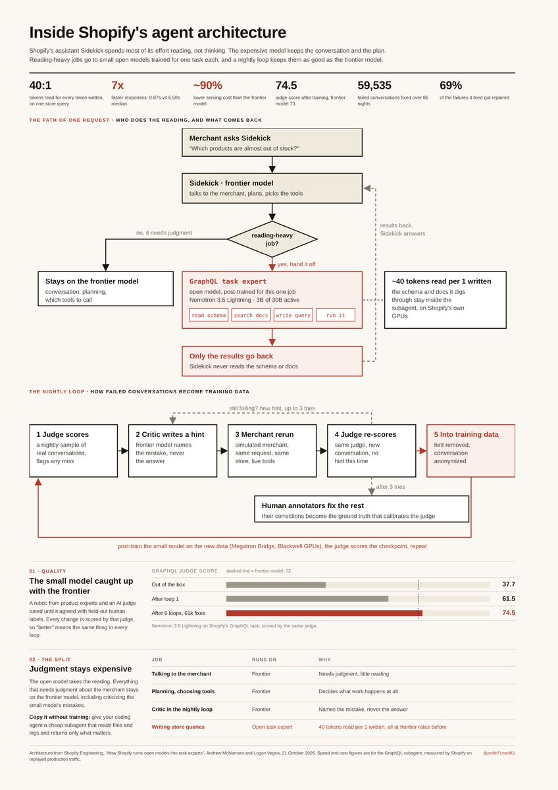

# Yarchi (@undefinedKi)

> Automatisch per `npm run ingest:x` erfasst. Quelle: [x.com/undefinedKi/status/2113689331412156666](https://x.com/undefinedKi/status/2113689331412156666)

## Bilder

<!-- Reihenfolge wie von der API geliefert (Cover zuerst). Die Position im Artikeltext gibt die API nicht mit. -->

**photo**

## Post-Text

Shopify just published the internal setup behind its AI agent. The one that got 7x faster and cut token usage by 90 percent. Here is how it works.

The observation behind it: most of the agent's work is reading, not thinking. To write one store query, it reads about 40 tokens for every 1 it writes. Huge amounts of context, little judgment, all billed at top rates.

So they split the work. The expensive model talks to the user and makes the plan. Reading-heavy jobs go to small open models trained for that one task. The expensive model only gets the result.

The clever part is how they keep the small models good. A separate AI judge scores every change, and they tuned it until it agreed with human experts: from 37.7 to 74.5, slightly above a frontier model's 73. Then every night, failed conversations get rerun and fixed, and the fixes become training data. 69% of the failures it tried got repaired.

One thing stays expensive: talking to the user and planning still runs on the frontier model.

You don't need to train models to copy this: give your coding agent a cheap subagent for reading files.

## Links

- [pic.x.com/NaadFMj3nf](https://x.com/undefinedKi/status/2113689331412156666/photo/1)
- [x.com/undefinedKi/st…](https://twitter.com/undefinedKi/status/2088611136027361368)

## Thread

### 1/6

Shopify just published the internal setup behind its AI agent. The one that got 7x faster and cut token usage by 90 percent. Here is how it works.

The observation behind it: most of the agent's work is reading, not thinking. To write one store query, it reads about 40 tokens for every 1 it writes. Huge amounts of context, little judgment, all billed at top rates.

So they split the work. The expensive model talks to the user and makes the plan. Reading-heavy jobs go to small open models trained for that one task. The expensive model only gets the result.

The clever part is how they keep the small models good. A separate AI judge scores every change, and they tuned it until it agreed with human experts: from 37.7 to 74.5, slightly above a frontier model's 73. Then every night, failed conversations get rerun and fixed, and the fixes become training data. 69% of the failures it tried got repaired.

One thing stays expensive: talking to the user and planning still runs on the frontier model.

You don't need to train models to copy this: give your coding agent a cheap subagent for reading files.

### 2/6

Source: https://t.co/XRCQS6ZT91

### 3/6

@gippp69 Shopify didn't release it, but the recipe's in the post: an expert rubric, then a judge tuned with GEPA and ACE until it matches human labels

### 4/6

@RohOnChain start with a cheap subagent for file reads, that's where most of the savings come from

### 5/6

@kaddisdeployed and on cost, not just tokens: the reading moves to a model that's ~90% cheaper to serve

### 6/6

@Argona0x the nightly self healing loop is my favorite part

## Erfassungsnachweis

Angefragter Post: https://x.com/undefinedKi/status/2113689331412156666

Im API-Abruf enthalten: 6 Post(s). Diese Zahl ist kein Nachweis eines vollständigen Threads.

- [Post 2113689331412156666](https://x.com/undefinedKi/status/2113689331412156666)
- [Post 2113689394557428034](https://x.com/undefinedKi/status/2113689394557428034)
- [Post 2113693356748316716](https://x.com/undefinedKi/status/2113693356748316716)
- [Post 2113693481327878510](https://x.com/undefinedKi/status/2113693481327878510)
- [Post 2113693675729678675](https://x.com/undefinedKi/status/2113693675729678675)
- [Post 2113693808458178716](https://x.com/undefinedKi/status/2113693808458178716)
