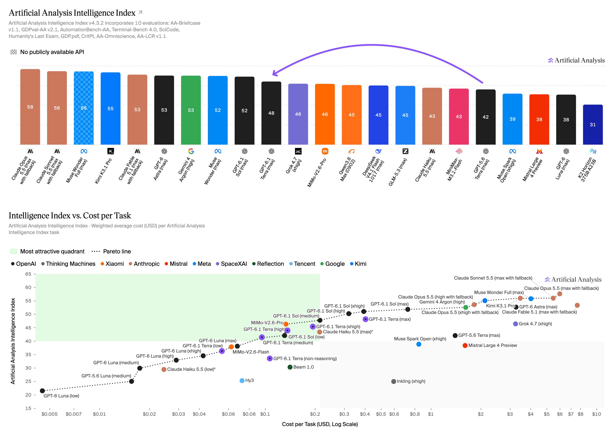
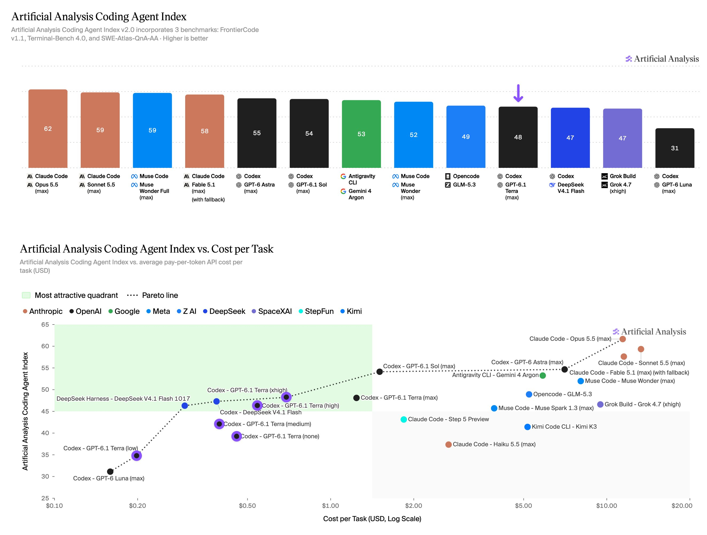
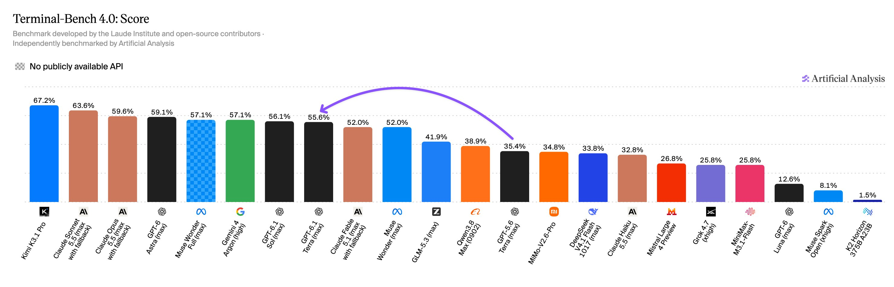

# Artificial Analysis (@ArtificialAnlys)

> Automatisch per `npm run ingest:x` erfasst. Quelle: [x.com/ArtificialAnlys/status/2114781865811063259](https://x.com/ArtificialAnlys/status/2114781865811063259)

## Bilder

<!-- Reihenfolge wie von der API geliefert (Cover zuerst). Die Position im Artikeltext gibt die API nicht mit. -->

**photo**

## Post-Text

OpenAI has released GPT-6.1 Terra, pushing the cost efficiency frontier. It is the first Terra-class model since GPT-5.6, and is more intelligent for less than a third of the cost

Pricing per token is half or less that of GPT-5.6 Terra - at $1/$5 per million input/output tokens vs $2/$12 for the previous model. Cache write has also halved, now at $1.25 per million tokens. Cached input is one quarter at $0.05 vs $0.20 per million tokens.

Key takeaways:

➤ Pareto-optimal for Intelligence vs Cost at low and medium effort: At max effort, GPT-6.1 Terra gains 6 points in the Artificial Analysis Intelligence Index over GPT-5.6 Terra, at less than a third of the cost per task ($0.40 vs $1.40). At lower effort levels the gain is larger, between 7 and 13 points. The low and medium effort levels are Pareto-optimal for cost efficiency, while the other effort levels sit behind the frontier. At max effort, the model scores 4 points below GPT-6.1 Sol and 10 points above GPT-6 Luna in the Intelligence Index.

➤ Pushes the Coding Agent Index cost efficiency frontier: With a score of 48 in the newly released Artificial Analysis Coding Agent Index v2.0, the model is 6 points below GPT-6.1 Sol (54) and 17 points above GPT-6 Luna (31). The xhigh and low effort settings sit on the frontier of cost efficiency in the Coding Agent Index, while other effort levels are behind the frontier.

➤ 50 point drop in hallucination rate: GPT-6.1 Terra guesses 38% of the time when it does not know the answer to a question in AA-Omniscience, our private knowledge and hallucination benchmark. Previously, GPT-5.6 Terra's hallucination rate was 88%. This significant reduction in hallucination is coupled with a 2 point increase in AA-Omniscience accuracy - meaning the model simultaneously answers more questions correctly.

➤ 20 point jump in Terminal-Bench 4.0, small improvements across most evaluations: The model makes significant progress in the terminal-based agentic benchmark, Terminal-Bench 4.0, with a gain of ~20 points, now rivaling GPT-6.1 Sol at max effort. Gains across most other evaluations are smaller, for example, 5 points in GDP.pdf.

Congratulations @OpenAI and @sama on the launch!

## Thread

### 1/6

OpenAI has released GPT-6.1 Terra, pushing the cost efficiency frontier. It is the first Terra-class model since GPT-5.6, and is more intelligent for less than a third of the cost

Pricing per token is half or less that of GPT-5.6 Terra - at $1/$5 per million input/output tokens vs $2/$12 for the previous model. Cache write has also halved, now at $1.25 per million tokens. Cached input is one quarter at $0.05 vs $0.20 per million tokens.

Key takeaways:

➤ Pareto-optimal for Intelligence vs Cost at low and medium effort: At max effort, GPT-6.1 Terra gains 6 points in the Artificial Analysis Intelligence Index over GPT-5.6 Terra, at less than a third of the cost per task ($0.40 vs $1.40). At lower effort levels the gain is larger, between 7 and 13 points. The low and medium effort levels are Pareto-optimal for cost efficiency, while the other effort levels sit behind the frontier. At max effort, the model scores 4 points below GPT-6.1 Sol and 10 points above GPT-6 Luna in the Intelligence Index.

➤ Pushes the Coding Agent Index cost efficiency frontier: With a score of 48 in the newly released Artificial Analysis Coding Agent Index v2.0, the model is 6 points below GPT-6.1 Sol (54) and 17 points above GPT-6 Luna (31). The xhigh and low effort settings sit on the frontier of cost efficiency in the Coding Agent Index, while other effort levels are behind the frontier.

➤ 50 point drop in hallucination rate: GPT-6.1 Terra guesses 38% of the time when it does not know the answer to a question in AA-Omniscience, our private knowledge and hallucination benchmark. Previously, GPT-5.6 Terra's hallucination rate was 88%. This significant reduction in hallucination is coupled with a 2 point increase in AA-Omniscience accuracy - meaning the model simultaneously answers more questions correctly.

➤ 20 point jump in Terminal-Bench 4.0, small improvements across most evaluations: The model makes significant progress in the terminal-based agentic benchmark, Terminal-Bench 4.0, with a gain of ~20 points, now rivaling GPT-6.1 Sol at max effort. Gains across most other evaluations are smaller, for example, 5 points in GDP.pdf.

Congratulations @OpenAI and @sama on the launch!

### 2/6

With a score of 48 in the Artificial Analysis Coding Agent Index v2.0, GPT-6.1 Terra is 6 points below GPT-6.1 Sol (54) and 17 points above GPT-6 Luna (31). The xhigh and low effort settings sit on the frontier of cost efficiency. https://t.co/Ue7LxxdaW6

### 3/6

GPT-6.1 Terra shows a 50 point drop in hallucination rate, measured in AA-Omniscience. This is coupled with a 2 point increase in AA-Omniscience accuracy - meaning the model simultaneously answers more questions correctly. https://t.co/yzpONnsqKw

### 4/6

The model makes significant progress in the terminal-based agentic benchmark, Terminal-Bench 4.0, with a gain of ~20 points, now rivaling GPT-6.1 Sol at max effort. https://t.co/Y26ywhiHAQ

### 5/6

Breakdown of the individual evaluations in the Artificial Analysis Intelligence Index v4.3.2 https://t.co/roah9Nas6p

### 6/6

Compare GPT-6.1 Terra with other leading models at: https://t.co/pJlLMaeJOp

## Medien der Thread-Fortsetzungen

### [Post 2114781869179031785](https://x.com/ArtificialAnlys/status/2114781869179031785)

### [Post 2114781871846641999](https://x.com/ArtificialAnlys/status/2114781871846641999)

### [Post 2114781874958811573](https://x.com/ArtificialAnlys/status/2114781874958811573)

### [Post 2114781877202768360](https://x.com/ArtificialAnlys/status/2114781877202768360)

