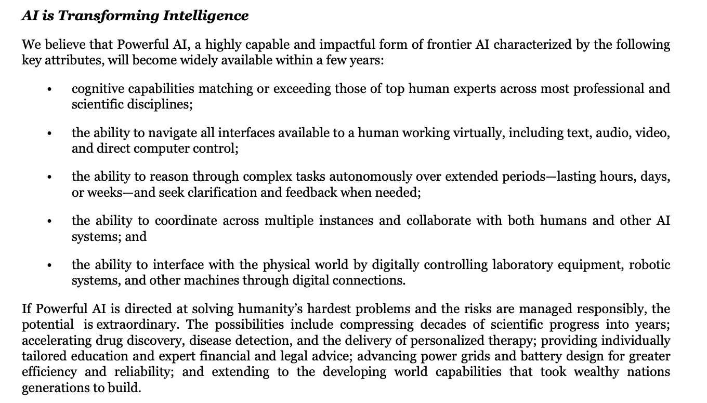
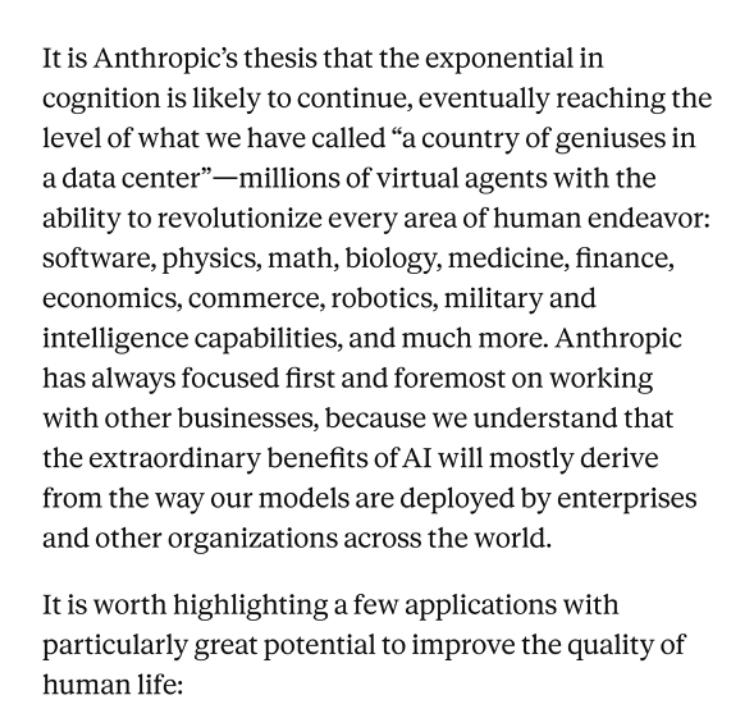
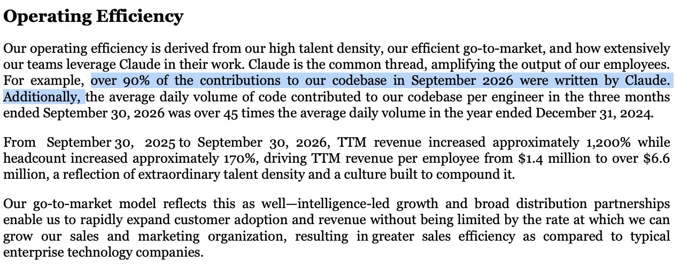
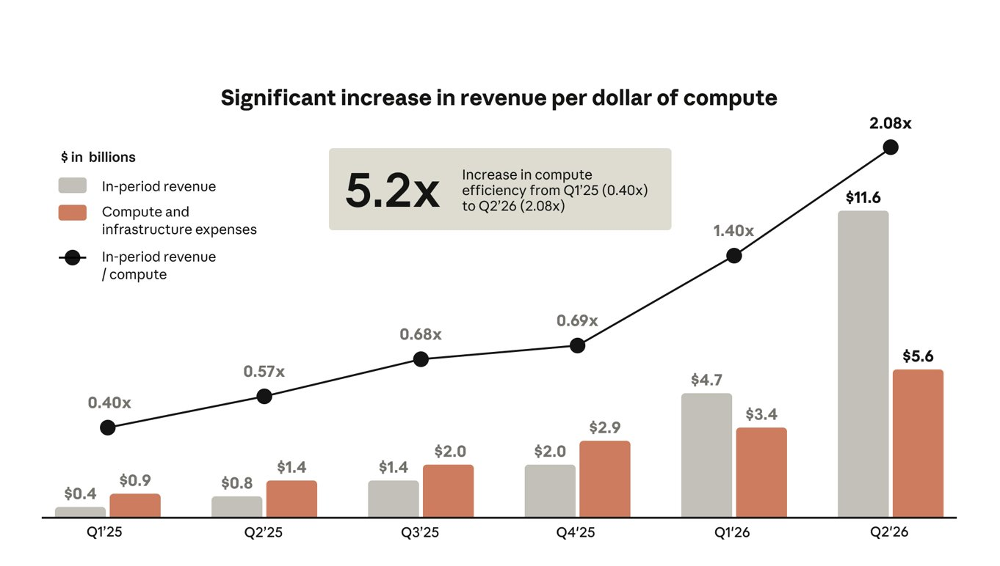

# Chubby♨️ (@kimmonismus)

> Automatisch per `npm run ingest:x` erfasst. Quelle: [x.com/kimmonismus/status/2114729823033590134](https://x.com/kimmonismus/status/2114729823033590134)

## Bilder

<!-- Reihenfolge wie von der API geliefert (Cover zuerst). Die Position im Artikeltext gibt die API nicht mit. -->

**photo**

**photo**

**photo**

## Post-Text

Anthropic expects AI that rivals top human experts, works autonomously for weeks and controls robots to become widely available within a few years.

Its IPO filing makes super exciting claims:

- Expert-level autonomous systems "within a few years": Anthropic expects AI to match or exceed leading human experts across most professional and scientific disciplines. These systems would work for hours, days or weeks, coordinate with other agents, and operate laboratory equipment and robots through digital interfaces.

- Millions of highly capable agents: Anthropic’s vision is "a country of geniuses in a data center". Vast numbers of agents working in parallel across software, physics, mathematics, biology, medicine and engineering. The company expects exponential progress in AI capabilities to continue.

- AI is already accelerating the development of its successors: Claude helps run experiments, generate and process training data, automate evaluations and safety audits, and write research code. Anthropic calls this "closing the loop": better models help discover improvements that make the next generation more capable. It says over 90% of September’s codebase contributions were written by Claude.

- Scientific progress could accelerate dramatically: Anthropic sees the potential for “compressing decades of scientific progress into years”. It also reports discovering a molecular machine with Claude that might become a new biotechnology tool, potentially for gene editing. That remains an early research finding requiring validation.

- Compute could remain the limiting factor: Anthropic expects increasingly capable models to unlock new categories of work, keeping demand ahead of available compute for the foreseeable future. It also argues that today’s models already have capabilities the wider economy has barely begun to use.

## Links

- [pic.x.com/m5zSfrXLVi](https://x.com/kimmonismus/status/2114729823033590134/photo/1)

## Thread

### 1/2

Anthropic expects AI that rivals top human experts, works autonomously for weeks and controls robots to become widely available within a few years.

Its IPO filing makes super exciting claims:

- Expert-level autonomous systems "within a few years": Anthropic expects AI to match or exceed leading human experts across most professional and scientific disciplines. These systems would work for hours, days or weeks, coordinate with other agents, and operate laboratory equipment and robots through digital interfaces.

- Millions of highly capable agents: Anthropic’s vision is "a country of geniuses in a data center". Vast numbers of agents working in parallel across software, physics, mathematics, biology, medicine and engineering. The company expects exponential progress in AI capabilities to continue.

- AI is already accelerating the development of its successors: Claude helps run experiments, generate and process training data, automate evaluations and safety audits, and write research code. Anthropic calls this "closing the loop": better models help discover improvements that make the next generation more capable. It says over 90% of September’s codebase contributions were written by Claude.

- Scientific progress could accelerate dramatically: Anthropic sees the potential for “compressing decades of scientific progress into years”. It also reports discovering a molecular machine with Claude that might become a new biotechnology tool, potentially for gene editing. That remains an early research finding requiring validation.

- Compute could remain the limiting factor: Anthropic expects increasingly capable models to unlock new categories of work, keeping demand ahead of available compute for the foreseeable future. It also argues that today’s models already have capabilities the wider economy has barely begun to use.

### 2/2

https://t.co/z3rB3j7an1 https://t.co/536jaYmsjq

## Medien der Thread-Fortsetzungen

### [Post 2114729883834122691](https://x.com/kimmonismus/status/2114729883834122691)

