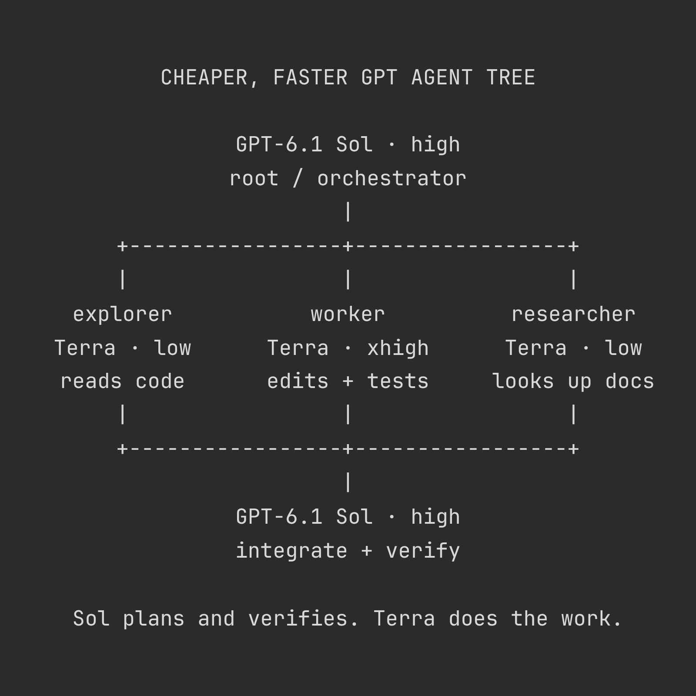

# Vox (@Voxyz_ai)

> Automatisch per `npm run ingest:x` erfasst. Quelle: [x.com/Voxyz_ai/status/2115096193240047938](https://x.com/Voxyz_ai/status/2115096193240047938)

## Bilder

<!-- Reihenfolge wie von der API geliefert (Cover zuerst). Die Position im Artikeltext gibt die API nicht mit. -->

**photo**

## Post-Text

OpenAI released GPT-6.1 Terra yesterday. It's 𝟯𝘅 𝗳𝗮𝘀𝘁𝗲𝗿 𝘁𝗵𝗮𝗻 𝟲.𝟭 𝗦𝗼𝗹 𝗮𝘁 𝗵𝗮𝗹𝗳 𝘁𝗵𝗲 𝗽𝗿𝗶𝗰𝗲, only a few points behind on benchmarks, and the best fit for a Codex subagent.

Set it up like the tree: the main session runs Sol on high reasoning effort and only breaks down tasks and does the final check. On OpenAI's DeepSWE chart, 6.1 Sol scores highest on high.

Every subagent runs Terra. Reading code and looking up docs get low, editing code gets xhigh. In a third-party coding agent benchmark, those are Terra's two most cost-efficient effort levels.

fork_turns sets how many turns of the main session's conversation a subagent takes with it. Leave it unset or set it to "all" and the subagent inherits the main session's model and effort. It 𝘀𝘁𝗶𝗹𝗹 𝗿𝘂𝗻𝘀 𝗦𝗼𝗹 𝗼𝗻 𝗵𝗶𝗴𝗵, and you've set up the tree for nothing.

Send the tree and this prompt to Codex 👇

"Set up my Codex to match this tree:
→ Main session: default to `gpt-6.1-sol` on high reasoning effort. It breaks down tasks, delegates, integrates, and verifies. Handle simple tasks directly; don't delegate them.
→ Three project-level custom agents: explorer reads code and researcher looks up docs, both with model `gpt-6.1-terra` and model_reasoning_effort `low`. worker edits code and runs tests, with model `gpt-6.1-terra` and model_reasoning_effort `xhigh`. Reuse fitting ones if they exist, and create only the missing ones.
→ If worker fails the tests on the same problem two rounds in a row, it hands the problem back to Sol in the main session.
→ Put the delegation rule in AGENTS.md: when spawning a subagent, set `fork_turns` to `"none"` or pass only the last few turns. If `fork_turns` is omitted or set to `"all"`, the subagent inherits the main session's model and effort.

Before changing anything, check:
→ Roles that still use older models like `gpt-6-sol` or `gpt-5.6-sol`. List them.
→ Roles whose model is set only in AGENTS.md and not in their agent config: check recent subagent session logs to confirm which model each one actually ran.

Show me the changes first, and wait for my OK before writing anything."

## Links

- [pic.x.com/hKdlhB91It](https://x.com/Voxyz_ai/status/2115096193240047938/photo/1)

## Thread

### 1/1

OpenAI released GPT-6.1 Terra yesterday. It's 𝟯𝘅 𝗳𝗮𝘀𝘁𝗲𝗿 𝘁𝗵𝗮𝗻 𝟲.𝟭 𝗦𝗼𝗹 𝗮𝘁 𝗵𝗮𝗹𝗳 𝘁𝗵𝗲 𝗽𝗿𝗶𝗰𝗲, only a few points behind on benchmarks, and the best fit for a Codex subagent.

Set it up like the tree: the main session runs Sol on high reasoning effort and only breaks down tasks and does the final check. On OpenAI's DeepSWE chart, 6.1 Sol scores highest on high.

Every subagent runs Terra. Reading code and looking up docs get low, editing code gets xhigh. In a third-party coding agent benchmark, those are Terra's two most cost-efficient effort levels.

fork_turns sets how many turns of the main session's conversation a subagent takes with it. Leave it unset or set it to "all" and the subagent inherits the main session's model and effort. It 𝘀𝘁𝗶𝗹𝗹 𝗿𝘂𝗻𝘀 𝗦𝗼𝗹 𝗼𝗻 𝗵𝗶𝗴𝗵, and you've set up the tree for nothing.

Send the tree and this prompt to Codex 👇

"Set up my Codex to match this tree:
→ Main session: default to `gpt-6.1-sol` on high reasoning effort. It breaks down tasks, delegates, integrates, and verifies. Handle simple tasks directly; don't delegate them.
→ Three project-level custom agents: explorer reads code and researcher looks up docs, both with model `gpt-6.1-terra` and model_reasoning_effort `low`. worker edits code and runs tests, with model `gpt-6.1-terra` and model_reasoning_effort `xhigh`. Reuse fitting ones if they exist, and create only the missing ones.
→ If worker fails the tests on the same problem two rounds in a row, it hands the problem back to Sol in the main session.
→ Put the delegation rule in AGENTS.md: when spawning a subagent, set `fork_turns` to `"none"` or pass only the last few turns. If `fork_turns` is omitted or set to `"all"`, the subagent inherits the main session's model and effort.

Before changing anything, check:
→ Roles that still use older models like `gpt-6-sol` or `gpt-5.6-sol`. List them.
→ Roles whose model is set only in AGENTS.md and not in their agent config: check recent subagent session logs to confirm which model each one actually ran.

Show me the changes first, and wait for my OK before writing anything."
