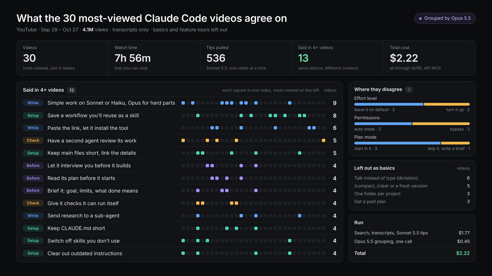

# Vox (@Voxyz_ai)

> Automatisch per `npm run ingest:x` erfasst. Quelle: [x.com/Voxyz_ai/status/2115167901779161148](https://x.com/Voxyz_ai/status/2115167901779161148)

## Bilder

<!-- Reihenfolge wie von der API geliefert (Cover zuerst). Die Position im Artikeltext gibt die API nicht mit. -->

**photo**

## Post-Text

This Opus 5.5 prompt is literally a $𝟭𝟱𝟬/𝗵𝗿 𝗿𝗲𝘀𝗲𝗮𝗿𝗰𝗵 𝗮𝗻𝗮𝗹𝘆𝘀𝘁 🤯

I ran it through @aimlapi on the 30 most-viewed Claude Code tutorials of the past month: 𝟴 𝗵𝗼𝘂𝗿𝘀 𝗼𝗳 𝘃𝗶𝗱𝗲𝗼 𝗳𝗼𝗿 𝗷𝘂𝘀𝘁 $𝟮.𝟮𝟮 𝘁𝗼𝘁𝗮𝗹, and these 13 things kept coming up:

Before it builds
→ Let it interview you first (4 videos)
→ Give it a brief: the goal, what it can't touch, what done looks like (4)
→ Read its plan and fix it before it starts (4)

While it works
→ Sonnet or Haiku for simple work, Opus only for the hard parts (9)
→ Send research to a sub-agent that brings back only the answer, so your main chat stays clean (4)
→ Don't install tools yourself. Paste the link and let it install and set them up (6)

Checking the work
→ Give it a check it can run itself. It's only done when it passes (4)
→ Have a second agent review what it did (5)

Your setup
→ A workflow you'll need again? Once it works, have it save that as a skill (8)
→ Move details into separate files it opens only when needed (5)
→ Keep CLAUDE.md short (4)
→ Switch off skills you don't use (4)
→ Clear out outdated instructions (4)

They split on three: effort level (leave it alone vs turn it up), permissions (auto vs bypass), and plan mode (start in it vs skip it and write a brief).

The YouTube search, the transcripts, the 536 tips Sonnet 5.5 pulled from them and the grouping by Opus 5.5 all ran through @aimlapi's MCP. I kept only what 4+ videos agree on and left out the basics and feature tours. Connect it at https://t.co/EcjWz172Wy, swap in whatever you're learning, and paste this 👇

"Use AI/ML API MCP. Find the 30 most-viewed YouTube videos about [your topic] from the last 4 weeks and pull their transcripts. Use Sonnet to list every concrete tip in each one, skipping the basics and feature tours. Then use Opus to group the tips that say the same thing. Keep only the ones at least 4 videos agree on, with how many said each and a timestamp, and list where they contradict each other."

## Links

- [aimlapi.com/mcp](http://aimlapi.com/mcp)

## Thread

### 1/1

This Opus 5.5 prompt is literally a $𝟭𝟱𝟬/𝗵𝗿 𝗿𝗲𝘀𝗲𝗮𝗿𝗰𝗵 𝗮𝗻𝗮𝗹𝘆𝘀𝘁 🤯

I ran it through @aimlapi on the 30 most-viewed Claude Code tutorials of the past month: 𝟴 𝗵𝗼𝘂𝗿𝘀 𝗼𝗳 𝘃𝗶𝗱𝗲𝗼 𝗳𝗼𝗿 𝗷𝘂𝘀𝘁 $𝟮.𝟮𝟮 𝘁𝗼𝘁𝗮𝗹, and these 13 things kept coming up:

Before it builds
→ Let it interview you first (4 videos)
→ Give it a brief: the goal, what it can't touch, what done looks like (4)
→ Read its plan and fix it before it starts (4)

While it works
→ Sonnet or Haiku for simple work, Opus only for the hard parts (9)
→ Send research to a sub-agent that brings back only the answer, so your main chat stays clean (4)
→ Don't install tools yourself. Paste the link and let it install and set them up (6)

Checking the work
→ Give it a check it can run itself. It's only done when it passes (4)
→ Have a second agent review what it did (5)

Your setup
→ A workflow you'll need again? Once it works, have it save that as a skill (8)
→ Move details into separate files it opens only when needed (5)
→ Keep CLAUDE.md short (4)
→ Switch off skills you don't use (4)
→ Clear out outdated instructions (4)

They split on three: effort level (leave it alone vs turn it up), permissions (auto vs bypass), and plan mode (start in it vs skip it and write a brief).

The YouTube search, the transcripts, the 536 tips Sonnet 5.5 pulled from them and the grouping by Opus 5.5 all ran through @aimlapi's MCP. I kept only what 4+ videos agree on and left out the basics and feature tours. Connect it at https://t.co/EcjWz172Wy, swap in whatever you're learning, and paste this 👇

"Use AI/ML API MCP. Find the 30 most-viewed YouTube videos about [your topic] from the last 4 weeks and pull their transcripts. Use Sonnet to list every concrete tip in each one, skipping the basics and feature tours. Then use Opus to group the tips that say the same thing. Keep only the ones at least 4 videos agree on, with how many said each and a timestamp, and list where they contradict each other."
