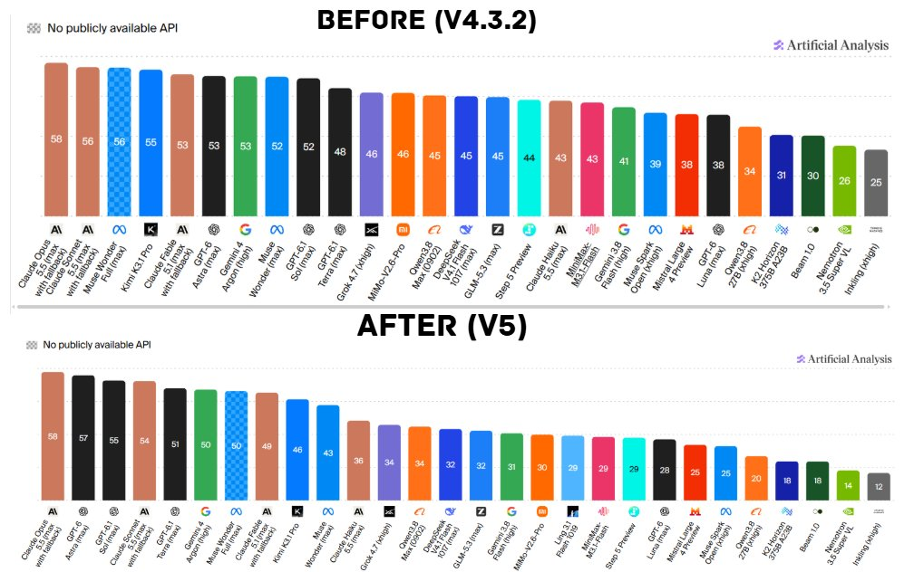

# AiBattle (@AiBattle_)

> Automatisch per `npm run ingest:x` erfasst. Quelle: [x.com/AiBattle_/status/2115269739069026766](https://x.com/AiBattle_/status/2115269739069026766)

## Bilder

<!-- Reihenfolge wie von der API geliefert (Cover zuerst). Die Position im Artikeltext gibt die API nicht mit. -->

**photo**

## Post-Text

The AA-Intelligence Index has been updated to V5

Rankings before:

1. Claude Opus 5.5 (Max) - 58
2. Claude Sonnet 5.5 (Max) - 56
3. Muse Wonder Full (Max)- 56
4. Kimi K3.1 Pro - 55
5. Claude Fable 5.1 (Max) - 53

Rankings now:

1. Claude Opus 5.5 (Max) - 58
2. GPT-6-Astra (Max) - 57
3. GPT-6.1-Sol (Max)- 55
4. Claude Sonnet 5.5 (Max) - 54
5. GPT-6.1-Terra (Max) - 51

## Links

- [pic.x.com/eXIlhsS0aB](https://x.com/AiBattle_/status/2115269739069026766/photo/1)
- [x.com/ArtificialAnly…](https://twitter.com/ArtificialAnlys/status/2115265133467635877)

## Thread

### 1/1

The AA-Intelligence Index has been updated to V5

Rankings before:

1. Claude Opus 5.5 (Max) - 58
2. Claude Sonnet 5.5 (Max) - 56
3. Muse Wonder Full (Max)- 56
4. Kimi K3.1 Pro - 55
5. Claude Fable 5.1 (Max) - 53

Rankings now:

1. Claude Opus 5.5 (Max) - 58
2. GPT-6-Astra (Max) - 57
3. GPT-6.1-Sol (Max)- 55
4. Claude Sonnet 5.5 (Max) - 54
5. GPT-6.1-Terra (Max) - 51
