# Artificial Analysis (@ArtificialAnlys)

> Automatisch per `npm run ingest:x` erfasst. Quelle: [x.com/ArtificialAnlys/status/2115265133467635877](https://x.com/ArtificialAnlys/status/2115265133467635877)

## Bilder

<!-- Reihenfolge wie von der API geliefert (Cover zuerst). Die Position im Artikeltext gibt die API nicht mit. -->

**photo**

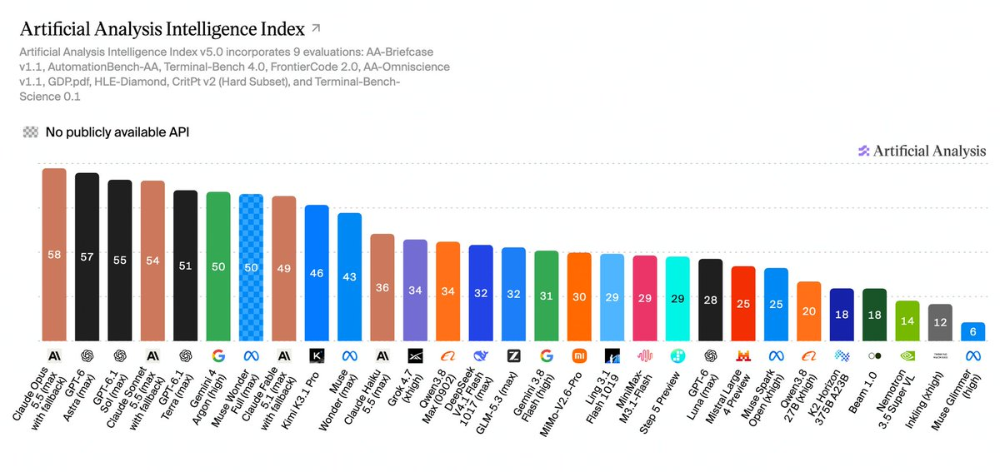

## Post-Text

Announcing Artificial Analysis Intelligence Index v5, featuring 2 new benchmarks and 3 upgrades. For the first time, the majority of the Index is built on private datasets

The Artificial Analysis Intelligence Index is our composite measure of model capabilities across tasks reflecting real-world usage today. v5 is our biggest upgrade since v4 launched in January. With v5, 60% of the Index is now based on evaluations with private test sets or held-out answers.

Alongside Intelligence Index v5, we’re launching the Artificial Analysis Progress Index v1, which tracks model capability over time on one continuous scale.

New to the Intelligence Index:

➤ FrontierCode 2.0: Cognition's newly-launched private benchmark of real-world coding tasks, graded on whether a repository maintainer would merge the agent's change

➤ Terminal-Bench-Science: 70 agentic scientific research tasks, run in a terminal environment

Upgraded:

➤ HLE-Diamond (replacing Humanity's Last Exam): a refined 1,000-question version of Humanity's Last Exam, split evenly between reasoning and knowledge questions

➤ AA-Omniscience v1.1: An updated dataset with saturated and public set questions removed, new questions added, and ambiguous or erroneous questions revised

➤ CritPt v2: a private, 40-question hard subset of CritPt v2, revised by the CritPt authors and run with a code-execution tool

Staying in the Index: AA-Briefcase, AutomationBench-AA, GDP.pdf and Terminal-Bench 4.0

Removed from the Index: GDPval-AA v2.1, SciCode, and AA-LCR v1.1

Key results:

➤ Claude Opus 5.5 (max) leads at 58, ahead of GPT-6 Astra (max, 57) and GPT-6.1 Sol (max, 55): Anthropic and OpenAI hold the top five models. Gemini 4 Argon (high) is next at 50

➤ The open weights gap widens from 3 points to 12: Kimi K3.1 Pro (weights not yet released) is the top open weights model at 46. Among released weights, DeepSeek V4.1 Flash 1017 (max) and GLM-5.3 (max) lead at 32 - 26 points behind the leader and below Claude Haiku 5.5 (max, 36)

➤ Cost per task varies by more than 13x among the leading models: of the 10 highest-scoring models shown, GPT-6.1 Terra (max) is the cheapest at $0.96 per Intelligence Index task and Claude Fable 5.1 (max) the most expensive at $13.04

## Links

- [pic.x.com/oA4tsXQOC6](https://x.com/ArtificialAnlys/status/2115265133467635877/photo/1)

## Thread

### 1/14

**Originalpost:** [2115265133467635877](https://x.com/ArtificialAnlys/status/2115265133467635877)

Announcing Artificial Analysis Intelligence Index v5, featuring 2 new benchmarks and 3 upgrades. For the first time, the majority of the Index is built on private datasets

The Artificial Analysis Intelligence Index is our composite measure of model capabilities across tasks reflecting real-world usage today. v5 is our biggest upgrade since v4 launched in January. With v5, 60% of the Index is now based on evaluations with private test sets or held-out answers.

Alongside Intelligence Index v5, we’re launching the Artificial Analysis Progress Index v1, which tracks model capability over time on one continuous scale.

New to the Intelligence Index:

➤ FrontierCode 2.0: Cognition's newly-launched private benchmark of real-world coding tasks, graded on whether a repository maintainer would merge the agent's change

➤ Terminal-Bench-Science: 70 agentic scientific research tasks, run in a terminal environment

Upgraded:

➤ HLE-Diamond (replacing Humanity's Last Exam): a refined 1,000-question version of Humanity's Last Exam, split evenly between reasoning and knowledge questions

➤ AA-Omniscience v1.1: An updated dataset with saturated and public set questions removed, new questions added, and ambiguous or erroneous questions revised

➤ CritPt v2: a private, 40-question hard subset of CritPt v2, revised by the CritPt authors and run with a code-execution tool

Staying in the Index: AA-Briefcase, AutomationBench-AA, GDP.pdf and Terminal-Bench 4.0

Removed from the Index: GDPval-AA v2.1, SciCode, and AA-LCR v1.1

Key results:

➤ Claude Opus 5.5 (max) leads at 58, ahead of GPT-6 Astra (max, 57) and GPT-6.1 Sol (max, 55): Anthropic and OpenAI hold the top five models. Gemini 4 Argon (high) is next at 50

➤ The open weights gap widens from 3 points to 12: Kimi K3.1 Pro (weights not yet released) is the top open weights model at 46. Among released weights, DeepSeek V4.1 Flash 1017 (max) and GLM-5.3 (max) lead at 32 - 26 points behind the leader and below Claude Haiku 5.5 (max, 36)

➤ Cost per task varies by more than 13x among the leading models: of the 10 highest-scoring models shown, GPT-6.1 Terra (max) is the cheapest at $0.96 per Intelligence Index task and Claude Fable 5.1 (max) the most expensive at $13.04

### 2/14

**Originalpost:** [2115265138119102648](https://x.com/ArtificialAnlys/status/2115265138119102648)

FrontierCode 2.0 is the latest update of @cognition's private coding benchmark. Launched earlier today, it comprises 132 tasks in real open-source repositories, graded on whether a maintainer would merge the agent's change. An attempt that fails any blocking check scores 0, and the tasks stay private to avoid contamination. We run every task three times in Stirrup, our agentic harness.

Claude Opus 5.5 (max) leads at 46%, followed by GPT-6 Astra (max), GPT-6.1 Terra (max) and Claude Sonnet 5.5 (max), all at 42%. DeepSeek V4.1 Flash 1017 (max) is the highest-scoring open weights model at 28%, 18 points behind the leader.

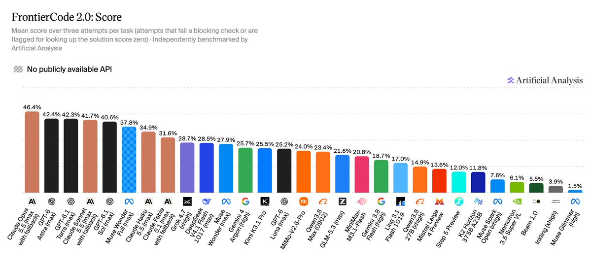

### 3/14

**Originalpost:** [2115265143437484093](https://x.com/ArtificialAnlys/status/2115265143437484093)

Terminal-Bench-Science tests whether agents can carry out scientific research workflows in a terminal. Experts curate and review each task, and a task passes only if every one of its tests passes.

GPT-6 Astra (max) leads at 63%, followed by Claude Opus 5.5 (max) at 59% and GPT-6.1 Sol (max) at 58%. Scores drop off sharply below the leaders: the best open weights model, Kimi K3.1 Pro (weights not yet released), scores 34%, and Claude Haiku 5.5 (max) scores 20%. The best open weights model with released weights, DeepSeek V4.1 Flash 1017 (max), scores 13%, and most open weights models we benchmarked score under 10%.

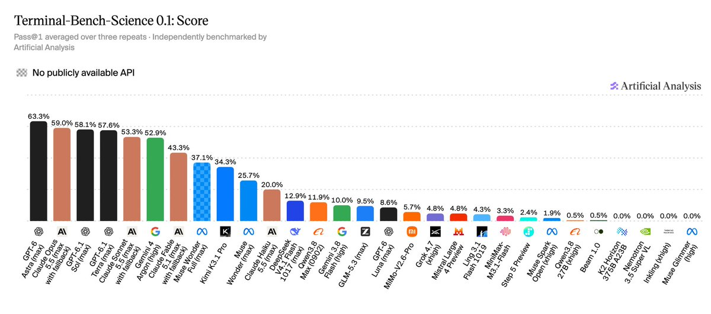

### 4/14

**Originalpost:** [2115265148932046900](https://x.com/ArtificialAnlys/status/2115265148932046900)

HLE-Diamond replaces Humanity's Last Exam in the Index. It is the refined 1,000-question version of Humanity's Last Exam from @CAIS and @scale_AI, split evenly between reasoning and knowledge. Claude Opus 5.5 (max) leads at 68%, followed by GPT-6 Astra (max) at 64% and Claude Fable 5.1 (max) at 60%.

Knowledge questions are harder than reasoning questions for the leading models: Claude Opus 5.5 (max) and GPT-6 Astra (max) both score 78% on reasoning respectively, compared with 58% and 50% on knowledge.

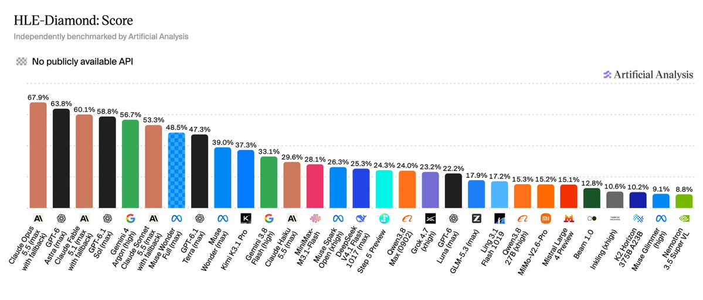

### 5/14

**Originalpost:** [2115265153788993907](https://x.com/ArtificialAnlys/status/2115265153788993907)

AA-Omniscience v1.1 is a cleaned version of our knowledge and hallucination benchmark, with saturated and public set questions removed, new questions added, and ambiguous or erroneous questions revised. Scores are mostly aligned with v1, with models scoring on average 2 points lower on the AA-Omniscience v1.1 Index (median 0.6). We’ve also released a new public subset on @huggingface, AA-Omniscience-Public-v1.1, recalibrated to ensure accuracy, hallucination rate, and overall performance are consistent between the public and private sets.

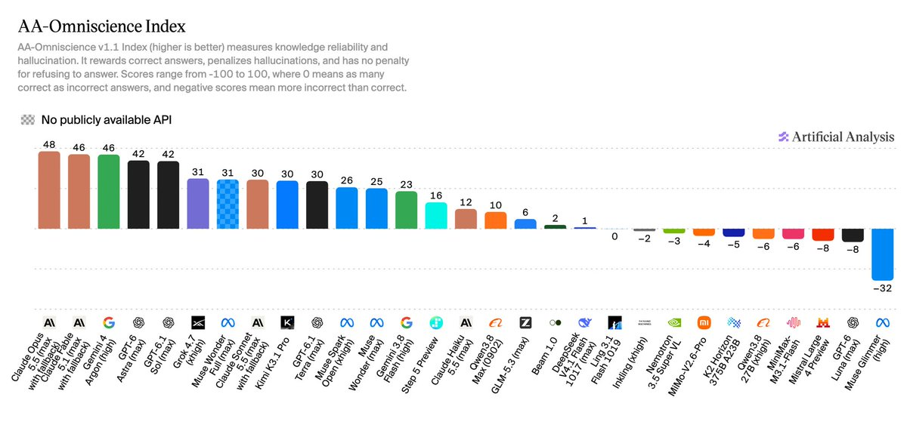

### 6/14

**Originalpost:** [2115265158465593531](https://x.com/ArtificialAnlys/status/2115265158465593531)

The Index scores CritPt v2 on a private 40-question hard subset: the 70 research-level physics questions, minus the 30 that seven frontier models solved in all five attempts at launch. Models work in an offline Python sandbox in Stirrup, our agentic harness.

GPT-6 Astra leads at 72% on high effort, followed by GPT-6.1 Sol at 69% on max effort. Claude Opus 5.5 (max), the top model in the Index overall, scores 61%. Kimi K3.1 Pro (weights not yet released) is the highest-scoring open weights model at 45%.

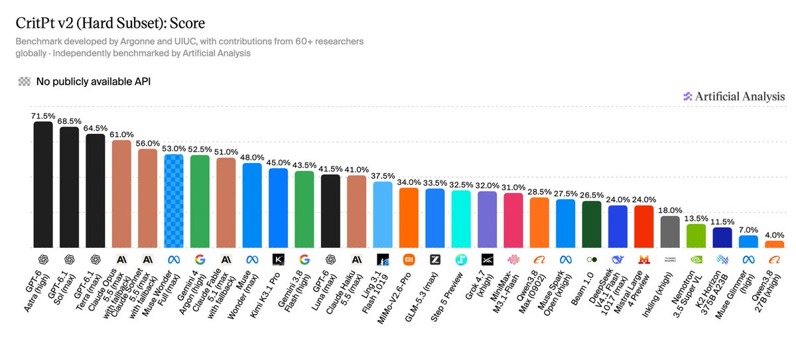

### 7/14

**Originalpost:** [2115265164891275745](https://x.com/ArtificialAnlys/status/2115265164891275745)

v5 leaves significant room for progress across all nine evaluations, and no single model leads them all. Of the models we measured, Claude Opus 5.5 leads three, and five other models lead the remaining six:

➤ Claude Opus 5.5: FrontierCode 2.0 (46%), HLE-Diamond (68%) and AA-Omniscience v1.1 (48)

➤ GPT-6 Astra: Terminal-Bench-Science (63%) and CritPt v2 hard subset (72%)

➤ Claude Sonnet 5.5: AA-Briefcase (1812 Elo)

➤ Kimi K3.1 Pro: Terminal-Bench 4.0 (67%)

➤ Gemini 4 Argon: AutomationBench-AA (78%)

➤ Muse Wonder Full: GDP.pdf (33% all-pass)

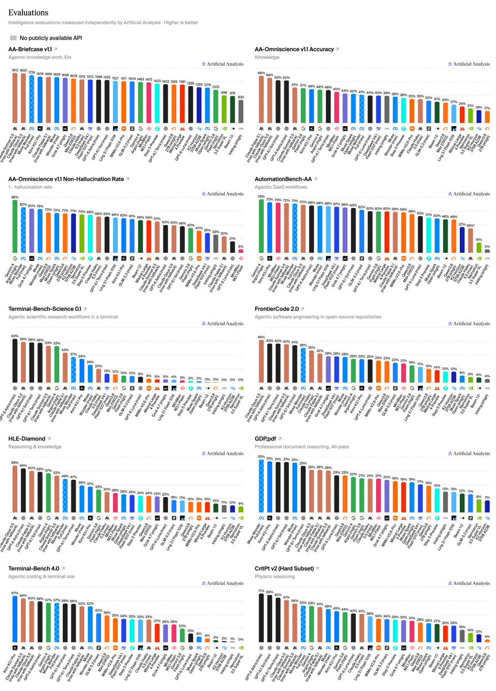

### 8/14

**Originalpost:** [2115265171233120627](https://x.com/ArtificialAnlys/status/2115265171233120627)

Open weights models fall further behind in v5. The leader, Kimi K3.1 Pro (weights not yet released), scores 46, 12 points behind the leader, compared with a 3-point gap in v4.3. Of models with released weights, DeepSeek V4.1 Flash 1017 (max) and GLM-5.3 (max) score highest at 32, and Claude Haiku 5.5 (max) outscores all of them.

The gap is widest on HLE-Diamond and Terminal-Bench-Science, where Kimi K3.1 Pro scores 37% and 34%, compared with 68% for Claude Opus 5.5 (max) and 63% for GPT-6 Astra (max).

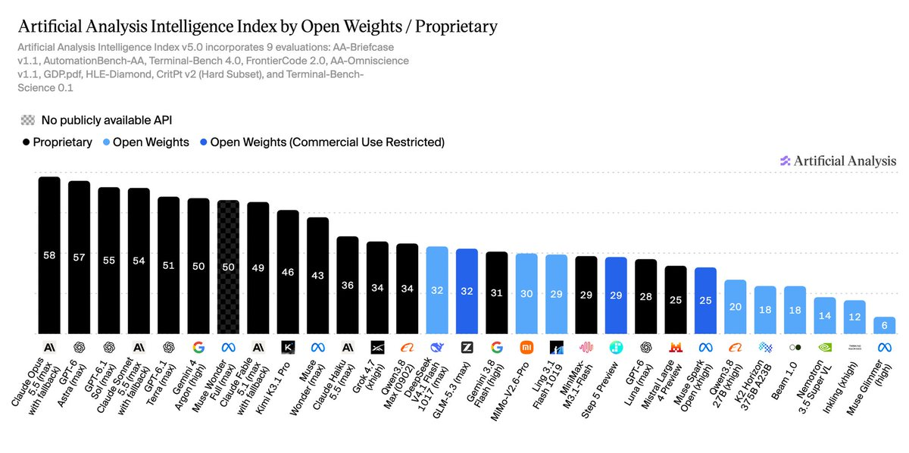

### 9/14

**Originalpost:** [2115265177046389089](https://x.com/ArtificialAnlys/status/2115265177046389089)

Cost varies widely among the leading models. Claude Opus 5.5 (max) costs $10.04 per Intelligence Index task, GPT-6 Astra (max) $6.24 and GPT-6.1 Sol (max) $1.27. GPT-6.1 Sol (max) scores within 4 points of Claude Opus 5.5 (max) at about an eighth of the cost per task. https://t.co/y9qfLy8ucI

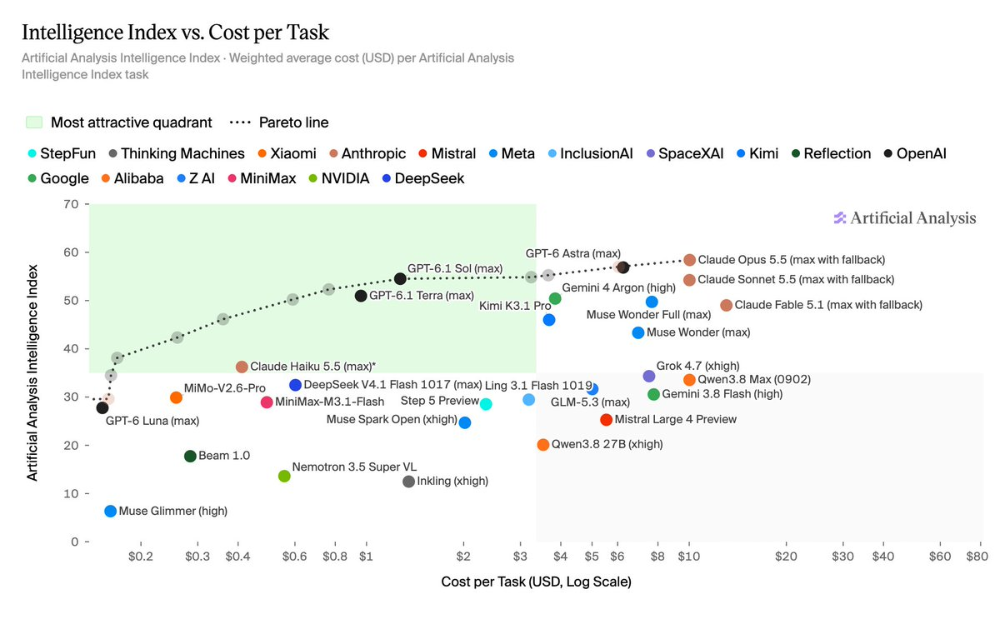

### 10/14

**Originalpost:** [2115265184025674152](https://x.com/ArtificialAnlys/status/2115265184025674152)

Effort settings matter more in v5 than in v4.3. Claude Opus 5.5 scores 35 at low effort and 58 at max, at 10x the cost per Intelligence Index task ($0.98 vs $10.04). Claude Sonnet 5.5 spans 29 points from low to max, up from 20 in v4.3, and GPT-6.1 Sol's spread doubles from 10 to 20 points.

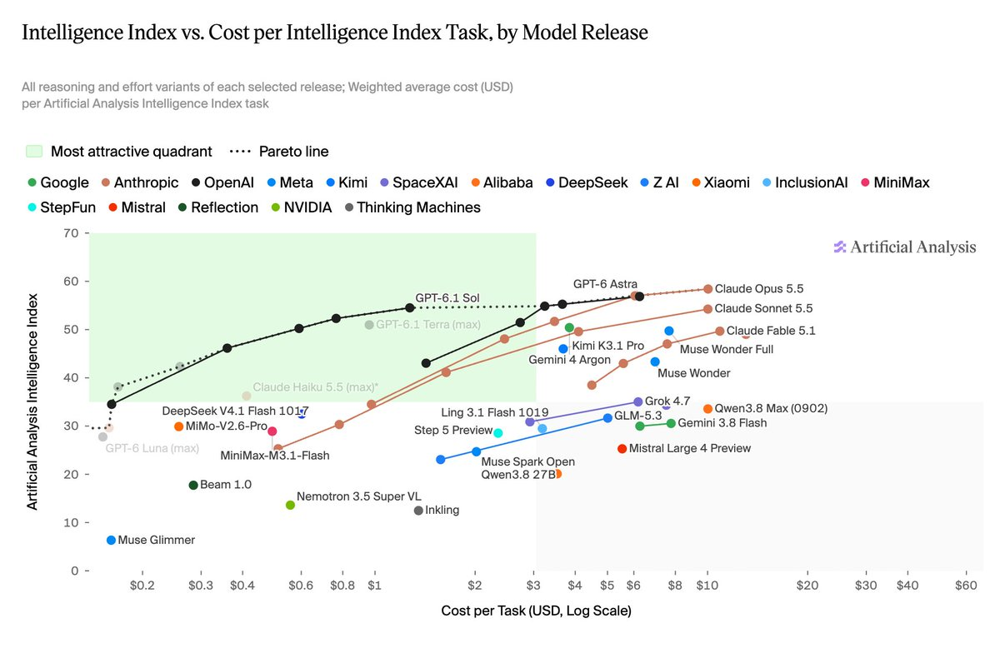

### 11/14

**Originalpost:** [2115265189482573894](https://x.com/ArtificialAnlys/status/2115265189482573894)

v5 tasks demand substantially more work from models. Every model we measured generates more output tokens per Intelligence Index task than in v4.3, with the median rising by two thirds, from 35k to 59k.

➤ Agentic evaluations account for most token use: Terminal-Bench-Science, Terminal-Bench 4.0, AA-Briefcase and FrontierCode 2.0 make up 55% of the Index weight but a median 88% of output tokens

➤ Terminal-Bench-Science is the most token-intensive: it accounts for about a third of output Tokens per Task on its own

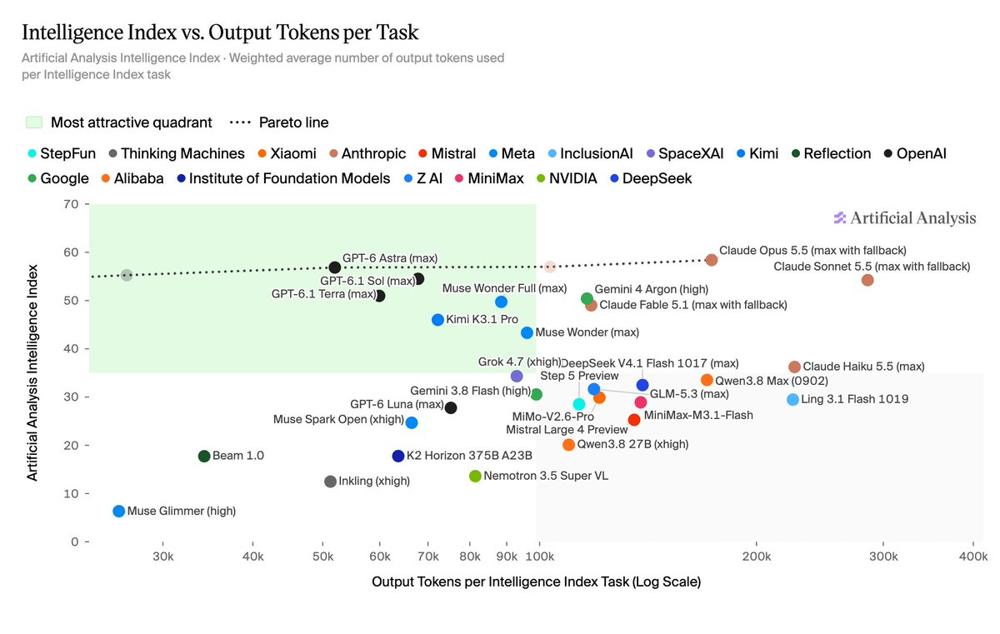

### 12/14

**Originalpost:** [2115265195417403444](https://x.com/ArtificialAnlys/status/2115265195417403444)

Alongside v5, we're launching the Artificial Analysis Progress Index v1. It places language models released since November 2022 on one capability scale, across a wide span of benchmarks.

Use the Progress Index to compare how underlying capability has changed over time, including between models released years apart. To compare models for current use cases and understand the present frontier, use the Intelligence Index, which remains our primary measure of current model intelligence.

Thank you to @EpochAIResearch and @AnthropicAI - we built on learnings from the Epoch Capabilities Index in designing the Progress Index

Explore the Progress Index: https://t.co/vvg5dU6Kg5

Methodology: https://t.co/F50x3Q2Bik

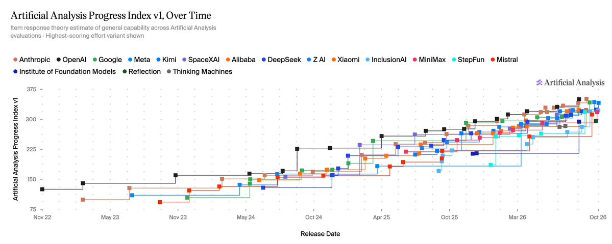

**Links des Posts:**
- [artificialanalysis.ai/trends](http://artificialanalysis.ai/trends)
- [artificialanalysis.ai/methodology/pr…](http://artificialanalysis.ai/methodology/progress-index)

### 13/14

**Originalpost:** [2115265198093435022](https://x.com/ArtificialAnlys/status/2115265198093435022)

Artificial Analysis Intelligence Index v5 weights:

➤ Knowledge Work (25%): AA-Briefcase (15%), AutomationBench-AA (5%), and GDP.pdf (5%)

➤ Coding (25%): FrontierCode 2.0 (15%) and Terminal-Bench 4.0 (10%)

➤ Science (25%): Terminal-Bench-Science (15%) and CritPt v2 hard subset (10%)

➤ General (25%): AA-Omniscience v1.1 15% (10% accuracy, 5% non-hallucination) and HLE-Diamond (10%)

### 14/14

**Originalpost:** [2115265200622551458](https://x.com/ArtificialAnlys/status/2115265200622551458)

Thank you to @cognition, @StevenDillmann and the @terminalbench team, @CAIS, @scale_AI, and @MiniHui_zhu, @MinyangTian1, @haopeng_uiuc, and the CritPt team for the benchmarks behind this update.

Explore the full results: https://t.co/XW6jIXbmLb

Methodology: https://t.co/LfVkv0Q7IZ

**Links des Posts:**
- [artificialanalysis.ai](http://artificialanalysis.ai)
- [artificialanalysis.ai/methodology/in…](http://artificialanalysis.ai/methodology/intelligence-benchmarking)

## Erfassungsnachweis

Die beiden angefragten URLs gehören zu diesem Strang:

- Hauptpost: https://x.com/ArtificialAnlys/status/2115265133467635877
- Ebenfalls angefragt: https://x.com/ArtificialAnlys/status/2115265171233120627 (Post 8/14)

Erfasst wurden 14 über die Antwortkette belegte Posts desselben Autors sowie 12 zugehörige Bilder. Die Zahl bezeichnet den erfassten Bestand und ist kein allgemeiner Vollständigkeitsnachweis.
