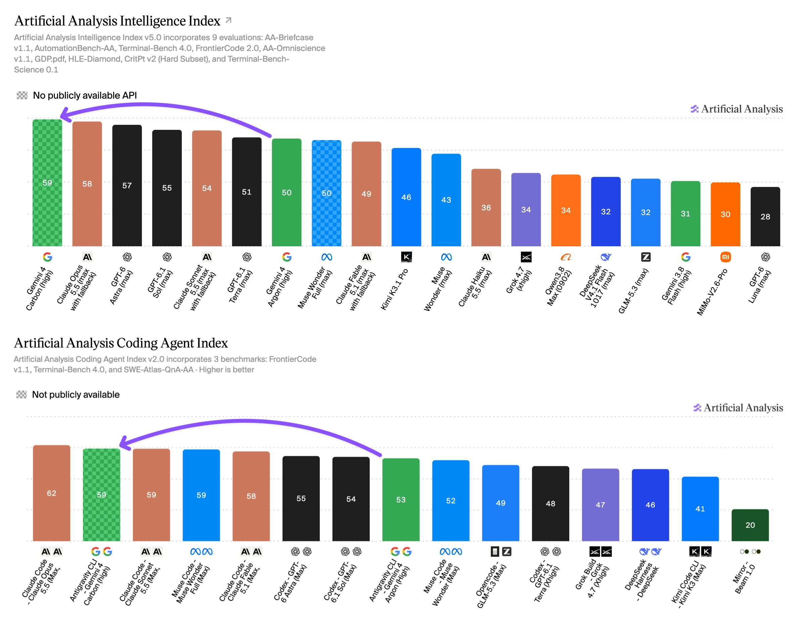
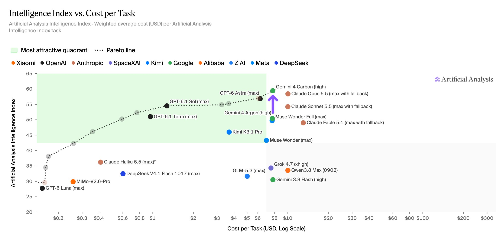
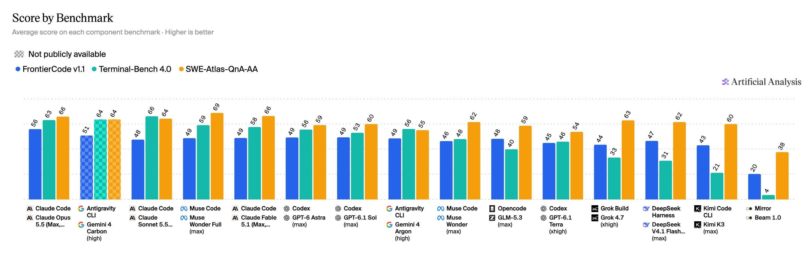
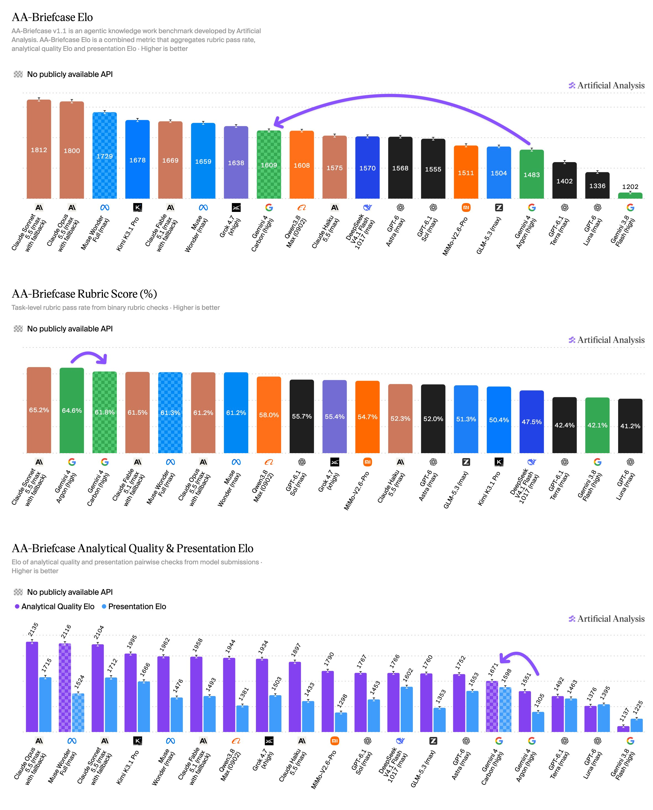
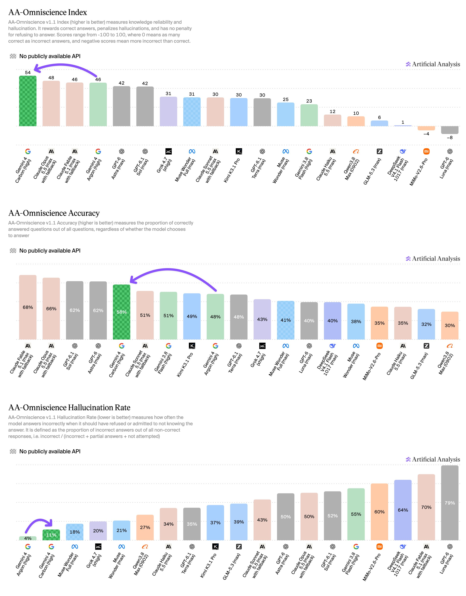
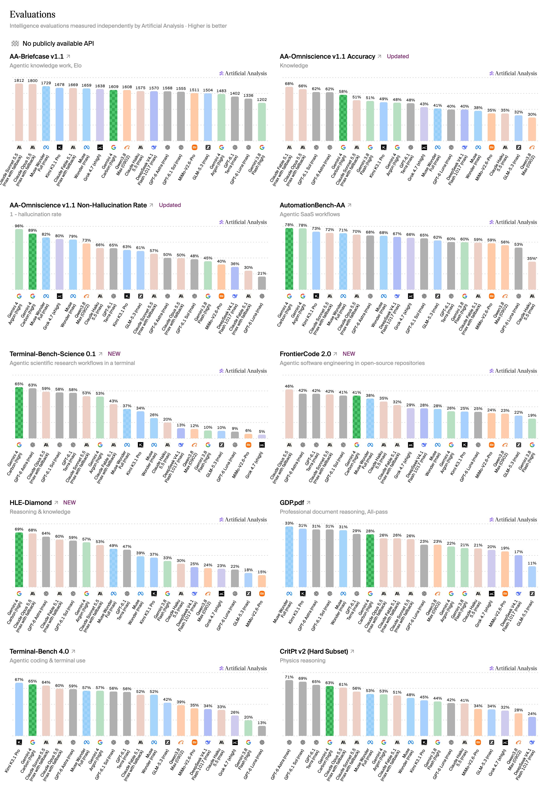

# Artificial Analysis (@ArtificialAnlys)

> Automatisch per `npm run ingest:x` erfasst. Quelle: [x.com/ArtificialAnlys/status/2115494553780367384](https://x.com/ArtificialAnlys/status/2115494553780367384)

## Bilder

<!-- Reihenfolge wie von der API geliefert (Cover zuerst). Die Position im Artikeltext gibt die API nicht mit. -->

**photo**

## Post-Text

Google’s Gemini 4 Carbon is the new #1 on the Artificial Analysis Intelligence Index v5, and second only to Claude Opus 5.5 on the Artificial Analysis Coding Agent Index

Gemini 4 Carbon scores 59 on Intelligence Index v5, driven by leading performance in complex reasoning, knowledge, and scientific tasks. It also has large gains in coding and knowledge work, particularly when compared to other Gemini models, but it is not leading in all these areas.

As with launch of Gemini 4 Argon, Gemini 4 Carbon is being rolled out to selected users and is not yet publicly available. Google is offering a 50% launch discount, with no confirmed end date. All our charts and figures use standard pricing for both Gemini 4 Carbon and Argon.

Key results for Gemini 4 Carbon with high reasoning:
➤ Gemini 4 Carbon leads the Intelligence Index v5, with the #1 score in 4 of the 9 Index evaluations: HLE-Diamond, Terminal-Bench-Science, AA-Omniscience, AutomationBench-AA. Carbon makes substantial gains elsewhere but is not leading in coding and knowledge work

➤ Behind only Claude Opus 5.5 on coding agents: With Antigravity CLI, Gemini 4 Carbon (high) scores 59 only 3 points behind Claude Code with Claude Opus 5.5 (max, 62) on the Artificial Analysis Coding Agent Index. Carbon ranks second on both Terminal-Bench 4.0 (64%) and FrontierCode v1.1 (51%), behind Claude Opus 5.5 (max) at 56%. Google has historically underperformed in this area and so this improvement stands out

➤ Improved agentic knowledge work, but not yet leading: On AA-Briefcase, Gemini 4 Carbon (high) scores 1609 Elo, a 126-point improvement over Gemini 4 Argon (high, 1483), but still behind models including Grok 4.7 (xhigh, 1638), Muse Wonder (max, 1659) and Kimi K3.1 Pro (1678). The largest gain comes from Presentation, up 293 Elo to 1598, alongside a 120-point improvement in Analytical Quality to 1671

➤ Lower Cost per Task than Claude Opus 5.5 for comparable overall intelligence: Gemini 4 Carbon costs $7.76 per Intelligence Index task, ~23% less than Claude Opus 5.5 (max, $10.04) but ~1.2x GPT-6 Astra (max, $6.25). It uses 123k output tokens per task, 29% fewer than Claude Opus 5.5 (max, 173k). At the same $4/$20 standard pricing, its Cost per Task is in line with Gemini 4 Argon ($7.68), while scoring 9 points higher on the Intelligence Index

➤ Leading AA-Omniscience v1.1 score, with low hallucination: Gemini 4 Carbon scores 54 on our recently updated AA-Omniscience v1.1, 6 points ahead of Claude Opus 5.5 (max, 48) and 8 points ahead of Gemini 4 Argon (46). Accuracy (% correct) rises 10 points over Argon to 58%, while its hallucination rate rises from 4% to 11%. This is still the second lowest of any model, behind only Argon, compared with 50% for both Claude Opus 5.5 (max) and GPT-6 Astra (max)

Key model details:
➤ Context Window: 1M tokens
➤ Multimodality: Text, image, video, and speech input, with text output
➤ Pricing: $4/$20 per 1M input/output tokens, the same as Gemini 4 Argon’s standard pricing, with a 50% discount. Cached input tokens receive a 95% discount ($0.20 per 1M)

Congratulations to the @GoogleDeepMind team!

## Thread

### 1/7

**Originalpost:** [2115494553780367384](https://x.com/ArtificialAnlys/status/2115494553780367384)

Google’s Gemini 4 Carbon is the new #1 on the Artificial Analysis Intelligence Index v5, and second only to Claude Opus 5.5 on the Artificial Analysis Coding Agent Index

Gemini 4 Carbon scores 59 on Intelligence Index v5, driven by leading performance in complex reasoning, knowledge, and scientific tasks. It also has large gains in coding and knowledge work, particularly when compared to other Gemini models, but it is not leading in all these areas.

As with launch of Gemini 4 Argon, Gemini 4 Carbon is being rolled out to selected users and is not yet publicly available. Google is offering a 50% launch discount, with no confirmed end date. All our charts and figures use standard pricing for both Gemini 4 Carbon and Argon.

Key results for Gemini 4 Carbon with high reasoning:
➤ Gemini 4 Carbon leads the Intelligence Index v5, with the #1 score in 4 of the 9 Index evaluations: HLE-Diamond, Terminal-Bench-Science, AA-Omniscience, AutomationBench-AA. Carbon makes substantial gains elsewhere but is not leading in coding and knowledge work

➤ Behind only Claude Opus 5.5 on coding agents: With Antigravity CLI, Gemini 4 Carbon (high) scores 59 only 3 points behind Claude Code with Claude Opus 5.5 (max, 62) on the Artificial Analysis Coding Agent Index. Carbon ranks second on both Terminal-Bench 4.0 (64%) and FrontierCode v1.1 (51%), behind Claude Opus 5.5 (max) at 56%. Google has historically underperformed in this area and so this improvement stands out

➤ Improved agentic knowledge work, but not yet leading: On AA-Briefcase, Gemini 4 Carbon (high) scores 1609 Elo, a 126-point improvement over Gemini 4 Argon (high, 1483), but still behind models including Grok 4.7 (xhigh, 1638), Muse Wonder (max, 1659) and Kimi K3.1 Pro (1678). The largest gain comes from Presentation, up 293 Elo to 1598, alongside a 120-point improvement in Analytical Quality to 1671

➤ Lower Cost per Task than Claude Opus 5.5 for comparable overall intelligence: Gemini 4 Carbon costs $7.76 per Intelligence Index task, ~23% less than Claude Opus 5.5 (max, $10.04) but ~1.2x GPT-6 Astra (max, $6.25). It uses 123k output tokens per task, 29% fewer than Claude Opus 5.5 (max, 173k). At the same $4/$20 standard pricing, its Cost per Task is in line with Gemini 4 Argon ($7.68), while scoring 9 points higher on the Intelligence Index

➤ Leading AA-Omniscience v1.1 score, with low hallucination: Gemini 4 Carbon scores 54 on our recently updated AA-Omniscience v1.1, 6 points ahead of Claude Opus 5.5 (max, 48) and 8 points ahead of Gemini 4 Argon (46). Accuracy (% correct) rises 10 points over Argon to 58%, while its hallucination rate rises from 4% to 11%. This is still the second lowest of any model, behind only Argon, compared with 50% for both Claude Opus 5.5 (max) and GPT-6 Astra (max)

Key model details:
➤ Context Window: 1M tokens
➤ Multimodality: Text, image, video, and speech input, with text output
➤ Pricing: $4/$20 per 1M input/output tokens, the same as Gemini 4 Argon’s standard pricing, with a 50% discount. Cached input tokens receive a 95% discount ($0.20 per 1M)

Congratulations to the @GoogleDeepMind team!

### 2/7

**Originalpost:** [2115494556548599953](https://x.com/ArtificialAnlys/status/2115494556548599953)

Gemini 4 Carbon costs $7.76 per Intelligence Index task, ~23% less than Claude Opus 5.5 (max, $10.04) but ~1.2x GPT-6 Astra (max, $6.25). It uses 123k output tokens per task, 29% fewer than Claude Opus 5.5 (max, 173k). At the same $4/$20 standard pricing, its Cost per Task is in line with Gemini 4 Argon ($7.68), while scoring 9 points higher on the Intelligence Index.

### 3/7

**Originalpost:** [2115494558947770872](https://x.com/ArtificialAnlys/status/2115494558947770872)

In Antigravity CLI, Gemini 4 Carbon scores 59 on the Artificial Analysis Coding Agent Index, behind only Claude Code with Claude Opus 5.5 (62). This is 6 points ahead of Gemini 4 Argon (53). Carbon ranks second on both Terminal-Bench 4.0 (64%) and FrontierCode v1.1 (51%), but sits mid-pack on SWE-Atlas-QnA-AA (64%, vs 69% for Muse Code with Muse Wonder Full)

### 4/7

**Originalpost:** [2115494561225347379](https://x.com/ArtificialAnlys/status/2115494561225347379)

Gemini 4 Carbon makes substantial improvements in agentic knowledge work, but is still behind the frontier in this area. On AA-Briefcase, it scores 1609 Elo, a 126-point improvement over Gemini 4 Argon (high, 1483), but still behind models including Grok 4.7 (xhigh, 1638), Muse Wonder (max, 1659) and Kimi K3.1 Pro (1678). The largest gain comes from Presentation Quality, up 293 Elo to 1598, alongside a 120-point improvement in Analytical Quality to 1671

### 5/7

**Originalpost:** [2115494564081570069](https://x.com/ArtificialAnlys/status/2115494564081570069)

Gemini 4 Carbon scores 54 on AA-Omniscience, the highest of any model, 6 points ahead of Claude Opus 5.5 (max, 48). It answers more questions correctly than Gemini 4 Argon (58% vs 48% accuracy), at the cost of a higher hallucination rate (11% vs 4%). This is still far below Claude Opus 5.5 (max) and GPT-6 Astra (max), both at 50%

### 6/7

**Originalpost:** [2115494566875037766](https://x.com/ArtificialAnlys/status/2115494566875037766)

Full benchmark results for Gemini 4 Carbon with high reasoning https://t.co/p4aPtYADZd

### 7/7

**Originalpost:** [2115494569311981897](https://x.com/ArtificialAnlys/status/2115494569311981897)

For further analysis, see https://t.co/QQExmm21Y9

**Links des Posts:**

- [artificialanalysis.ai/models/gemini-…](https://artificialanalysis.ai/models/gemini-4-carbon)

## Erfassungsnachweis

Erfasst wurden sieben über die Antwortkette belegte Posts desselben Autors und sechs zugehörige Bilder. Die Zahl bezeichnet den erfassten Bestand und ist kein allgemeiner Vollständigkeitsnachweis.
