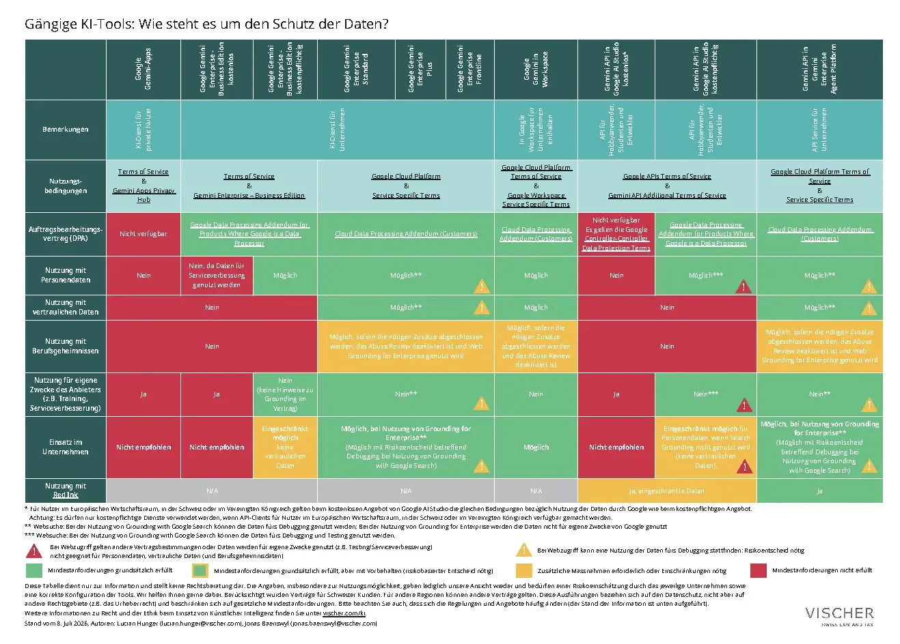

# KI-Dienste nach Vertrag, Edition und Datenfluss unterscheiden

Die VISCHER-Autoren David Rosenthal, Lucian Hunger und Jonas Baeriswyl beurteilen KI-Angebote am `14.07.2026` anhand konkreter Vertrags- und Konfigurationskombinationen. Ihre Tabellen tragen den Stand `08.07.2026`; die Ergebnisse sind datierte Autorenbewertungen, keine heutige Anbieterfreigabe.

## Reichweite der Bewertung

Die Autoren untersuchen bei internationalen Anbietern die `DSGVO` und das Schweizer `DSG`, bei Schweizer Anbietern das `DSG`. Berufs- und Amtsgeheimnis behandeln sie nach Schweizer Recht. Die Tabellen berücksichtigen Verträge für Schweizer Kunden, beschränken sich auf gesetzliche Mindestanforderungen und schließen andere Rechtsgebiete wie Urheberrecht aus. Die Auswahl folgt ihrer Beratungspraxis, keiner vollständigen Marktübersicht.

Die Farbfelder unterscheiden „Mindestanforderungen grundsätzlich erfüllt“, Vorbehalte, zusätzliche Maßnahmen und nicht erfüllte Mindestanforderungen. Warnsymbole ergänzen insbesondere Webzugriff und Debugging. Ein grünes Feld ist in dieser Darstellung keine Zertifizierung.

## Historische Unterschiede statt pauschaler Produkturteile

Die folgenden Befunde geben ausschließlich die Autorenbewertung vom Juli `2026` wieder:

| Angebot und Bezug | Von den Autoren benannte Grenze |
|---|---|
| `ChatGPT Team`, `Enterprise`, `OpenAI API` | Geschäftskundenverträge unterschieden sich von Privatangeboten; Vorbehalte betrafen besonders schützenswerte Personendaten, Unterauftragsbearbeiter-Mitteilungen und fehlende Geheimniszusätze. Für die Websuche diskutierten sie eine ausdrücklich nicht nachprüfbare Wettbewerberangabe. |
| `Microsoft 365 Copilot Chat`, `Microsoft 365 Copilot`, `Azure OpenAI Services` | Ihre grundsätzlich positive Bewertung der Geschäftsverträge erstreckte sich nicht auf `Bing Search`: Dort sahen sie andere Bedingungen und einen Rollenwechsel. Berufsgeheimnisbewertungen verlangten zusätzliche Verträge und Konfigurationsbedingungen; `work` bedeutete nicht automatisch „ohne Websuche“. |
| `Claude Team`, `Enterprise`, `API` direkt | Die Autoren sahen Vertraulichkeits- und Nichttrainingszusagen, aber Einschränkungen bei besonders schützenswerten Daten und keine ausreichende Lösung für Berufs-/Amtsgeheimnisse. |
| `Gemini Enterprise`, `Workspace`, `AI Studio`, API über `Gemini Enterprise Agent Platform` | Sie unterschieden Edition, Vertragsfamilie und Zugangsweg. `Grounding with Google Search` konnte nach ihrer Darstellung Debugging-Speicherung für `3 Tage` einschließen; `Web Grounding for Enterprise` wurde anders beurteilt. Dessen Verfügbarkeit im UI blieb teilweise unklar. |
| `DeepL Free` und `DeepL Pro` | Sie unterschieden Eigennutzung der Daten, Vertraulichkeit und individuell zu vereinbarende Geheimniszusätze. |
| Schweizer `MTF` und `Alpine AI` | Die Tabelle bewertete veröffentlichte Verträge, nicht allein den Schweizer Standort; bei `Alpine AI` benannte sie eine Vertraulichkeitsdauer bis `3 Jahre` nach Vertragsende und unklare Drittanbieternutzung bei Websuche. |

## Modellbezug, Konfiguration und Connectoren getrennt erfassen

Die Autoren unterscheiden ein beim Hyperscaler betriebenes Modell von einem weitergereichten Dienst mit zusätzlichem Unterauftragsbearbeiter. Bei `Anthropic` nennen sie zudem Ausnahmen für „Covered Models“; Angebote über `AWS` und `Azure` hätten sie nicht näher geprüft.

Ihre Bewertung trennt automatische Filter vom menschlichen Abuse Monitoring. Weitere Prüfpunkte sind Caching, Aufbewahrung, Zugriffsfreigaben, Routing und Bearbeitungsorte. Als Beispiel für veränderliche Konfigurationen nennen sie `Flex Routing`. Für neue KI-Unterauftragsbearbeiter bei Microsoft beschreiben sie `30 Tage` Ankündigung statt bisher `6 Monaten`, daneben eine zeitweise Deaktivierungsoption.

Den Blick weiten sie auf die verwendete Software und zusätzliche Datenquellen: Auch Websuche, `MCP` und Connectoren können weitere Empfänger, Zwecke und Bedingungen einführen. Die eigene Lösung `Red Ink` ist Teil ihrer Selbstdarstellung, kein unabhängiger Produktvergleich.

## Einordnung

Als übertragbare Arbeitsweise ergibt sich die getrennte Erfassung von Vertrag, Edition, Konfiguration, Datenfluss und Rechtsraum. Produktnamen oder Standortangaben allein ersetzen diese Zuordnung nicht. Die Notiz übernimmt keine rechtlichen Resultate als operative Freigaberegeln. Vertragsbehauptungen und Konfigurationen wurden hier nicht gegen heutige Anbieterunterlagen geprüft. Die Tabellen sind mit ihrem älteren Stichtag neben dem Artikeldatum zu lesen.

## Kernaussagen

- [[KI-Adoption-mit-Use-Case-und-Befaehigungs-Gate]]: Der konkrete Einsatz und seine Daten gehören vor eine pauschale Toolentscheidung.
- [[Erweiterungs-Ebenen-Zuordnung]]: `MCP` und Connectoren sind eigene Integrationswege, deren Datenflüsse separat erfasst werden müssen.

## Verbindungen

- [[KI-Dienste-nach-Vertrag-und-Datenfluss-pruefen]]

- [[KI-Adoption-mit-Use-Case-und-Befaehigungs-Gate]] – fachlichen Einsatz und Abnahme abgrenzen.
- [[Erweiterungs-Ebenen-Zuordnung]] – externe Integrationen im Gesamtsystem verorten.
