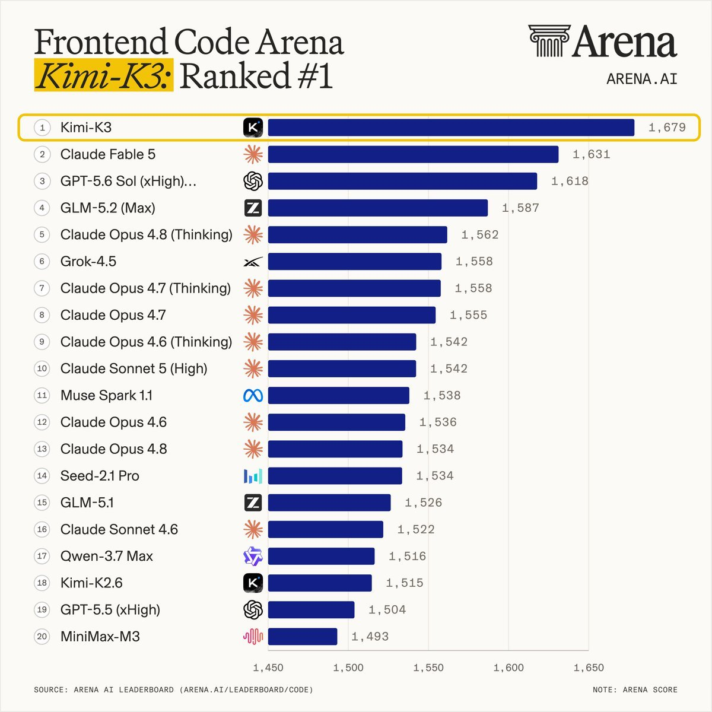

# Kimi K3 auf Rang 1 der Frontend Code Arena

Chubby kommentiert am 16. Juli 2026 eine Arena-Rangliste. Der eigenständige Informationswert steckt in der lokal archivierten Grafik; „nicht einmal knapp“ ist die Interpretation des Autors.

## Zahlen und Methode

Die Grafik heißt **Frontend Code Arena**, führt „Arena Score“ als Einheit auf und verweist auf Arena AI Leaderboard als Quelle:

| Sichtbare Modellbezeichnung | Rang | Arena Score |
| --- | ---: | ---: |
| `Kimi-K3` | 1 | 1679 |
| `Claude Fable 5` | 2 | 1631 |
| `GPT-5.6 Sol (xHigh)…` | 3 | 1618 |
| `GLM-5.2 (Max)` | 4 | 1587 |
| `Claude Opus 4.8 (Thinking)` | 5 | 1562 |

## Einordnung

Der Post ist eine Sekundärquelle für eine Drittmessung. Die Grafik zeigt weder Stichprobengröße noch Unsicherheitsintervalle, Auswahlverfahren oder vollständige Konfigurationen. Der Abstand zwischen Rang 1 und 2 lässt sich aus den abgebildeten Scores ablesen; statistische Sicherheit und praktische Projektqualität sind daraus nicht belegt. Die abgeschnittene GPT-Bezeichnung bleibt unverändert gekennzeichnet.

Der Text nennt „design arena frontend“, die Grafik „Frontend Code Arena“. Scores dieser Rangliste dürfen nicht mit Intelligence-Index-Punkten oder GDPval-Elo derselben Modelle gleichgesetzt werden. Dies ist ein Juli-Snapshot, keine aktuelle Rangliste.

## Kernaussagen

- Die archivierte Grafik belegt die dargestellte Rangfolge und Scores.
- Allgemeine Überlegenheit oder die Qualität eines konkreten Frontends benötigt eigene Abnahme.

## Verbindungen

- [[2026-07-16-artificialanlys-2077832874183860404]] — Kimi K3 in anderen Evaluationen und Kostenmaßen.
- [[Variantenvergleich-vor-Produktionsabnahme]] — Tatsächliche UI-Ergebnisse vergleichend prüfen.
