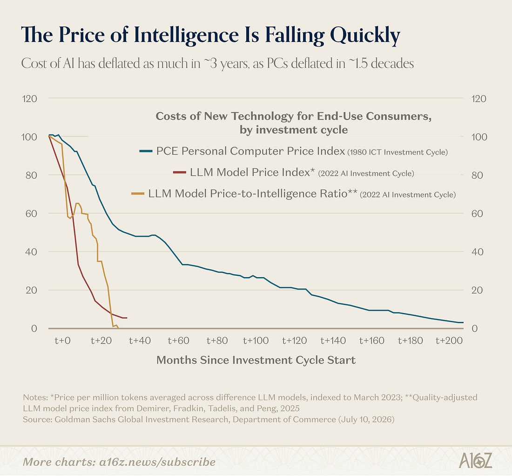

# KI-Preisverfall: Indexvergleich mit methodischen Grenzen

Hedgeye behauptet am 17. Juli 2026, KI-Preise fielen „fünfmal schneller“ als PC-Preise. Die beigefügte Grafik liefert einen historischen Indexvergleich, keine nachgerechnete universelle Rate.

## Zahlen und Methode

Die Grafik behauptet ähnliche Deflation binnen ungefähr **3 Jahren** bei KI und **1,5 Jahrzehnten** bei PCs. Ihre Zeitachse zeigt Monate seit Beginn des jeweiligen Investitionszyklus:

- PC-Kurve: **PCE Personal Computer Price Index**, Investitionszyklus **1980**.
- LLM-Kurve: **durchschnittlicher Preis pro 1 Mio. Tokens über verschiedene Modelle**, indexiert auf **März 2023**, Investitionszyklus **2022**.
- Weitere LLM-Kurve: qualitätsbereinigtes Preis-Leistungs-Verhältnis; Fußnote verweist auf Demirer, Fradkin, Tadelis und Peng, **2025**.

Als Datenquellen nennt die Grafik Goldman Sachs Global Investment Research und Department of Commerce, datiert **10. Juli 2026**. Die Darstellung trägt zusätzlich a16z-Branding.

## Einordnung

Dies ist eine weitergereichte Grafik mit knapper Methodik. Tokenpreis und qualitätsbereinigter Tokenpreis sind getrennte Reihen; der PC-Index misst wiederum einen anderen Warenkorb. Gewichtungen, Modellkorb, Rohdaten und identische Qualitätsbereinigung fehlen im Archiv. Die Faktor-fünf-Behauptung bleibt deshalb attribuiert und ungeprüft; sie wird nicht als verifizierte Preisänderungsrate übernommen.

Kurvenpunkte ohne Zahlenlabel werden nicht aus Pixelpositionen geschätzt. Aus Tokenpreisen folgen keine garantierten Einsparungen für Abonnements, Agent-Läufe oder den gesamten Betrieb. Keine aktuelle Preisprognose ableiten.

## Kernaussagen

- Vor Preisvergleichen Indexbasis, Qualität und Warenkorb getrennt prüfen.
- Der Post beschreibt eine historische Darstellung, keine belastbare Zukunftsrate.

## Verbindungen

- [[2026-09-22-epoch-the-plunging-price-of-thought]] — Weiteres Material zur Preisentwicklung; eigener Zeitraum und Methode.
- [[Modell-Eskalation-von-guenstig-nach-teuer]] — Kosten konkreter Aufgaben statt pauschaler Preisrhetorik bewerten.
