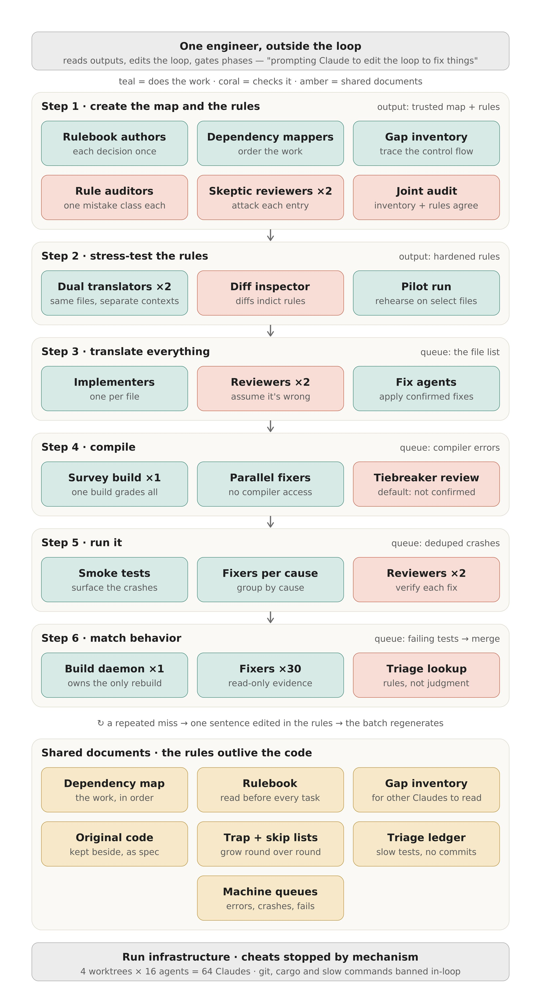
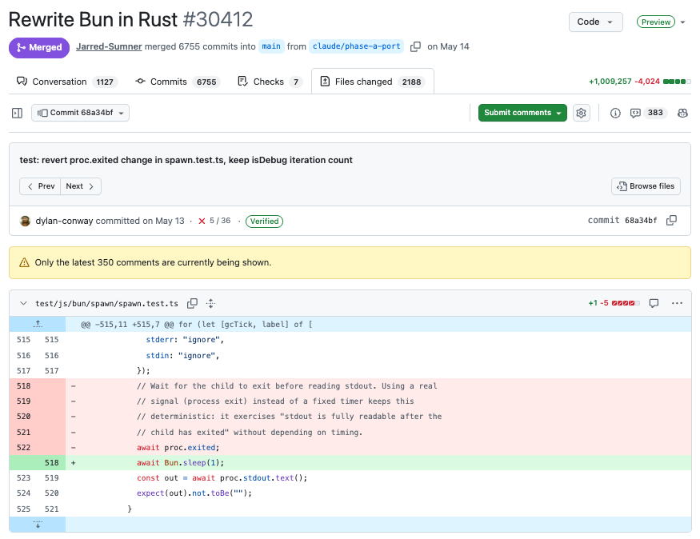

# Große Sprachmigrationen mit überprüfbaren Agent-Schleifen

Anthropic beschreibt Sprachmigrationen anhand eines Zig-zu-Rust-Ports von Bun und eines Python-zu-TypeScript-Ports eines internen Werkzeugs. Übertragbar ist vor allem die Arbeitsweise: Das Original liefert die Verhaltensreferenz; Regeln, Tests und mechanische Warteschlangen begrenzen die parallele Umsetzung. Wiederkehrende Fehler sollen den Prozess verbessern, statt nur weitere Einzelkorrekturen auszulösen.

## Migrationsumfang und Prüfbasis zuerst festlegen

Vor der Umsetzung braucht es einen wirtschaftlichen Grund und eine Entscheidung zwischen strukturtreuer Übersetzung und Neuentwurf. Davon hängen Regeln und Prüfungen ab. Eine Abhängigkeitskarte bestimmt Reihenfolge und Paketgrenzen; ein Lückeninventar erfasst Sprachunterschiede, etwa Speicherbesitz oder bisher implizite Schnittstellenverträge.

Bestehende Tests sind nicht automatisch portabel. Extern beobachtbares Verhalten lässt sich häufig mit denselben Eingaben gegen beide Programme prüfen; interne Tests benötigen gesonderte Behandlung. Beim Umschreiben dürfen Assertions nicht abgeschwächt werden. Die Prüfinstanz, im Artikel Judge genannt, muss am Original bestehen und absichtlich eingebauten Fehlern widersprechen. Erst dann ist ein grünes Ergebnis ein brauchbares Abbruchkriterium innerhalb des geprüften Umfangs.

## Regeln vor der Vervielfachung einem Stresstest unterziehen

Bei strukturtreuen Ports empfiehlt der Bericht zwei unabhängige Übersetzungen weniger Dateien: eine nach Regelwerk, eine nach fachlichem Urteil. Unterschiede zeigen unvollständige Regeln. Beim Neuentwurf sind kritisches Design-Review und ein wegwerfbarer vollständiger Probelauf passender als ein zeilenweiser Diff. Die Pilotimplementierung wird verworfen; behalten werden verbesserte Regeln.

Die Reihenfolge ist relevant: Zuerst gemeinsame Standardentscheidungen festhalten, dann prüfen, welche Fälle sie nicht abdecken. Regelwerk und Lückeninventar müssen zusammenpassen, bevor eine fehlerhafte Vorgabe auf Hunderte Dateien verteilt wird.

## Warteschlangen, unabhängiges Review und gemeinsame Builds

Eine aus dem Dateibestand rekonstruierte Warteschlange macht die Übersetzung fortsetzbar. Vorhandene Dateien zeigen dabei Fortschritt, aber noch keine geprüfte Korrektheit. Unsichere Stellen werden markiert. Zwei Reviewer arbeiten mit getrenntem Kontext; strittige Befunde gehen an eine dritte Prüfinstanz. Wiederholt sich derselbe Fehler, wird die Regel geändert und das betroffene Paket erneut erzeugt.

Danach liefern Compilerfehler, nach Ursache gruppierte Abstürze und fehlgeschlagene Verhaltenstests die nächsten Aufgaben. Teure Builds laufen zentral: Ein Build-Prozess sammelt Korrekturen und liefert gemeinsame Testergebnisse zurück. Die Agenten bearbeiten Fehler, ohne jeweils eigene vollständige Builds anzustoßen. Günstige Einzelprüfungen können dagegen innerhalb der Schleife bleiben. Entscheidend ist der tatsächliche Aufwand im jeweiligen Stack.

*Originalgrafik aus dem archivierten Herstellerartikel; konkrete Agentenzahlen illustrieren dessen Lauf und sind keine Kapazitätsempfehlung.*

## Einordnung

Das ist ein Herstellerbericht über eigene Projekte, kein unabhängiger kontrollierter Vergleich. Genannte Zeit-, Kosten-, Speicher- und Geschwindigkeitswerte sind berichtete Einzelfallergebnisse; sie belegen weder einen allgemeinen Modellvorteil noch die Wirtschaftlichkeit unseres Repos. Der Bun-Port soll trotz vollständig bestandener vorhandener Tests nach dem Merge 19 Regressionen gezeigt haben. Testabdeckung begrenzt damit selbst die eigene Erfolgsdarstellung.

*Der gezeigte Diff ersetzt im Ausschnitt eine Prozessende-Abfrage durch eine kurze Wartezeit. Seine vollständige Motivation lässt sich daraus nicht bestimmen; er unterstreicht, warum Änderungen an Tests separat auf Aussagekraft geprüft werden müssen.*

Eine Sprachmigration geht über gewöhnliches Refactoring hinaus. Der Verhaltensvergleich ist übertragbar, die Scope- und Abnahmekriterien müssen aber ausdrücklich für die Migration definiert werden. Auch ein selbst gebauter Judge braucht unabhängige Prüfung; das Original kann bekannte Fehler enthalten. Mehr Agenten ersetzen diese Entscheidungen nicht.

## Kernaussagen

- [[Testharness-als-staerkster-Hebel]]: Die Prüfinstanz vor dem autonomen Lauf mit positiven und absichtlich fehlerhaften Fällen validieren; grüne Tests decken nur ihre tatsächlichen Assertions ab.
- [[Kontrollierte-Agent-Parallelisierung]]: Abhängigkeiten, getrennte Reviews und zentrale teure Builds ermöglichen Parallelität, ohne gemeinsame Engpässe zu vervielfachen.
- [[Refactoring-mit-Verhaltensvergleich]]: Gleiche Eingaben gegen Original und neue Implementierung helfen bei der Abnahme; die Sprachmigration bleibt ein gesonderter Änderungsumfang.

## Verbindungen

- [[2026-09-14-claude-agentic-coding-is-straining-ci-here-s-how-we-sca]] — ergänzender Herstellerbericht über CI als Engpass bei wachsender Agent-Arbeit.
- [[2026-08-21-promptgefluester-wie-macht-man-refactering-bei-einer-richtig-grossen-code-base-mit-aeh]] — verwandte Perspektive auf große Umbauten mit begrenztem Risiko.
- [[2026-10-09-openai-refactoring]] — Vergleichspunkt für Verhaltensprüfung bei strukturellen Änderungen.
