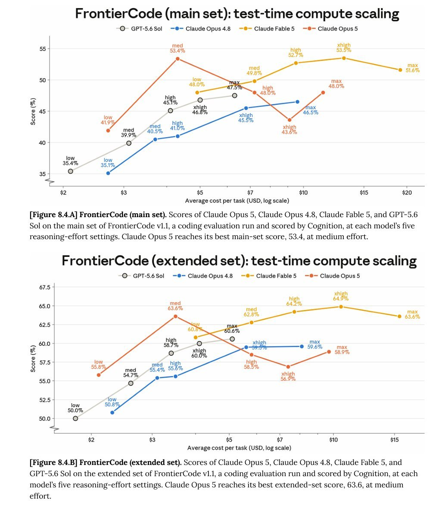

# Opus 5: Mehr Effort steigert FrontierCode-Scores nicht durchgehend

Andrew Carr kommentiert am 24. Juli 2026 eine FrontierCode-Grafik mit der zugespitzten Frage, ob man `Opus 5` besser nicht denken lasse. Die lesbaren Zahlen zeigen ein engeres Ergebnis: In diesen Aufgaben erzielt das Modell sein Maximum bei `medium`.

## Zahlen und Methode

Die Bildunterschriften nennen **FrontierCode v1.1**, eine von Cognition ausgeführte und bewertete Coding-Evaluation. **Main set** und **extended set** sind getrennte Auswertungen. Die Grafik zeigt fünf Reasoning-Stufen:

| `Claude Opus 5` Effort | Main set | Extended set |
| --- | ---: | ---: |
| `low` | 41,9 % | 55,8 % |
| `medium` | 53,4 % | 63,6 % |
| `high` | 48,0 % | 58,5 % |
| `xhigh` | 43,6 % | 56,9 % |
| `max` | 48,0 % | 58,9 % |

Die horizontale Achse zeigt durchschnittliche Aufgabenkosten in USD auf logarithmischer Skala. Exakte Punktkosten sind nicht beschriftet und werden deshalb nicht geschätzt.

## Einordnung

Carr ist Kommentator, Cognition der benannte Evaluator. Die Rohquelle enthält weder vollständigen Evaluationsbericht noch Fallzahlen, Fehlerbalken oder Wiederholungen. Nichtmonotonie ist in den dargestellten Scores sichtbar, ihre Signifikanz ist hier nicht belegt. Andere Benchmarkfamilien und reale Aufgaben können andere Ergebnisse liefern. Die Pointe „nicht denken lassen“ wird nicht als Methode übernommen.

## Kernaussagen

- Höchster Effort ist in diesen zwei Auswertungen kein automatischer Qualitätsgewinn.
- Effort-Wahl braucht eine passende Evaluation; beide Datensätze getrennt dokumentieren.

## Verbindungen

- [[Modell-Eskalation-von-guenstig-nach-teuer]] — Kosten und Ergebnisqualität getrennt beobachten.
- [[2026-07-08-claudedevs-modell-vs-effort]] — Modell und Effort als unterschiedliche Stellschrauben.
