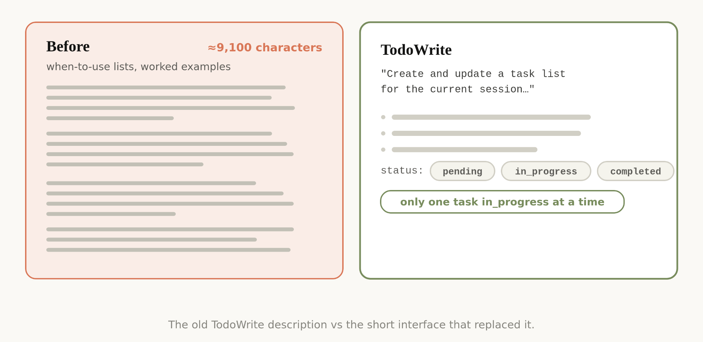

# Agent-Kontext nach Modellwechseln neu kalibrieren

Thariq Shihipar beschreibt, wie Anthropic den System Prompt von Claude Code für `Claude Opus 5` und `Claude Fable 5` um mehr als 80 Prozent verkürzt habe, ohne messbaren Verlust in den eigenen Coding-Evals. Der Beitrag vom 24. Juli 2026 erklärt die konkreten Änderungen; die URL- und X-Fassung sind dieselbe Primärquelle und keine unabhängigen Bestätigungen.

## Widersprüche kosten Aufmerksamkeit

System Prompt, Skills, Repo-Regeln und Nutzerauftrag bilden gemeinsam den Kontext. Überlappende Vorgaben können gegeneinander arbeiten. Die erste Grafik illustriert diese Kollision; ihre Beispiele sind ausdrücklich keine wörtlichen Transkriptausschnitte. Shihipar empfiehlt, Regeln darauf zu prüfen, welche Fehler sie tatsächlich verhindern und ob neuere Modelle dafür weiterhin dieselbe Anleitung brauchen.

Für gewöhnliche Stilfragen ersetzt Anthropic starre Verbote durch die Orientierung am umgebenden Code: Kommentarhäufigkeit, Benennung und Idiom folgen dem Repository. Der Text erlaubt damit keine pauschale Lockerung von Sicherheits- oder Freigabegrenzen.

## Schnittstellen statt umfangreicher Beispiele

Tool-Schemas können Verhalten bereits durch verständliche Parameter und zulässige Zustände erklären. Die Grafik zu `TodoWrite` zeigt vorher ungefähr 9.100 Zeichen mit Anwendungslisten und Beispielen, danach eine kurze Beschreibung, die Zustände `pending`, `in_progress`, `completed` und die Regel, höchstens eine Aufgabe gleichzeitig als laufend zu markieren. Die Abbildung nennt keine gemessene neue Zeichenanzahl.

Die übertragbare Entscheidung lautet: Informationen möglichst an der Schnittstelle erklären, an der sie gebraucht werden. Wiederholungen zwischen System Prompt und Tool-Beschreibung vermeiden; verbleibende Regeln müssen weiterhin eindeutig sein.

## Kontext gezielt nachladen

Die Repo-Datei enthält vor allem Besonderheiten und Stolperfallen, die aus dem Code schwer erkennbar sind. Ausführliche Review- und Verifikationsanleitungen werden in referenzierte Skills ausgelagert. Lange Skills können auf weitere Dateien verweisen; Tool-Definitionen können bei Bedarf geladen werden.

Referenzen müssen kein Fließtext sein: Tests, HTML-Mockups, Rubrics und vorhandener Code können Anforderungen konkreter ausdrücken. Der Beitrag nennt Auto-Memory sowie `/doctor` beziehungsweise `claude doctor` als damalige Produktfunktionen; ihre heutige Verfügbarkeit wird hier nicht geprüft.

## Einordnung

Die 80-Prozent-Angabe ist ein Herstellerbericht ohne veröffentlichten Eval-Datensatz oder vollständige Vorher/Nachher-Prompts. Daraus folgt weder eine allgemeine Erfolgsquote noch ein universeller Kürzungswert für unsere Regeln. Die Arbeitsweise ergänzt vorhandene Patterns: Kontext nach Modellwechseln überprüfen, Redundanz reduzieren und Freiheitsgrade nach Aufgabenrisiko vergeben. Kritische Grenzen bleiben explizit; die Wirksamkeit einer Kürzung müsste an eigenen Aufgaben verglichen werden.

## Kernaussagen

- Repo-Regeln auf schwer erkennbare Besonderheiten konzentrieren und Spezialwissen referenzieren → [[AGENTS-md-Onboarding-Design]].
- Stilvorgaben können für geeignete Modelle mehr Urteilsspielraum zulassen; fragile Operationen benötigen weiterhin genaue Grenzen → [[Freiheitsgrad-nach-Aufgaben-Fragilitaet]].
- Tool-Schemas und Beschreibungen nach Modellfähigkeiten gestalten und nach Upgrades überprüfen → [[Action-Space-Design-nach-Modellfaehigkeit]].

## Verbindungen

- [[2026-02-27-thariq-lessons-building-claude-code]]
- [[AGENTS-md-Onboarding-Design]]
- [[Freiheitsgrad-nach-Aufgaben-Fragilitaet]]
- [[Action-Space-Design-nach-Modellfaehigkeit]]
