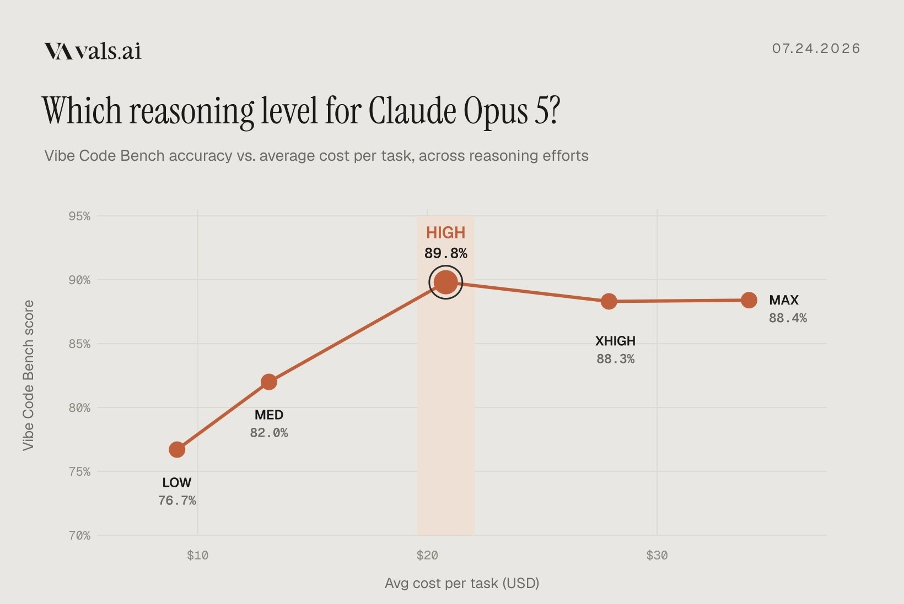

# Mehr Reasoning bringt im Vals-Snapshot nicht automatisch mehr Treffer

Vals AI veröffentlicht am 25. Juli 2026 einen Vergleich von fünf Reasoning-Stufen für `Opus 5` auf Vibe Code Bench. Die Grafik selbst trägt das Datum 24. Juli 2026. Es handelt sich um eine historische Fremdmessung.

## Ergebnisse und Methode

| Reasoning | Vibe Code Bench Score |
| --- | --- |
| `low` | 76,7 % |
| `medium` | 82,0 % |
| `high` | 89,8 % |
| `xhigh` | 88,3 % |
| `max` | 88,4 % |

Die Grafik stellt Score gegen durchschnittliche USD-Kosten pro Aufgabe. Kostenpunkte sind nicht mit exakten Beträgen beschriftet; sie werden hier deshalb nicht als genaue Preise übernommen. Die teuersten Stufen zeigen höhere Kosten und keinen höheren Punktwert als `high`.

## Einordnung

Der Post bezeichnet die Unterschiede der höchsten Stufen ausdrücklich als innerhalb der Fehlerbalken liegend. Die angehängte Grafik zeichnet jedoch keine Fehlerbalken und nennt weder Stichprobengröße noch Intervalle. Eine statistisch gesicherte Rangfolge zwischen `high`, `xhigh` und `max` lässt sich daraus nicht ableiten. Gemessen wird ein bestimmter Benchmark; eine Übertragung auf unsere Repositories ist ungeprüft.

## Kernaussagen

- Effort als eigene Kosten- und Qualitätsachse untersuchen.
- Höchste Einstellung nicht allein wegen ihres Namens bevorzugen.
- Für eigene Aufgaben Score, Kosten und Unsicherheit gemeinsam messen: [[Modell-Eskalation-von-guenstig-nach-teuer]].

## Verbindungen

- [[Modell-Eskalation-von-guenstig-nach-teuer]]: Unterstützt die gezielte Prüfung statt reflexhaft maximalem Reasoning.
- [[2026-07-08-claudedevs-modell-vs-effort]]: Ergänzender Kontext zur getrennten Modell- und Effort-Wahl.
