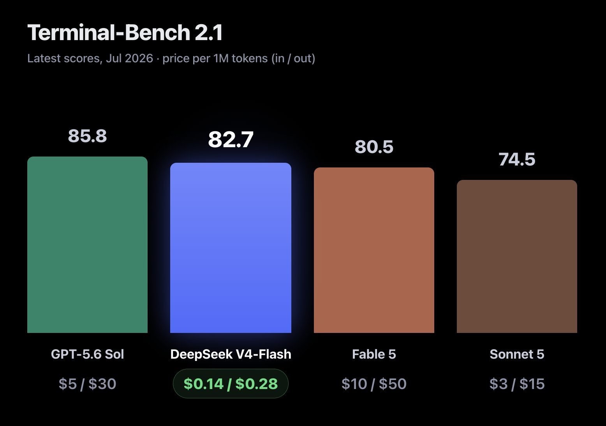

# DeepSeek V4 Flash: niedrige Tokenpreise im Terminal-Bench-Snapshot

Der Post vom 31. Juli 2026 bewertet den Flash-Release als außergewöhnlichen Kostensprung. Die beigefügte Grafik liefert einen historischen Vergleich für `Terminal-Bench 2.1`; die Bewertung des Autors bleibt Meinung.

## Archivierte Werte

Die Grafik bezeichnet die Preise ausdrücklich als Input/Output je eine Million Tokens, in USD.

| Modell | Benchmark-Score | Input je MToken | Output je MToken |
| --- | --- | --- | --- |
| `GPT-5.6 Sol` | 85,8 | `5 USD` | `30 USD` |
| `DeepSeek V4-Flash` | 82,7 | `0,14 USD` | `0,28 USD` |
| `Fable 5` | 80,5 | `10 USD` | `50 USD` |
| `Sonnet 5` | 74,5 | `3 USD` | `15 USD` |

## Einordnung

Die Grafik nennt keinen konkreten Harness, kein Effort, keine Stichproben oder Unsicherheiten und zeigt beim Score kein Prozentzeichen. Deshalb werden die Werte als abgebildete Benchmark-Scores übernommen, nicht als selbst verifizierte Erfolgsquoten. Die Score-Präzision stammt vollständig aus dem Bild.

Niedrige Preise pro Token bedeuten nicht automatisch niedrige Kosten pro erledigter Aufgabe: Ausgabeumfang, Wiederholungen und Fehlerkorrekturen sind hier unbekannt. Die Behauptung, die Leistung sei praktisch zu billig zum Abrechnen, ist eine rhetorische Bewertung.

## Kernaussagen

- Preisunterschiede nur mit identischen Einheiten vergleichen.
- Benchmark-Ergebnis und Tokenpreis getrennt dokumentieren.
- Aus diesem Bild folgt weder eine universelle Modellrangfolge noch eine lokale Betriebskostengarantie.

## Verbindungen

- [[2026-07-31-unslothai-2083231049434435596]]: Derselbe Release im Kontext lokaler Quantisierung.
- [[2026-08-01-arena-2083348755559207047]]: Späterer Snapshot mit anderem Benchmark und auffälliger Preisabweichung.
