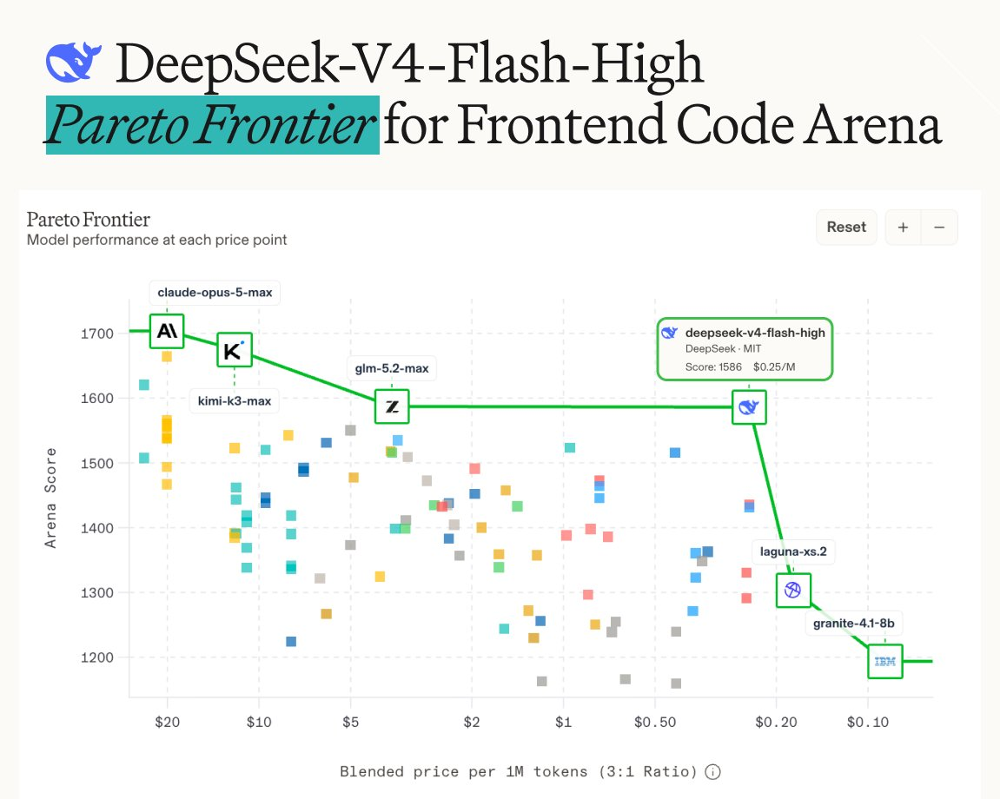

# Arena-Snapshot: starke Frontend-Wertung mit widersprüchlicher Preisachse

Arena berichtet am 1. August 2026, `DeepSeek-V4-Flash-High` verschiebe die Pareto-Grenze der Frontend Code Arena. Der historische Snapshot verbindet eine veröffentlichte Arena-Wertung mit Tokenpreisen; eine Prüfung unserer Anwendung ist damit nicht erfolgt.

## Ergebnis und Preisdarstellung

Der Post und das Bild nennen einen Arena-Score von 1586 Punkten. Der Post nennt `0,14 USD Input` und `0,28 USD Output` je MToken. Diese Reihenfolge entspricht der expliziten Input/Output-Grafik des verwandten Posts vom 31. Juli.

Die Arena-Grafik verwendet stattdessen einen gemischten Tokenpreis bei einem Input/Output-Verhältnis von 3:1. Der Tooltip nennt `0,25 USD je MToken`. Aus den angegebenen Einzelpreisen ergibt die 3:1-Gewichtung rechnerisch `0,175 USD je MToken`. Die Abweichung wird im Archiv nicht erklärt; sie darf nicht durch Gleichsetzen der Preise verdeckt werden.

## Einordnung

Die Pareto-Aussage gilt für die dargestellten Modelle und diese Kostenmetrik. Arena-Score, Terminal-Bench-Score und Tokenpreis messen unterschiedliche Dinge. Stichprobengröße, Unsicherheit und vollständiger Harness fehlen im Bild. Die beworbene beste Leistung pro Dollar lässt sich bei ungeklärter Preisbasis nicht unabhängig bestätigen.

## Kernaussagen

- `high` als Bestandteil der konkreten Modell-Konfiguration erhalten.
- Gemischte Preise und separate Input/Output-Tarife unterscheiden.
- Eigene Frontend-Abnahme und Aufgaben-Kosten bleiben offen.

## Verbindungen

- [[2026-07-31-kimmonismus-2083144340176609556]]: Explizite Input/Output-Preise für denselben Flash-Release.
- [[Modell-Eskalation-von-guenstig-nach-teuer]]: Kostenorientierte Auswahl braucht eine nachvollziehbare Messbasis.
