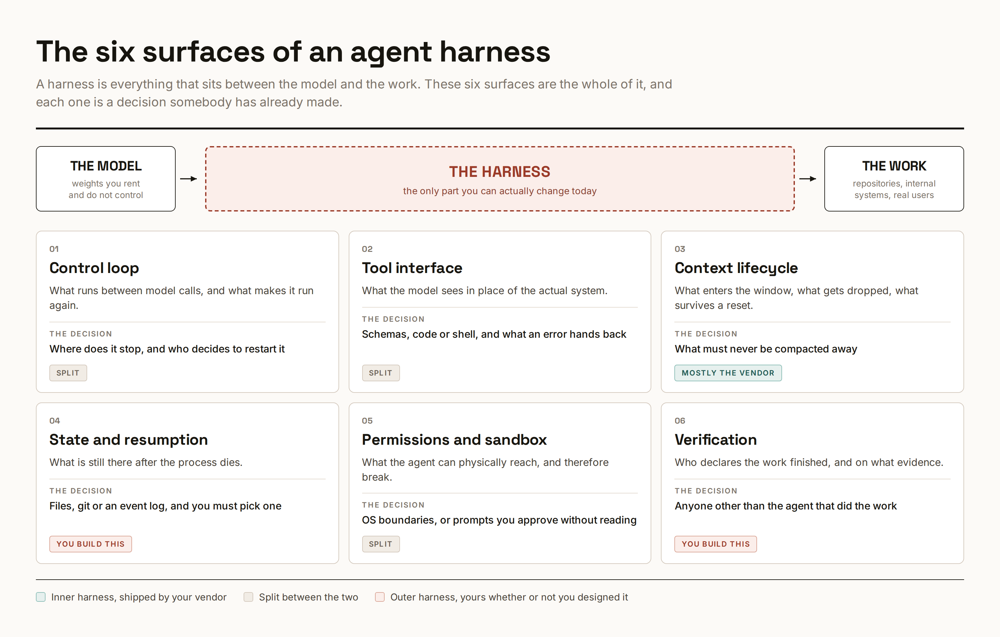

# Sechs Entscheidungen für einen belastbaren Agent-Harness

Yarchi bündelt Praxisempfehlungen und berichtete Studien-/Firmenzahlen; deren Primärbelege sind im Archiv nicht nachprüfbar. Der vollständige Artikel und fünf Bilder liegen vor, mögliche Folgeposts bleiben wegen der Sieben-Tage-Abrufgrenze offen.

## Sechs konkrete Entscheidungen

1. **Loop:** Vorab Abschlussbedingung festlegen; nach Fehlern bewusst stoppen oder mit Fehlernotiz neu starten; Turns/Laufzeit begrenzen und unbeaufsichtigte Läufe protokollieren.
2. **Tools:** Beschreibungen bedarfsweise laden, selten genutzte Werkzeuge entfernen; Fehler mit ungültigem Feld, gültigem Wert und nächstem Schritt zurückgeben. Bei einem einzelnen Repo mit Standardwerkzeugen sieht der Autor wenig Optimierungsbedarf.
3. **Kontext:** Recherche, Plan und Implementierung über schriftliche Übergaben trennen; unverhandelbare Regeln nach Resets erneut laden. 300.000–400.000 Tokens und ein Neustart nach wiederholter Zustimmung sind Autorenheuristiken.
4. **Wiederaufnahme:** `SPEC.md` fixieren, `PLAN.md` mit Abnahmebedingungen, `PROGRESS.md` mit Fehlversuchen und `DECISIONS.md` append-only pflegen; funktionierende Schritte versionieren.
5. **Rechte:** Schreibpfade und Netzwerk auf OS-Ebene begrenzen; gemeinsame Systeme über protokolliertes Gateway, Zugangsdaten kurzlebig und auftragsbezogen halten.
6. **Verifikation:** Frische Review-Session, echte Browser-/CLI-Ausführung und 20–50 frühere Fehlerfälle; dreimal ausführen und den schlechtesten Lauf bewerten.

## Einordnung

Die Struktur ist übertragbar, ihre Zahlen sind keine eigene Validierung. Der Autor kennzeichnet die Compaction-Studie selbst als unbegutachtete Einzelautorenarbeit und Retry-Policies als unbelegt. Sein Anthropic-Beispiel berichtet sechs Stunden/200 Dollar gegenüber 20 Minuten/neun Dollar: Qualitätsgewinn kann erheblichen Mehraufwand verlangen.

## Kernaussagen

- Abschlussnachweis, Wiederaufnahme und harte Grenzen explizit gestalten.
- Mehr Harness lohnt laut Autor besonders für bisher nicht delegierbare Aufgaben.

## Verbindungen

- [[Testharness-als-staerkster-Hebel]]
- [[Kontext-Hygiene-Entscheidungsbaum]]
