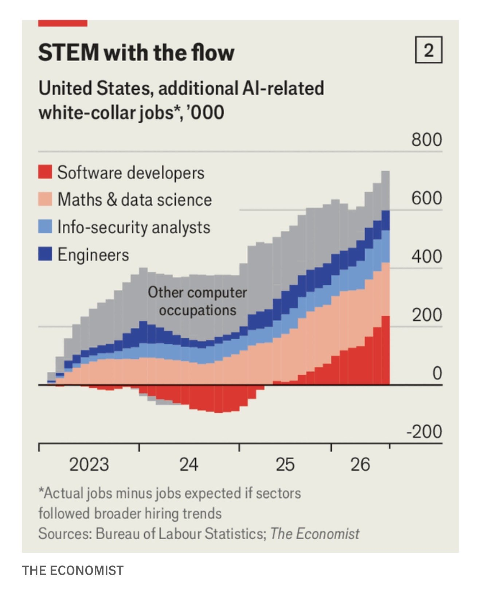

# KI-bezogene US-Beschäftigung relativ zum Einstellungstrend

Karl Lauterbach verbindet am 06.09.2026 eine Economist-Grafik mit einer politischen Bewertung von KI und Europas Exportstrategie. Die Grafik erlaubt eine engere Aussage als der Tweet.

## Was die Grafik misst

Das lokale Bild zeigt zusätzliche KI-bezogene US-Angestelltenjobs in Tausend: tatsächliche Beschäftigung minus erwartete Beschäftigung, falls die Branchen dem allgemeinen Einstellungstrend gefolgt wären. Kategorien sind Softwareentwicklung, Mathematik/Data Science, Informationssicherheitsanalyse, Ingenieurwesen und übrige IT-Berufe.

Der neueste gestapelte Balken für 2026 liegt grafisch ungefähr bei `700.000` Jobs oberhalb dieses erwarteten Bestands. Das ist eine gerundete visuelle Schätzung. Das Bild nennt das Bureau of Labour Statistics und The Economist als Quellen.

## Einordnung

Die Zahl wurde aus dem lokalen Diagramm geschätzt, nicht aus einer Datentabelle übernommen. Der verlinkte Economist-Artikel wurde hier nicht vollständig gelesen. Die Differenz ist keine reine Zahl neu geschaffener Stellen und kein Kausalnachweis für KI. Lauterbachs Exportprognose und Aussagen über Arbeiter werden durch dieses White-Collar-Diagramm nicht bestätigt. Eigene Bewertung: Der Befund eignet sich als datierter Marktindikator unter der dargestellten Vergleichsannahme.

## Kernaussagen

- Gemessen wird Beschäftigung relativ zu einem erwarteten Branchenverlauf.
- Rund `700.000` beschreibt eine grafische Größenordnung, keine exakt belegte Gesamtzahl.
- Politische Interpretation, Beschäftigungsmaß und KI-Kausalität bleiben getrennt.

## Verbindungen

- [[Great-Decoupling-Rollenverstaendnis]] — Rollenwandel und Beschäftigungszahlen sind getrennte Fragen.
- [[2026-09-09-orf-anthropic-forscher-ki-risiko-fuer-menschen]] — weiterer gesellschaftlicher KI-Kontext, keine Bestätigung dieser Beschäftigungsdaten.
