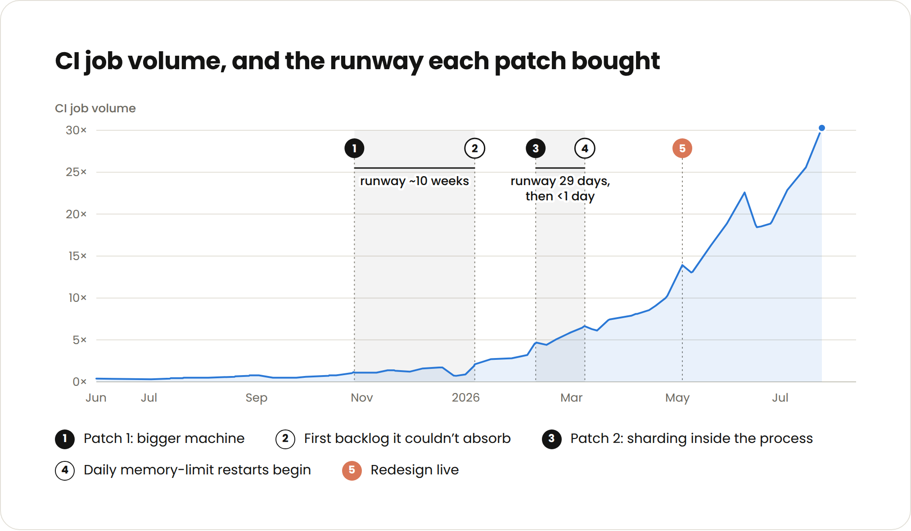
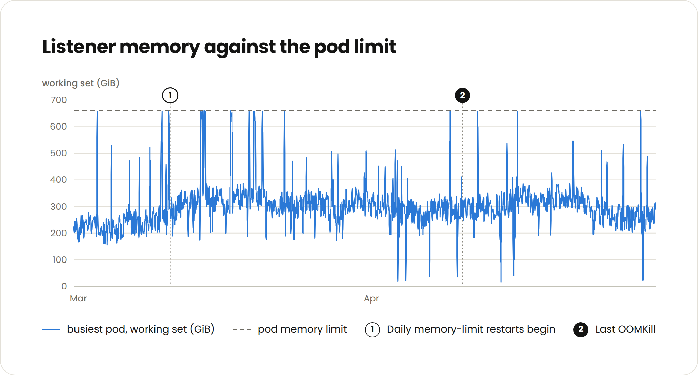
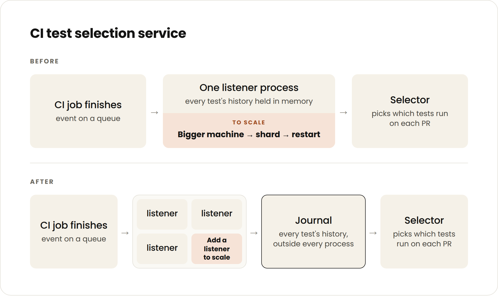
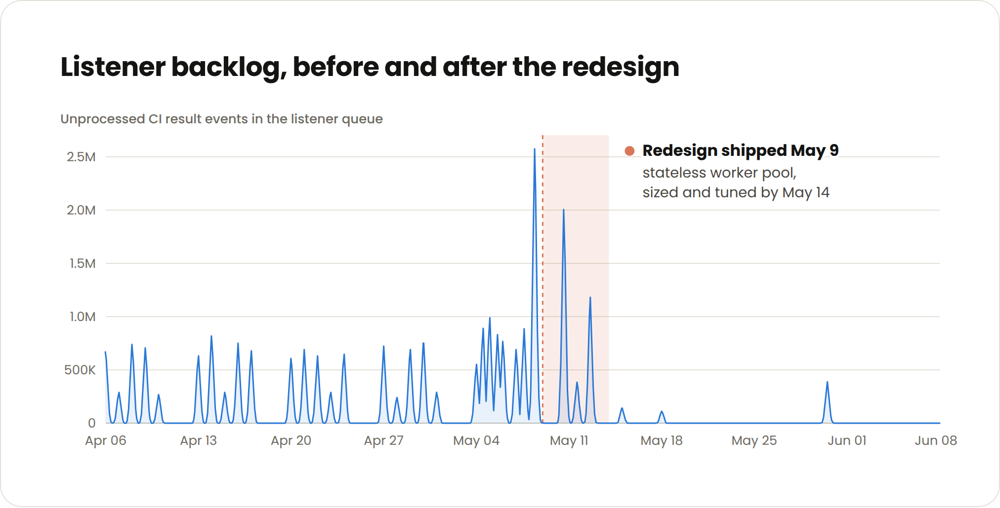

# Testselektion bei stark wachsender Agent-CI skalieren

Sachin Malhotra beschreibt, wie Anthropic seine Test-Impact-Analyse nach mehreren kurzlebigen Patches neu aufbaute. Nach seinem Betriebsbericht lieferten Engineers durchschnittlich achtmal so viel Code pro Quartal wie 2021–2025; 80 % des Codes stammten von Claude. Die Testmenge wuchs auf das Zehnfache, die CI-Jobs innerhalb von sechs Monaten auf das 25-Fache. Das sind selbstberichtete historische Betriebszahlen, kein kontrollierter Produktivitätsbenchmark.

## Veraltete Testhistorien beschädigen die Auswahl

Ein deterministischer Listener erfasste CI-Ergebnisse; ein Selector entschied anhand bisheriger Ergebnisse und Paketrelevanz, welche Tests ein PR benötigt. Bei hohem Durchsatz konnten 20 Minuten Listener-Lag Zehntausende noch nicht übernommene Testupdates bedeuten: Flaky Tests blockierten weiter, neue oder reparierte Tests wurden noch nicht ausgewählt.

Der ursprüngliche Prozess hielt die laufenden Testhistorien im Speicher. Ergebnisse mussten geordnet angewendet werden; später erkannte das Team, dass ein Writer je Package genügte. Dieses Sharding blieb jedoch innerhalb des Prozesses und beseitigte den wachsenden Speicherbedarf nicht.

## Immer kürzere Patches zeigen den Strukturengpass

Mehr Kerne verschafften 70 Tage, internes Sharding 29 Tage, ein Neustart weniger als einen Tag. Die Wachstumsgrafik bezeichnet den ersten Zeitraum als ungefähr zehn Wochen und endet bei etwas über 30-fachem CI-Volumen; das ist vom berichteten 25-fachen Wachstum über sechs Monate zu unterscheiden.

Die Speichergrafik zeigt wiederholte Spitzen an einem ungefähr 660-GiB-Pod-Limit. Neustarts vergrößerten den Rückstand; bei mehr als einer Stunde Lag gingen laut Bericht zahlreiche Ergebnisse für den Listener verloren. CI war auf den PRs gelaufen: Das Problem war eine veraltete Grundlage der Testauswahl, kein ungeprüftes Production-Deployment. Claude meldete sich beim Autor, sobald der Listener mehr als 50.000 Jobs zurücklag.

## Ergebnisannahme von Historienbildung trennen

Die neue Architektur verwendet zustandslose Listener: Jeder Worker kann ein Ergebnis an ein externes In-Memory-Journal anhängen. Ein separater Consumer verdichtet das Journal alle paar Sekunden zu Historien je Test; der Selector liest die relevante Historie. Dadurch können weitere Listener hinzukommen, ohne selbst die gesamte Historie zu halten.

Die Backlog-Grafik zeigt vor dem Umbau Spitzen über 2,5 Millionen Ereignissen. Der Rollout erfolgte am 9. Mai, die Abstimmung bis zum 14. Mai; dazwischen gab es noch eine Spitze um zwei Millionen, danach kleinere einzelne Ausschläge. Der Autor berichtet anschließend stabilen Betrieb bei höheren Infrastrukturkosten. Ein Engineer benötigte drei Wochen; die rückblickende Schätzung von ungefähr einem Quartal ein Jahr zuvor ist kein vergleichender Versuch.

## Einordnung

Der eigenständige Beitrag ist eine Architektur für aktuelle Testhistorien, nicht eine neue TDD-Methode. Der Engpass beim geordneten Schreiben wird vom Listener zur separaten Historienbildung verschoben; Reihenfolge und Korrektheit bleiben zu prüfen. Journal, Consumer und Selector erhöhen den Betriebsaufwand, und der Autor bestätigt höhere Kosten. Der Bericht beweist weder Exactly-once noch beschreibt er Persistenz-, Wiederholungs- oder Wiederherstellungsgarantien. Malhotras Empfehlung, für 25-fache Last zu planen, bleibt eine kontextabhängige Vorsorgehypothese. Rohmessdaten, kontrollierte Vergleichsläufe und überprüfbare Korrektheitstests fehlen im archivierten Artikel.

## Kernaussagen

- [[Testharness-als-staerkster-Hebel]]: Neben Testqualität begrenzt die Aktualität der ausgewählten Tests die Verifikation.
- Eingang und Verarbeitung der CI-Ergebnisse abgleichen; Durchsatz, Lag und Speicher gemeinsam beobachten.
- [[TDD-als-Verifikationshebel]] bleibt fachlich anschlussfähig, wird hier aber weder angewendet noch vergleichend geprüft.

## Verbindungen

- [[Testharness-als-staerkster-Hebel]]
- [[TDD-als-Verifikationshebel]]

- [[Zustandslose-CI-Listener-mit-Ergebnisjournal]]
