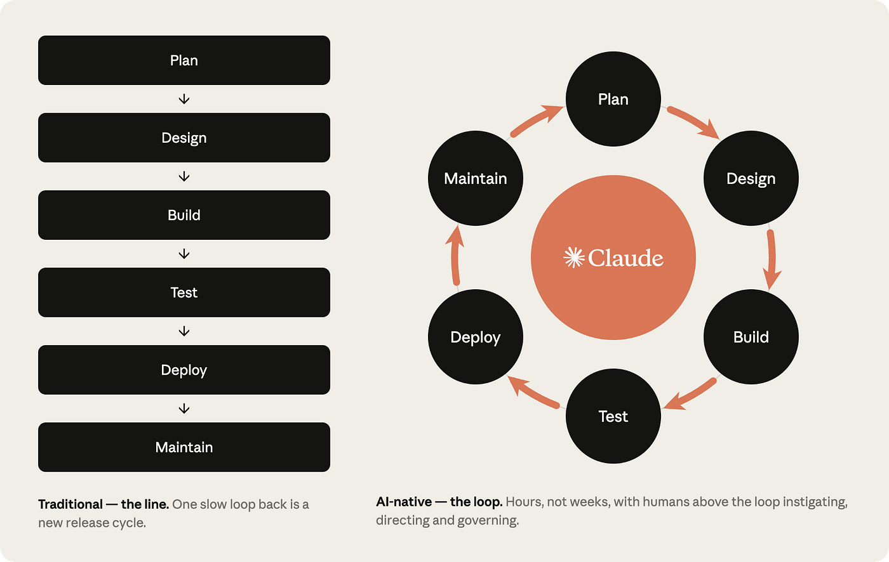
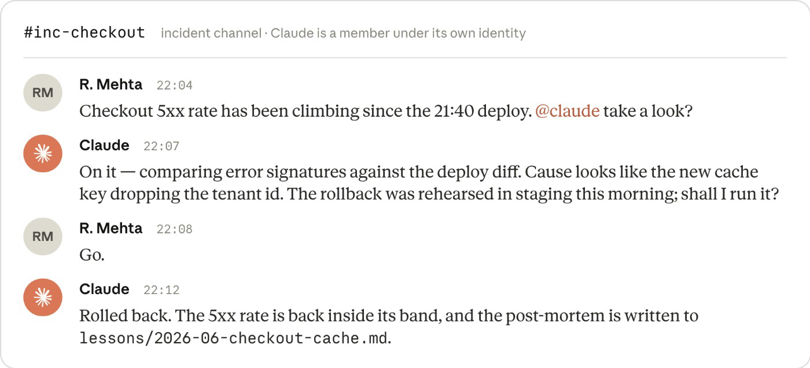

# Versionierte Übergaben verbinden schnelle Agenten mit menschlicher Abnahme

Schneller erzeugter Code beschleunigt die Auslieferung nur, wenn Planung, Review und Betrieb anschließen können. Vateo beschreibt dafür einen Entwicklungsprozess mit gemeinsamen Datei-Artefakten, überprüfbaren Übergaben und begrenzter Agent-Autonomie. Der Beitrag ist eine Sekundärdarstellung des Anthropic-Playbooks, ergänzt um eigene Praxiseindrücke; er liefert keine unabhängige Produktivitätsmessung.

## Dateien als Übergabevertrag

Die sechs Phasen Plan, Design, Build, Test, Deploy und Maintain bleiben erhalten. Ihre Verbindung verändert sich: Ein versioniertes Ergebnis dient als Eingang der nächsten Phase. Die beschriebene Kette führt von `intent.md` über `spec.md` und `plan.md` zu Code, Tests und Review-Befunden; ein Produktionsvorfall erzeugt anschließend einen neuen Intent.

Ein Intent hält Problem, gewünschtes Ergebnis, betroffene Menschen und Systeme, Grenzen und offene Fragen fest. Den Implementierungsplan prüft ein Engineer vor der Umsetzung: Er soll auch für jemanden verständlich sein, der am Gespräch nicht teilgenommen hat. Menschen entscheiden weiterhin über Ziel, Risiko und Autorisierung. Git dokumentiert die Artefaktgeschichte, ersetzt aber nicht die fachliche Abnahme.

Der Artikel nennt 16 Plays in sechs Phasen. Die Einstiegsgrafik staffelt die Einführung über fünf Ebenen: Intent, `CLAUDE.md`, Feedback, Hooks und Plan Mode stehen am Anfang; Skills, Subagents und Evals bauen darauf auf; danach folgen Design und PR-Review, CI/CD und schließlich die Rückkopplung aus dem Betrieb. Das ist ein Abhängigkeitsvorschlag, kein Nachweis, dass jedes Team dieselbe Reihenfolge braucht.

## Nachweise für Code und Agent-Konfiguration

Vor einer Übergabe sollen Build, Tests und gegebenenfalls UI-Screenshots vorliegen. Bei Bugfixes schlägt der Beitrag zuerst einen fehlschlagenden Regressionstest vor, den der Agent während der Reparatur nicht verändern darf. Zusätzlich sollen Änderungen an `CLAUDE.md`, Skills oder Hooks gegen eine Sammlung von 20–50 historischen Aufgaben geprüft werden. Produktionsvorfälle erweitern diese Eval-Sammlung.

Skills vermitteln Regeln; Hooks sollen konkret prüfbare Grenzen technisch durchsetzen. Die zugespitzte Behauptung des Beitrags, Hooks machten Regelkonformität sicher, ist damit nicht belegt. Ein Hook kann nur seine implementierte Bedingung und die erfassten Ausführungspfade kontrollieren.

## Betrieb mit abgestuften Rechten

Deterministische Überwachung soll Abweichungen erkennen, bevor ein Modell hinzukommt. Die vorgeschlagenen Stufen lauten: bei `1σ` protokollieren, bei `2σ` ausschließlich diagnostizieren und bei `3σ` einen PR öffnen oder ein vorab freigegebenes Runbook auslösen. Diese Schwellen sind ein Entwurf, keine universell validierten Alarmwerte.

Die Abbildung zeigt einen Deploy um 21:40, die Anfrage um 22:04, eine Diagnose um 22:07, menschliche Zustimmung um 22:08 und den gemeldeten Rollback um 22:12. Als Ursache nennt sie einen Cache-Key ohne Tenant-ID. Die Zeitfolge illustriert die Abnahmegrenze; die Darstellung allein belegt keinen unabhängig geprüften Produktionsvorfall.

## Einordnung

Übertragbar sind explizite Übergabeverträge, getrennte Planprüfung und Evals für die Agent-Konfiguration. Der Artikel verknüpft bereits bekannte Methoden, statt eine vollständig neue Arbeitsweise zu belegen. Die genannte Quote von über 80 % durch Claude geschriebenem, gemergtem Code ist eine weitergegebene Herstellerangabe und keine Messung des gesamten Lieferprozesses. Versionierte Dokumente, gepflegte Evals und getestete Rollbacks verursachen laufenden Aufwand. Der Nutzen muss sich an Durchlaufzeit, Fehlern und Nacharbeit zeigen; schnellere Codeerzeugung allein reicht dafür nicht.

## Kernaussagen

- Versionierte Übergaben und eine vorab geprüfte Umsetzungsskizze begrenzen implizite Entscheidungen → [[Plan-first-mit-getrenntem-Review]].
- Auch Änderungen an Regeln, Skills und Hooks brauchen historische Prüfaufgaben → [[Skill-Qualitaet-durch-Trigger-und-Baseline-Evals]].
- Deterministische Erkennung und vorab begrenzte Reaktionsrechte verbinden Betrieb mit der nächsten Entwicklungsrunde → [[Metrikband-gestufte-Agent-Autonomie]].

## Verbindungen

- [[Handoff-Doc]]
- [[Plan-first-mit-getrenntem-Review]]
- [[Metrikband-gestufte-Agent-Autonomie]]
- [[2026-09-20-eric-tech-claude-code-the-complete-ai-native-sdlc-guide]]
