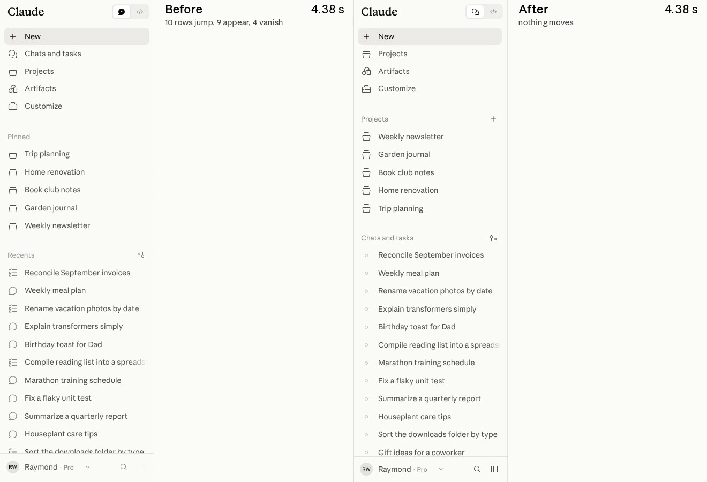

# Performance-Agenten brauchen validierte Messgrößen und geschützte Gewinne

Raymond Wang beschreibt einen zweiwöchigen Performance-Sprint bei Anthropic im August 2026. Der übertragbare Kern ist eine Mess- und Review-Schleife: relevante Nutzerabläufe instrumentieren, Laborwerte gegen reale Latenz prüfen, kleine Änderungen ausrollen und belegte Verbesserungen gegen Regression absichern. Die Ergebnisse stammen aus einem Herstellerbericht und wurden hier nicht unabhängig reproduziert.

## Nutzerabläufe bestimmen das Optimierungsziel

Vier Abläufe machten laut Bericht 95 % der Aktivität aus: App öffnen, Unterhaltung starten, bestehende Unterhaltung laden und Nachricht senden. Dreizehn vergleichbare Messungen starteten jeweils mit einer Nutzerinteraktion und endeten mit dem gerenderten Ergebnis; Client- und Serverarbeit wurden getrennt.

Für das 75. Perzentil nennt der Bericht beim frischen Laden eine bis zur Eingabebereitschaft gemessene Verkürzung von 3,1 auf 0,55 Sekunden, beim Start einer `Claude Code`-Session von 0,8 auf 0,3 Sekunden und bei einer `Cowork`-Cloud-Session von 2,6 auf 0,73 Sekunden. Das ist keine allgemeine Beschleunigung jedes Ablaufs um denselben Faktor.

## Ein Proxy muss seinen Bezug zur Nutzererfahrung beweisen

Reale Laufzeit schwankt als CI-Signal. Das Team erprobte deshalb Instruktionszahlen, React-Commits, Style-Neuberechnungen und DOM-Mutationen. Unzuverlässige Messungen oder Proxys ohne nachgewiesenen Zusammenhang mit Nutzerlatenz wurden verworfen.

Bei zwei JavaScript-Pfaden sanken Instruktionszahlen laut Bericht um 48 % und 31 %, die Laufzeit um 78 % und 44 %. Erst nach diesem Abgleich wurden die Zählwerte als CI-Obergrenze festgeschrieben. Ein täglicher Job senkte die Grenze bei weiteren Verbesserungen; spätere Erhöhungen ließen PRs scheitern. Eine niedrigere Zahl allein rechtfertigte keine Übernahme.

## Kleine Schleifen mit realer Rückkopplung

Ein eng begrenzter Thread begann mit einem langsamen Ablauf oder einer Aufnahme. Der Agent baute eine reproduzierbare Messung, schlug risikogerecht kleine PRs vor und beobachtete nach dem Rollout die Felddaten. Ein bestätigter Gewinn wurde abgesichert; ohne Gewinn wurde das Feature-Flag abgeschaltet und weiter untersucht.

Beim späten Springen der Sidebar übersah die bestehende CLS-Schwelle kleine, störende Verschiebungen. Neue Telemetrie unterschied Region und Zeitpunkt. Ein gezielter Integrationstest schlug vor der Korrektur 20 von 20 Mal fehl und bestand danach 20 von 20 Mal. Felddaten zeigten laut Bericht bei 31 % der Seitenaufrufe Bewegung nach Eingabebereitschaft.

## Menschen verantworten Geschmack, Risiko und Komplexität

Jeder PR benötigte mindestens eine menschliche Zustimmung. Nutzerwirksame Änderungen erhielten kurzlebige Flags; riskante Änderungen liefen zuerst intern, danach bei 1 % und schließlich breiter. Für einen statischen Composer prüften Tests unter anderem 14 Viewports mit höchstens einem Pixel Abweichung sowie verlorene oder vertauschte Tastatureingaben.

Headless-Tests übersahen dennoch einen Layoutsprung durch Chromes spekulatives Laden mit wechselnder Browserfläche. Erst eine reale Aufnahme machte ihn sichtbar. Ein benannter Mensch pro Thread entschied über sichtbare Änderungen und Wartungskosten; ein 900-Zeilen-PR für zwei Millisekunden Gewinn wurde abgelehnt.

## Einordnung

Die Methode verbindet zuverlässige Labormessung, Produktionsbezug und menschliche Abnahme. Die berichteten mehr als 3.000 Änderungen ohne kundenwirksamen Vorfall oder Rollback sind eine Selbstauskunft, keine allgemeine Sicherheitsgarantie. Mehr als 150 parallele Threads und umfangreiche Telemetrie setzen erhebliche Infrastruktur- und Review-Kapazität voraus. Der Bericht bezeichnet die Arbeit ausdrücklich nicht als autonom; auch gute CI-Proxys können reale Browserbedingungen verfehlen.

## Kernaussagen

- Nur gegen Nutzerwirkung validierte Proxys optimieren und gewonnene Qualität absichern → [[Hillclimbing-mit-Holdout-Split]]
- Tests aus tatsächlich beobachteten Fehlern und Zielumgebungen ableiten → [[Testharness-als-staerkster-Hebel]]
- Reale Aufnahmen ergänzen Headless- und Zahlenprüfungen → [[Visuelle-Abnahme-mit-Live-Lokal-Vergleich]]

## Verbindungen

- [[Hillclimbing-mit-Holdout-Split]]
- [[Testharness-als-staerkster-Hebel]]
- [[Visuelle-Abnahme-mit-Live-Lokal-Vergleich]]
