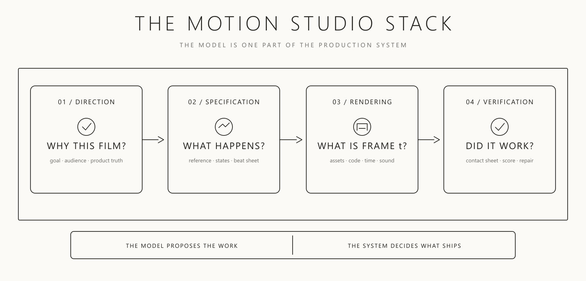

# Ein Motion-Studio braucht überprüfbare Produktionsstufen

rari entwirft einen wiederverwendbaren Prozess für Code-Videos: Brief, belegte Assets, Zustände und Beats, deterministischer Renderer, visuelle Reparatur und Exportabnahme. Der Artikel ist ein konzeptioneller Vorschlag mit Schaubildern; er liefert keinen dokumentierten Produktionslauf oder gemessenen Vergleich der beworbenen Modellleistung.

## Einordnung

Die eigene fachliche Bewertung: Der Nutzen liegt im expliziten Übergang zwischen Produktionsartefakten, damit ein langer Agent-Lauf an einer überprüfbaren Stelle weiterarbeitet. Die Trennung von Produktfakten und filmischer Gestaltung begrenzt erfundene Interfaces. Framezugriff und lokale Reparatur machen die vorgeschlagene Methode konkreter als einen allgemeinen Review-Aufruf. Ein Contact Sheet zeigt jedoch nur ausgewählte Zustände, und ein selbst erzeugtes Score ersetzt keine unabhängige Wirkungsprüfung. Die Quelle zählt fünf Schichten, das zugehörige Schaubild zeigt vier; vor einer Übernahme müssen die tatsächlichen Stufen eindeutig benannt werden. Aussagen zu `Opus 5.5` bleiben Quelleneinordnung, keine hier getestete Modellbewertung.

## Kernaussagen

- **Brief und Assetliste zuerst abnehmen.** Zielgruppe, eine erinnerbare Botschaft, reale Produktscreens, Logo, Referenz und Ausschlusskriterien festhalten. Gestalterische Vorschläge dürfen Produktdaten nicht ersetzen. Fehlt ein vorgeschriebener Screenshot, ist das eine Eingabelücke statt einer Einladung zur Erfindung. Das konkretisiert [[Brand-Kit-als-gemeinsame-Artefaktbasis]] für Bewegtbild.
- **Die Geschichte als Zustandsfolge beschreiben.** Jeder Beat bekommt Ein- und Ausgangszustand sowie einen kommunikativen Zweck. Dasselbe Produktobjekt kann Position, Größe oder Inhalt wechseln, soll dabei wiedererkennbar bleiben. Die Zeitplanung ist damit ein Vertrag über sichtbare Bedeutung, nicht nur eine Liste von Effekten.
- **Beliebige Frames direkt abrufen können.** Rendererwahl nach dem nächsten wiederkehrenden Einsatz treffen; kleine Filme können mit Canvas oder SVG auskommen, Serien von expliziter Szenenstruktur profitieren. Der vorgeschlagene Vertrag berechnet den Frame aus Spezifikation, Assets, Stil, Zeit und Seed. Eine Animation, die erst nach acht Sekunden Browserlauf den richtigen Zustand erreicht, erfüllt ihn nicht.
- **Die Abnahme zeitlich auflösen.** Pro wichtigem Beat ein Bild und um schnelle Übergänge eine dichte Framefolge rendern. Lesbarkeit, Überschneidungen, Blickführung und Kontinuität an benannten Stellen prüfen; dann begrenzt reparieren und erneut ansehen. Wie bei [[Visuelle-Abnahme-mit-Live-Lokal-Vergleich]] zählt das sichtbare Resultat, ergänzt um Playback und Sound.
- **Formate aus der Komposition ableiten.** Für `16:9` und `9:16` können Schrift, gleichzeitige Inhalte, Kamera und Erzähltempo unterschiedlich ausfallen. Dieselben Assets und Zustände nutzen, aber Layoutregeln pro Format festlegen und jedes Ergebnis prüfen. Das bloße Zuschneiden eines bereits abgenommenen Films reicht im vorgeschlagenen Prozess nicht.
- **Den nächsten Lauf aus Dateien starten lassen.** Brief, Assetliste, Timeline, Rendervertrag, Reviewbefunde und Lieferung aufbewahren. Vor jedem Übergang muss klar sein, welches Artefakt geprüft ist und welche Eingabe fehlt. Ein erfolgreicher Encoderlauf belegt die Dateierzeugung, nicht die Abnahme.

Das Schaubild zeigt vier Stufen. Eine weitere Illustration verteilt eine Geschichte auf fünf Beats von 0 bis 16 Sekunden; das sind Beispielintervalle, keine gemessenen Empfehlungen zur optimalen Filmlänge.

## Medien und Prüflücken

Alle vier lokalen Bilder wurden geprüft. Sie erläutern Prozess und Framezugriff, zeigen jedoch weder einen vollständigen Beispielrenderer noch einen abgenommenen Film. Im Textexport fehlen angekündigte Prompt- und Vertragsblöcke. Der Vorschlag für Sound verlangt Anhören und gemeinsame Zeitmarken, spezifiziert aber keine nachgewiesene Synchronisationsmessung. Die Marketingaussage, ein Studio verbessere zuverlässig den zehnten Clip, ist eine plausible Zielsetzung ohne vorgelegte Erfolgsreihe.

## Verbindungen

- [[Brand-Kit-als-gemeinsame-Artefaktbasis]]: Gemeinsame Markenbasis ergänzen um echte Produktassets und benannte Entscheidungsgrenzen.
- [[Visuelle-Abnahme-mit-Live-Lokal-Vergleich]]: Bildbelege und Nachprüfung auf Frames, Übergänge und Ausgabeformate übertragen.
- [[Framebasierte-Motion-Produktion-mit-Brief-und-Abnahme]]
