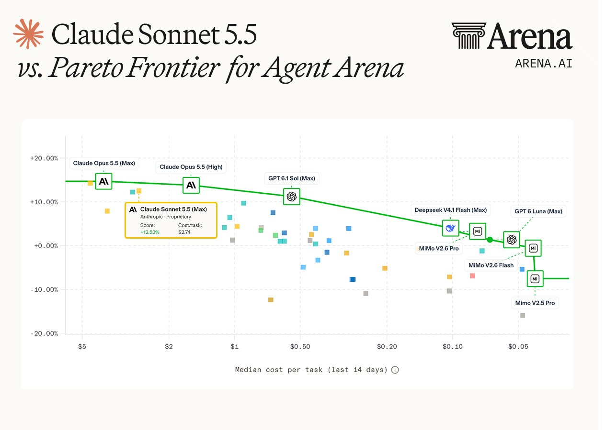

# Sonnet 5.5 liegt außerhalb der Agent-Arena-Paretofront

Der Arena-Post vom 02.10.2026 erläutert die Preis-Leistungs-Einordnung von `Claude Sonnet 5.5`. Die beigefügte Grafik zeigt einen Betreiber-Snapshot; eine unabhängige Messung oder vollständige Methodik liegt hier nicht vor.

## Datierter Messstand

Der Text nennt Rang 3, +12,5 % „Net Improvement“ und median `2,74 USD` je Aufgabe für `Sonnet 5.5`. Der Tooltip spezifiziert die Variante als `Claude Sonnet 5.5 (Max)` und zeigt den genauer ausgewiesenen Score von +12,52 %. Die Kostenachse bezieht sich ausdrücklich auf den Median der letzten 14 Tage; es handelt sich nicht um einen Tokenpreis.

Laut Text erzielt `Claude Opus 5.5` auf Rang 2 einen höheren Score bei `1,58 USD` je Aufgabe. Dadurch liegt Sonnet im dargestellten Kosten-Score-Vergleich außerhalb der Paretofront.

Die Grafik beschriftet allerdings den führenden, teuersten Punkt als `Claude Opus 5.5 (Max)`, während die zeitgleiche Gesamtrangliste im verknüpften Arena-Post `Claude Fable 5.1 (Max)` führt. Diese Abweichung wird nicht stillschweigend korrigiert. Eine Harness-Version, Baseline-Definition und Stichprobengröße sind nicht angegeben.

## Kernaussagen und Einordnung

Die Quelle illustriert einen datierten Zielkonflikt zwischen Kosten und Arena-Score. Sie wiederholt die Sonnet-Ergebnisse des parallelen Betreiberposts und zählt nicht als unabhängiger zweiter Leistungsnachweis.

## Verbindungen

- [[2026-10-02-arena-2106104809514516541]]: Begleitpost mit Gesamtrangliste und widersprüchlicher Modellbeschriftung.
- [[Modell-Eskalation-von-guenstig-nach-teuer]]: Kosten und Leistung gemeinsam betrachten; der Snapshot begründet keine heutige Modellauswahl.
