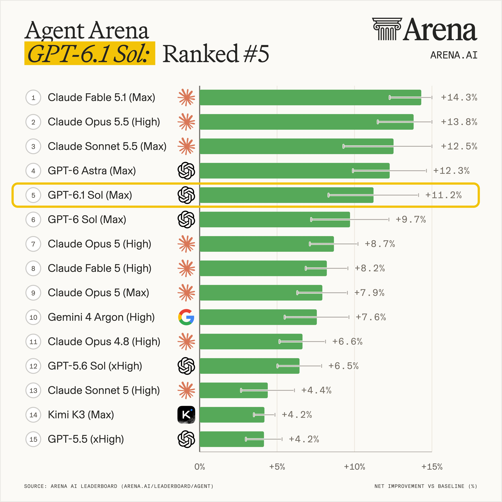
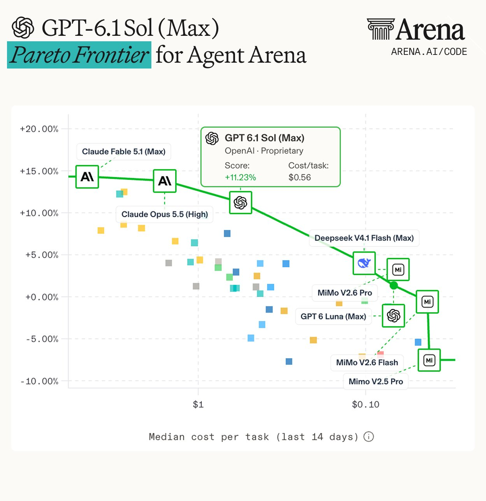

# GPT-6.1 Sol erreicht die Agent-Arena-Paretofront

Arena meldet am 02.10.2026 Rang 5 für `GPT-6.1 Sol (Max)` und zeigt Rangliste sowie Kosten-Score-Grafik. Das ist ein datierter Betreiberbericht; Harness-Version, Stichprobe und genaue Baseline sind im Archiv nicht dokumentiert.

## Datierter Messstand

Text und Pareto-Tooltip weisen +11,23 % „Net Improvement“ aus; die Rangliste rundet auf +11,2 %. Der Tooltip nennt median `0,56 USD` pro Aufgabe. Die Kostenachse umfasst die letzten 14 Tage und beschreibt Aufgabenkosten, keine API-Tokenpreise.

Innerhalb dieses Arena-Snapshots berichtet der Text gegenüber `GPT-6 Sol (Max)` 39 % geringere Kosten bei 1,52 Prozentpunkten höherem Score. Gegenüber `GPT-6 Astra (Max)` seien es 81 % geringere Kosten bei 1,04 Prozentpunkten Abstand. Für `Claude Fable 5.1 (Max)`, `Claude Opus 5.5 (High)` und `Claude Sonnet 5.5 (Max)` nennt er Kostenabschläge von 88 %, 65 % beziehungsweise 80 %. Diese Prozentangaben sind gerundete Betreiberangaben.

## Kernaussagen und Einordnung

Der Pareto-Status gilt für die dargestellten Kosten und Arena-Scores. Er lässt sich weder auf andere Harnesses noch auf jede reale Aufgabe übertragen. Die Pareto-Bilder der beiden Posts sind nicht vollständig deckungsgleich: `GPT-6 Luna (Max)` erscheint in der Pareto-Grafik unter 0 %, im anderen Sonnet-Pareto-Snapshot desselben Tages oberhalb von 0 %. Die Abweichung betrifft einen Nebenpunkt, bleibt aber offen.

## Verbindungen

- [[Modell-Eskalation-von-guenstig-nach-teuer]]: Leistungsziel und Aufgabenkosten gemeinsam abwägen.
- [[2026-10-02-arena-2106105400487821764]]: Paralleler Kosten-Snapshot mit abweichender Nebenpunktdarstellung.
