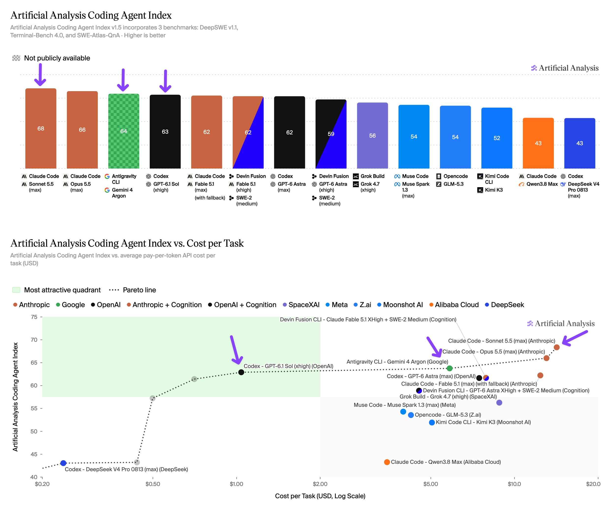

# Coding-Agenten: Leistung und Aufgabenpreis im Oktober 2026

Artificial Analysis veröffentlichte am 02.10.2026 eigene Benchmarkmessungen, keine Hersteller-Selbstauskunft. Text und Grafik stimmen bei den drei hervorgehobenen Ergebnissen überein. Die Grafik präzisiert den **Coding Agent Index auf `v1.5`** mit `DeepSWE v1.1`, `Terminal-Bench 4.0` und `SWE-Atlas-QnA`.

## Datierte Messungen

| Modell und Harness | Indexpunkte | Durchschnittliche API-Kosten je Aufgabe |
|---|---:|---:|
| `Claude Sonnet 5.5 (max)` in `Claude Code` | 68 | `14,19 USD` |
| `Gemini 4 Argon (high)` in `Antigravity CLI` | 64 | `5,84 USD` |
| `GPT-6.1 Sol (xhigh)` in `Codex` | 63 | `1,04 USD` |

Die Kosten bezeichnen gemessene Pay-per-Token-API-Kosten dieses Tests, keine Abopreise. Für `Argon` gelten Googles Aktionspreise; das Modell war laut Quelle am 02.10.2026 noch nicht öffentlich verfügbar.

## Einordnung und Kernaussagen

- Der Index bewertet **Modell plus Harness**, nicht isolierte Modelle. Die Messreihe belegt einen Zielkonflikt zwischen gemessenem Score und Aufgabenpreis.
- Die Konfiguration mit 68 Punkten kostet in dieser Reihe deutlich mehr als die mit 63 Punkten. Daraus folgt keine allgemeine Rangfolge für reale Projektaufgaben oder andere Harnesses.
- Der Befund dokumentiert den Quellenstand vom 02.10.2026 und liefert keine heutige Kauf- oder Modellwahl-Empfehlung.

## Verbindungen

- [[Modell-Eskalation-von-guenstig-nach-teuer]]: Aufgabenpreis und Leistungsgewinn getrennt bewerten.
- [[2026-09-30-artificialanlys-2105392625788637299]]: weitere datierte Benchmarkquelle; Ergebnisse nur mit passendem Testkontext einordnen.
