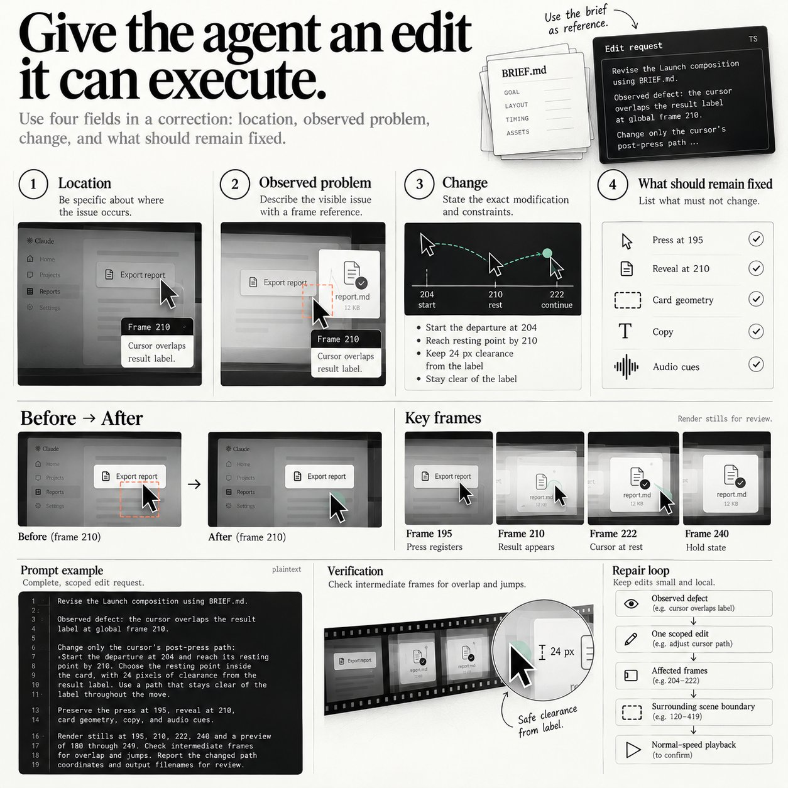

# Launch-Videos werden durch Ereignisframes und begrenzte Reparaturen abnehmbar

beamnxw beschreibt eine kleine Remotion-Produktion rund um eine reale Produktaktion, mit Referenzanalyse, Brief, Stills, Playback und finalem Exportcheck. Die Anleitung und Infografiken machen Kontrollpunkte greifbar; sie belegen weder bezahlte Kundenaufträge noch die Wirtschaftlichkeit des vorgeschlagenen Angebots mit `Opus 5.5`.

## Einordnung

Die eigene fachliche Bewertung: Besonders brauchbar sind die Trennung gemessener Werte von visuellen Schätzungen und die vier Felder einer ausführbaren Korrektur. Die Lesbarkeit längster Texte sowie benachbarte Szenengrenzen werden ausdrücklich vor einem vollständigen Render geprüft. Das ergänzt allgemeine visuelle Abnahme um einen Filmvertrag mit Ereignissen und Zustandsübergängen. Drei Stills allein können Timing, Sound und kurze Kollisionen nicht nachweisen, weshalb Playback Teil der Methode bleiben muss. Die lokalen Bilder sind Anleitungen und Dokumentationsscreenshots, kein abgenommener Launch-Clip. Pilotpreis und Verkaufsversprechen sind Vermarktungshypothesen ohne gemessenen Aufwand oder Kundennachweis.

## Kernaussagen

- **Die Referenz auf einen Zweck begrenzen.** Eine Kartenlandung, einen Übergang oder die Reaktion auf einen Cursor analysieren. Zwei Bilder pro Sekunde geben einen Überblick; um Schlüsselereignisse braucht es aufeinanderfolgende Originalframes mit Zeitmarken. Framerate, tatsächliche Messung, visuelle Schätzung und eigene Gestaltungsentscheidung getrennt festhalten, statt geschätzte Koordinaten als Präzision auszugeben.
- **Eine Aktion als Geschichte planen.** Ausgangszustand, Cursor, Press, Ergebnis und Lesefenster benennen. Im ausgearbeiteten Brief stehen 20 Sekunden, `1080 × 1080`, 30 Bilder pro Sekunde und 600 Frames. Die Produktszene läuft von Frame 120 bis 419; Press bei 195, Ergebnis ab 210, lesbarer Zustand ab 234, Schluss ab 420. Das Lesefenster beginnt erst mit tatsächlich lesbarem Text.
- **Layout vor Motion stabilisieren.** Längste erwartete Headline und längsten Produktnamen mit tatsächlicher Schrift rendern. Breite, Zeilenlimit, Logoplatz und Endpositionen dokumentieren; bei Überlauf Copy oder Layout korrigieren. Ein geändertes Wort kann die vorherige Abnahme entwerten. Das erweitert [[Brand-Kit-als-gemeinsame-Artefaktbasis]] um wiederverwendbare Grenzen statt nur Farben und Fonts.
- **Framezustände reproduzierbar halten.** Die Quelle verwendet `useCurrentFrame()`, Interpolation beziehungsweise Springs und festen Seed. Eintritt, Ziel, Dauer und Landung zusammen ablegen. Lokale und globale Frames ausdrücklich unterscheiden: Start bei global 120 plus lokal 30 ergibt global 150. Diese Zuordnung verhindert Reparaturen an der falschen Stelle.
- **Eine Reparatur mit vier Feldern beauftragen.** Ort, sichtbarer Fehler, konkrete Änderung und unveränderliche Elemente nennen. Das Beispiel korrigiert einen Cursor bei globalem Frame 210 und erhält Press bei 195, Reveal bei 210, Kartengeometrie, Copy und Audio. Danach betroffene Zwischenframes, Nachbargrenzen und normales Playback prüfen. Das macht [[Visuelle-Abnahme-mit-Live-Lokal-Vergleich]] für zeitabhängige Artefakte ausführbar.
- **Nur den tatsächlich geprüften Export liefern.** Bild und Sound zunächst getrennt abstimmen, dann die codierte Datei mit Kopfhörern und Telefonlautsprecher prüfen. Metadaten können Größe, Framerate und Dauer bestätigen; sie ersetzen das vollständige Anschauen nicht. Der Vorschlag begrenzt das erste Angebot auf eine Funktion, einen Film, ein Cover und eine Korrekturrunde. `150 US-Dollar` ist ausdrücklich ein illustrativer Testpreis; Vorbereitung, Feedback und Renderzeit müssen erst vollständig erfasst werden.

## Medien und Prüflücken

Alle 15 lokalen Bilder wurden angesehen. Sie enthalten unterschiedliche illustrative Timelines: Das Angebotsbild schließt ab Sekunde 16, der ausgearbeitete Framebrief ab Sekunde 14. Deshalb ist vor Umsetzung genau eine Timeline zu wählen; die Bilder dürfen nicht ungeprüft vermischt werden. Der Textexport lässt angekündigte Befehlsblöcke aus, während einzelne Screenshots Befehle zeigen; eine vollständige reproduzierbare Projektdatei oder ein Video liegt hier nicht vor. Die dargestellten Produktoberflächen und Launch-Termine sind Beispiele, keine verifizierten Funktionen oder Kundenfälle.

## Verbindungen

- [[Visuelle-Abnahme-mit-Live-Lokal-Vergleich]]: Konkrete Fehlerbelege, lokale Reparatur und erneute Sichtprüfung.
- [[Brand-Kit-als-gemeinsame-Artefaktbasis]]: Gemeinsame Assets um Copy-, Layout- und Ereignisgrenzen erweitern.
- [[Framebasierte-Motion-Produktion-mit-Brief-und-Abnahme]]
