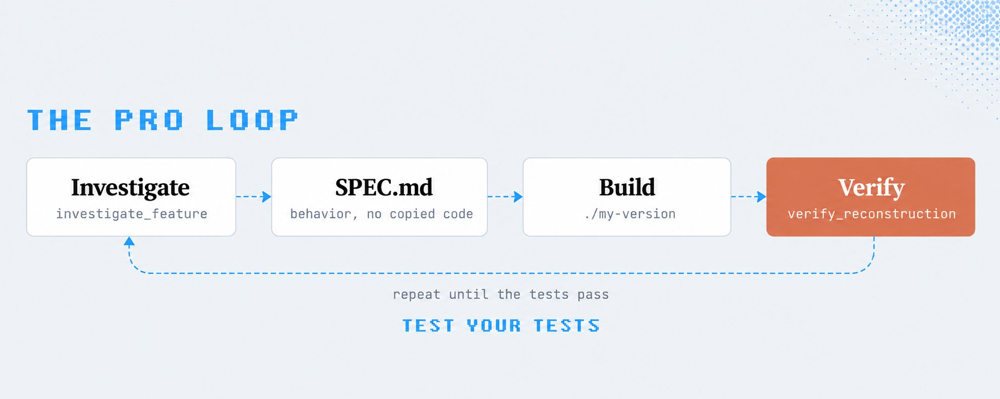

# Reverse Engineering braucht eine überprüfbare Verhaltensspezifikation

Der übertragbare Kern von Codilas REA-Kurs ist die Kette Untersuchung → Verhaltensspezifikation → eigene Implementierung → Vergleichstest. Die Beleglage besteht aus Autorbehauptungen, referenzierten Projekt-Showcases, Drittposts und erläuternden Grafiken; eine unabhängige Durchführung fehlt. Virale Reichweite und wiederholte Behauptungen sind keine Funktionsnachweise.

## Vom einzelnen Feature zur prüfbaren Rekonstruktion

Codila beschreibt REA als lokalen MCP-Server mit CLI für Coding-Agenten. Ausgangspunkt soll eine begrenzte Frage sein: Was passiert beim Notizexport? Im beschriebenen Übungsbeispiel verfolgt der Agent `renderer.js` über `preload.js` und die IPC-Nachricht `notes:export` zu `main.js` und einer CSV-Datei im Downloads-Ordner. Das ist ein berichteter Beispielpfad, kein hier reproduziertes Ergebnis.

Daraus lässt sich eine Arbeitsroutine ableiten:

1. Ein Feature und dessen beobachtbares Ergebnis abgrenzen.
2. Dateien, Funktionen, Aufrufe und verbleibende Unbekannte festhalten.
3. In `SPEC.md` Verhalten, Eingaben, Ausgaben und Grenzfälle beschreiben.
4. Eine eigene Implementierung anhand dieser Beschreibung erstellen.
5. Gegen beobachtetes Referenzverhalten prüfen und auch den Vergleichsmechanismus testen.

Der Autor nennt dafür `investigate_feature`, `verify_reconstruction` und `audit_residual_unknowns`; Verfügbarkeit und Wirkung wurden hier nicht getestet. Seine wichtigste Prüfregel: Agentenerklärungen bleiben Hypothesen. Er berichtet von einer fehlerhaften Vergleichsprüfung, die eine falsche Funktion akzeptierte.

Die Grafik erklärt den vorgeschlagenen Ablauf; sie dokumentiert keinen erfolgreichen Lauf.

## Voraussetzungen, Aufwand und technische Grenzen

Laut Artikel benötigen JavaScript-/Electron- und .NET-Ziele keine zusätzliche Analyse-Engine; native Programme benötigen Ghidra, Hopper oder IDA, Android-Pakete JDK und JADX. Webseiten setzen einen Chrome-basierten Browser voraus, EVM-Bytecode Linux x64. Windows-Ghidra bezeichnet der Autor als experimentell und nur lesend. Die Anleitung verlangt passende Node-Versionen sowie einen kompatiblen Agenten und beschreibt Setup-Plan, Freigabe, Neustart und Diagnose als getrennte Schritte.

„Absolut kostenlos“ widerspricht bereits dem im Artikel genannten bezahlten Claude-Zugang und kommerziellen Engine-Lizenzen. Auch Ressourcenbedarf bleibt: @chasemdev nennt für einen unfertigen Super-Mario-Sunshine-Port ungefähr 365 Agentenstunden und 17,3 Milliarden Tokens; diese eingebettete Selbstauskunft wurde nicht reproduziert und ist kein typischer Aufwandsschätzer.

Der Artikel grenzt lokale Artefakte von nicht ausgeliefertem Servercode ab, unterscheidet Rekonstruktion von Originalquelltext und nennt schwierige Binärziele sowie mögliche Modellablehnungen. Die Behauptung, alles bleibe lokal, enthält keinen Nachweis über Datenwege des angeschlossenen Agenten.

## Fremdbelege und Zusatzartikel getrennt lesen

ArtCraft-Screenshots zeigen Produktankündigungen mit Alpha-/Entwicklungsmarkierungen, keine geprüfte Funktionsgleichheit mit Adobe oder Office. @RohOnChain wirbt mit kostenlosen TradingView-Premiumindikatoren; Codila grenzt seinen Vorschlag dagegen auf einen eigenen Nachbau ein. Der mitarchivierte Jev-Artikel stammt von @RohOnChain: deterministische Zustandsberechnung, begrenzte Modellurteile, eigene Policy und harte Vetos sind dessen Architekturvorschlag. Anbieterbenchmark, Latenz-, Kosten- und Handelsversprechen bleiben unbestätigt; AgenKit-Werbung ist kein Produktionsnachweis.

## Einordnung

Nutzbar ist die überprüfbare Untersuchungsroutine, nicht das Versprechen, beliebige Produkte an einem Abend zu ersetzen. Codila nennt Clean-Room-Entwicklung und historische Rechtsfälle, behauptet im Thread zugleich pauschale Legalität; diese rechtlichen Aussagen wurden nicht geprüft. Sein vorgeschlagener Ablauf mit demselben Agenten dokumentiert die von ihm selbst beschriebene Trennung zweier Teams nicht. Daraus folgt hier keine rechtliche Bewertung oder Freigabe.

## Kernaussagen

- [[Codepfad-vor-Aenderung-nachvollziehen]]: Featurewissen an konkrete Übergänge und offene Annahmen binden; REA-Ergebnisse bleiben ungeprüft.
- [[Testharness-als-staerkster-Hebel]]: Rekonstruktionen und ihre Verifier getrennt prüfen; berichtete Showcase-Ergebnisse sind keine unabhängige Bestätigung.

## Verbindungen

- [[Codepfad-vor-Aenderung-nachvollziehen]] liefert die Struktur für eine kleine Untersuchungsfrage.
- [[Testharness-als-staerkster-Hebel]] macht aus der Verhaltensbeschreibung ein überprüfbares Abnahmekriterium.

## Archivgrenzen

Der Hauptartikel liegt mit separaten Codeblöcken vor; Bild- und Blockpositionen sind unbekannt. Von seinen direkten Einbettungen sind laut Archiv 12/13 abrufbar: `2091221918561317355` fehlt mit Authorization Error. Drei unmittelbare Zitate wurden nachgeladen; weitere Zitate enthalten nur mitgelieferten Text. Vier tiefere Einbettungen des Jev-Artikels bleiben Links. Alle referenzierten Bilder wurden gesichtet, detailreiche Grafiken und Screenshots zusätzlich einzeln; lokale MP4s wurden weder transkribiert noch inhaltlich verifiziert.
