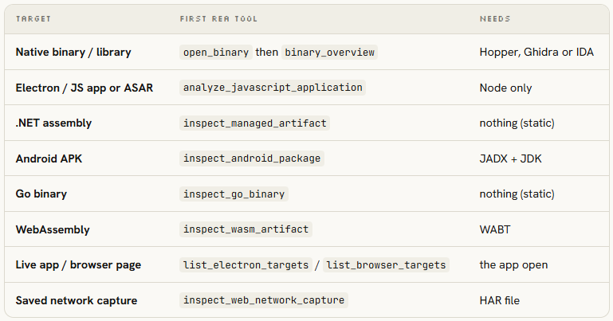

# Binäranalyse mit kleinen Belegschritten und Verhaltensvergleichen steuern

Movez beschreibt einen Workflow, in dem `Opus 5.5` über REA spezialisierte Analysewerkzeuge bedient und Erkenntnisse schrittweise in eine Spezifikation und Reimplementierung überführt. Nutzbar sind die vorgeschlagenen Arbeitsverträge; universelle Rekonstruierbarkeit, Produktgleichwertigkeit und Erfolgszahlen bleiben Autorbehauptungen. Eine unabhängige Durchführung fehlt.

## Zieltyp und Erkenntnisfrage zuerst begrenzen

Der Einstiegsprompt benennt Anwendung, absoluten Pfad und gesuchte Funktion. Erst Zieltyp bestimmen, dann einen kleinen Überblick abrufen: Architektur, Funktionen, Strings und Querverweise; tiefere Analysen nur für konkrete Lücken. Für Electron empfiehlt der Kurs JavaScript-/IPC-Analyse statt Disassemblierung, für native Programme Hopper, Ghidra oder IDA. Als Voraussetzungen nennt er `Node.js 22+`, npm und je nach Ziel zusätzliche Engines; die Befehle wurden hier nicht ausgeführt.

Das Belegprotokoll trennt Beobachtung, Schlussfolgerung und Unbekanntes; jede Aussage erhält Adresse, Bytes, Pseudocode oder Aufrufstelle. Statische Lektüre darf laut Originalregeln nicht als Laufzeitbeobachtung erscheinen. Sitzungen und vorhandene Analysen wiederverwenden, statt identische Abfragen zu wiederholen. Hohe Querverweiszahlen dienen dem Autor zur Priorisierung; daraus allein folgt für die eigene Einordnung noch kein Verständnis der Zielfunktion.

## Annotation und Delegation mit gemeinsamen Verträgen

Der Worker-Prompt verlangt pro Funktion Adresse, Zweck, Konfidenz, verwendete und neue Strukturen, Rekonstruktion und Auffälligkeiten. Ein Controller verteilt Callgraph-Cluster, liefert bereits aufgelöste Strukturnamen mit und führt Ergebnisse zusammen. Unterhalb der vorgeschlagenen Konfidenzschwelle soll ein zweiter Durchgang gezielt Nachbarkontext erhalten. Solche Selbsteinschätzungen ersetzen keine Prüfung.

Die Aufträge sind allerdings uneinheitlich: Der Controller verteilt Cluster, während der Worker ausdrücklich nur eine Funktion bearbeitet. Diese Granularität wäre vor einer Übernahme festzulegen. Kosten werden nach Clustern protokolliert; bei Obfuskation empfiehlt Movez ein Ausgabenlimit je Funktion und frühes Abbrechen. Seine Elastic/Tigress-Grafik nennt durchschnittlich 2,39 US-Dollar je Erfolg und 4,83 je Fehlschlag; Methodik, Modellvergleich und Übertragbarkeit wurden hier nicht unabhängig geprüft. Das sind keine Budgetzusagen. Auch die behauptete Caveman-Rauschreduktion liefert keinen eigenen Wirksamkeitsnachweis.

## Verhalten spezifizieren und Abweichungen sichtbar machen

Der Spezifikationsprompt fordert Schnittstellen, Datenmodell, beobachtbare Funktionen, Formate, Fehlerverhalten und Testfälle; Adressen, dekompilierte Variablennamen und Assembly sollen darin fehlen. Ein anderer Kontext implementiert anschließend nur aus dieser Beschreibung.

Der vorgeschlagene Harness vergleicht Original und Nachbau mit denselben Normal-, Rand- und Fehlerfällen, möglichst bytegenau, sonst semantisch. Ergebnis sind Trefferquote, konkrete Abweichungen und Schweregrade. Die genannten 50 Eingaben sind eine Promptvorgabe, kein bestandener Testlauf. Auch der DX-Ball-Bericht mit 3.205 Tests und 63 reproduzierten Bytes bleibt ein zitierter Showcase, kein hier nachgestelltes Ergebnis.

## Einordnung

Die Stärke liegt im begrenzten Analyseauftrag mit Belegpflicht und Verhaltensvergleich. Movez’ rechtliche Zusicherung anhand von vier Clean-Room-Regeln wurde nicht geprüft; zugleich verbietet seine Regel das Disassemblieren, das frühere Kursschritte gerade verlangen. Der eingebettete @yuhasbeentaken berichtet separat, dass Opus ohne REA im eigenen Vergleich schneller fertig wurde; das ist ebenfalls ein Erfahrungsbericht. Die lokal geprüften ArtCraft-Screenshots kennzeichnen Produkte als „Early Alpha“ oder „In Development“ und belegen keine vollständigen Ersatzprodukte. Wiederholungen von Movez’ Produktversprechen in Zusatzposts sind keine unabhängigen Bestätigungen. Die Behauptung lokaler Verarbeitung schließt im Artikel ausdrücklich die an das Modell übermittelten Befunde aus.

## Kernaussagen

- [[Codepfad-vor-Aenderung-nachvollziehen]]: Erst Ziel und Belegstellen eingrenzen, dann vertiefen; Annotationen als Hypothesen behandeln.
- [[Kontrollierte-Agent-Parallelisierung]]: Gemeinsame Strukturnamen, begrenzte Rückgabeformate, Nachbarwissen und Verbrauchsprotokoll machen Delegation überprüfbarer.
- [[Testharness-als-staerkster-Hebel]]: Spezifikation und Abschluss hängen an beobachtbaren Verhaltensfällen, nicht am überzeugenden Pseudocode.

## Verbindungen

- [[Refactoring-mit-Verhaltensvergleich]] verbindet die Rekonstruktion mit der Prüfung gleicher Eingaben und expliziter Abweichungen.
- [[Handoff-Doc]] passt zur Übergabe einer eigenständig implementierbaren Spezifikation zwischen getrennten Kontexten.

## Archivgrenzen

Vollständig gelesen wurden der Haupttext, 13 getrennte Blöcke sowie eingebettete und zitierte Zusatztexte einschließlich des separaten Motion-Artikels. Alle 38 referenzierten Bilder wurden lokal gesichtet; detailreiche Charts und Screenshots zusätzlich im Original. Sechs direkte Embeds und drei unmittelbare Zitate sind archiviert, tiefere Verweise teils nur verlinkt. Artikelpositionen der Bilder und Blöcke fehlen; lokale Videos sind untranskribiert und inhaltlich unverifiziert. Weder REA noch Nachbauten wurden hier getestet.
