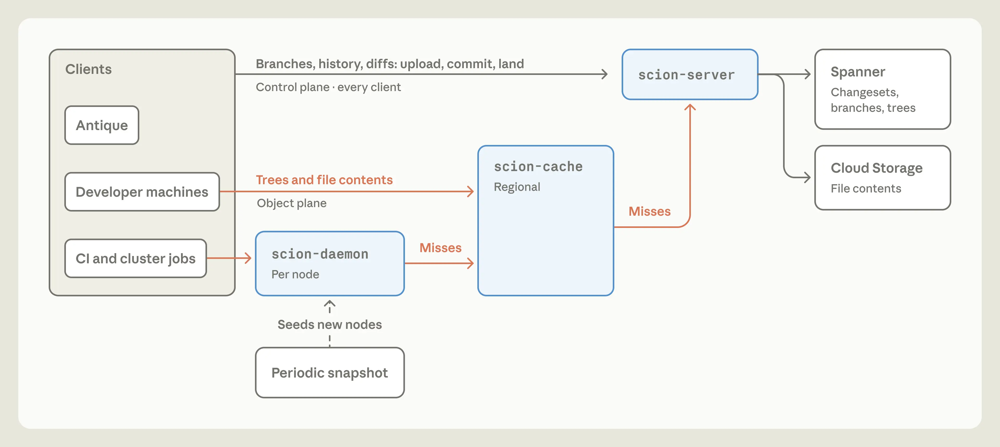

# Repository-Zugriff nach tatsächlichem Datenbedarf skalieren

Anthropic beschreibt mit Scion einen zentralen Source-Control-Dienst für extrem viele ständig verbundene Agenten und CI-Jobs. Der übertragbare Gedanke: Metadatenfragen ohne Checkout beantworten und Dateien nur bei tatsächlichem Bedarf übertragen. Architektur und Leistungsangaben stammen aus einem Hersteller-Selbstbericht vom 13. Oktober 2026, aktualisiert am 15. Oktober; eigene Messungen oder eine unabhängige Reproduktion fehlen.

## Der Engpass war wiederholter Repository-Zugriff

Anthropic nennt knapp 100 GB Main-Historie, über 25 GB komprimierte Arbeitskopie und ungefähr 25 Millionen tägliche CI-Checkouts. Die daraus abgeleiteten über 600 PB Git-Verkehr pro Tag beschreiben einen hypothetischen naiven Vollabruf, keine gemessene Verkehrsmenge. Shallow Clones, Sparse Checkouts, Promisor Remotes, mehrere hundert interne Mirrors und Snapshots im Blob-Speicher hätten Zeit gewonnen, aber mit steigendem Merge-Durchsatz zunehmend Betriebsaufwand verursacht.

Die entscheidende Annahmenänderung: Fast alle Clients seien ohnehin online. Vollständige lokale Historie und Offline-Rechenfähigkeit verlieren dann ihren Nutzen, während ständig wiederholtes Laden teuer bleibt.

## Changesets und abgeleitete Indizes statt vollständiger Klone

Scion erzeugt Changesets serverseitig als Einträge eines Write-ahead-Logs. Sie speichern geänderte Dateien relativ zum ersten Parent und inhaltsadressierte Verweise auf komprimierte Dateiinhalte. Bäume, Blame, Pfadhistorie und Commit-Graph-Indizes sind abgeleitete Daten, rekursiv aus Elternzuständen berechnet; je nach Nutzung erfolgt die Berechnung vorab oder bei Bedarf.

Commits, Rebases, Merges und Historienfragen laufen auf dem Server. Der Client hält einen begrenzten Objektcache und materialisiert angefragte Dateien. Refs werden weitgehend vermieden; vorhandene Ref-Änderungen bleiben separate Compare-and-swap-Operationen auf einer Spanner-Zeile. „Ohne Koordination“ betrifft somit nicht beliebigen gemeinsamen Zustand.

Beim Fetch fragt der Client unveränderliche fehlende Trees und Blobs an, statt seinen gesamten Besitz auszuhandeln. Metadaten-APIs können Checkouts vollständig ersetzen; Sparse- und virtualisierte Checkouts beschränken übrige Downloads.

## Cache-Hierarchie und Ausfallgrenzen

Auf Rechenknoten teilen Jobs einen `scion-daemon`, gestartet aus einem regelmäßig erneuerten Snapshot. Fehlende Objekte kommen vom regionalen `scion-cache`, erst dessen Fehlzugriffe vom autoritativen `scion-server` mit Spanner und Cloud Storage. Identische RPCs vereinfachen die Komponenten; strikt eingehaltene Schichten sollen verhindern, dass ein regionaler Cache-Ausfall den Ursprung überlastet.

Die Grafik erklärt Zuständigkeiten und Miss-Pfade; sie belegt keine Ausfallsicherheit.

## Leistungszahlen mit ihren Bezugsgrößen lesen

Anthropic berichtet über 99 % Cache-Treffer pro Schicht, einen 200-fach kleineren CPU-/RAM-Footprint gegenüber seiner früheren Mirror-Infrastruktur und 25 % gewonnene CI-CPU-Kapazität. Die Median-Grafik differenziert: CI-Checkout 31 → 3,5 Sekunden, Compute-Checkout 175 → 22 Sekunden, neue Agenten-Worktree 7,1 Minuten → 5,1 Sekunden. Das sind unterschiedliche Operationen; die im Fließtext genannten zwei Größenordnungen dürfen nicht pauschal auf jeden Checkout übertragen werden. Messaufbau und Streuung sind hier nicht unabhängig geprüft.

## Engineering bleibt Grenzsetzung und Verifikation

Laut Team entstehen Qualität und Optimierung durch hermetische Simulationen, Fuzzing und menschliche Architekturentscheidungen. Agenten mussten etwa von linearen Commit-Log-Suchen statt gezielter Review-API-Abfragen sowie übertriebener Absicherung interner Dienste abgebracht werden. Jede Änderungsanfrage werde weiter geprüft, stärker nach Absicht als zeilenweise. Post-Merge- und Pre-Deploy-Tests ersetzen im beschriebenen Durchsatz eine globale Merge-Sperre; konkurrierende Änderungen können dennoch kollidieren.

## Einordnung

Scion adressiert eine außergewöhnliche Last, nicht einen allgemeinen Mangel von Git. Kleine Repos sollten daraus zunächst die Frage ableiten, welche Jobs wirklich Dateien oder vollständige Historie benötigen. Ein Systemwechsel erfordert laut Anthropic eigene Review-, Such- und CI-Infrastruktur und ist kein allgemein geeigneter Git-Ersatz. Das besondere interne Tokenbudget begrenzt die Übertragbarkeit von Entwicklungstempo und Betrieb. Piper und Saplings Server Mononoke, insbesondere dessen Bonsai-Datenmodell, werden als Vorarbeiten anerkannt; die Aktualisierung vom 15. Oktober ergänzt diese Einordnung.

## Kernaussagen

- [[Testharness-als-staerkster-Hebel]]: Infrastrukturinteraktionen simulieren und fuzztesten; die berichtete Qualität ist kein externer Nachweis.
- [[Intent-Engineering-als-dritte-Schicht]]: Systemzwänge und erlaubte Trade-offs explizit machen, damit Agenten keine lokal plausible Fehloptimierung verfolgen.

## Verbindungen

- [[Bedarfsorientierter-Repositoryzugriff]] überträgt die Trennung von Metadaten und Dateibedarf auf gemessene Checkout-Engpässe.
- [[Testharness-als-staerkster-Hebel]] verbindet den Architekturwechsel mit überprüfbaren Invarianten.
- [[Intent-Engineering-als-dritte-Schicht]] erklärt die weiterhin nötige menschliche Grenzsetzung bei Suchwegen und Review-Komplexität.
