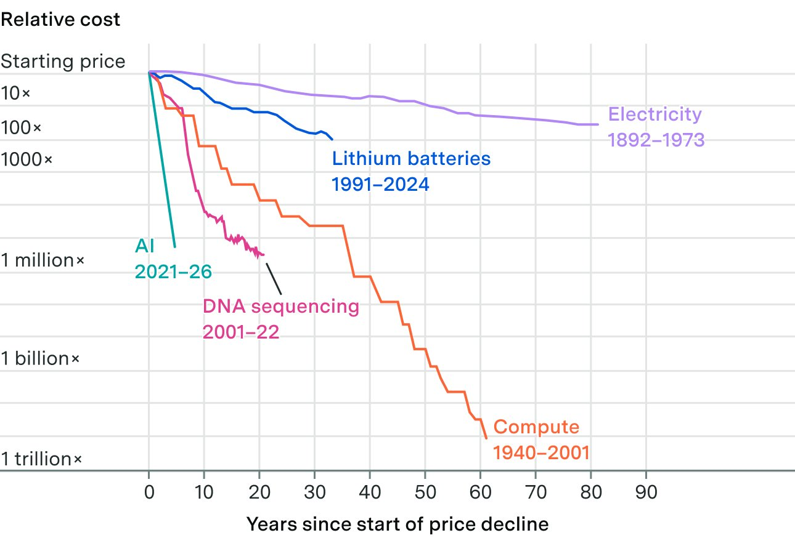

# Sinkende KI-Stückkosten beantworten die Budgetfrage noch nicht

Andrew Curran behauptet rapide sinkende KI-Kosten. Die bereinigte Quelle enthält seinen Hauptpost und eine gekennzeichnete fachliche Ergänzung mit Grafik, keine belastbare Kostenmessung.

## Behauptung und fehlender Maßstab

Curran bezeichnet den Preisrückgang als 54-mal schneller als bei Elektrizität und behauptet eine seit `GPT-3` anhaltende Entwicklung. Die beigefügte Grafik vergleicht relative Preisrückgänge ab dem jeweiligen Startjahr: KI `2021–2026`, Elektrizität `1892–1973`, Lithiumbatterien `1991–2024`, DNA-Sequenzierung `2001–2022` und Rechenleistung `1940–2001`. Sie zeigt keine Definition der verglichenen KI-Leistung und keinen nachvollziehbaren Rechenweg für den Faktor 54.

## Einordnung

Der Faktor 54 wird als nicht verifizierte Aussage archiviert und nicht ins Faktenregister übernommen. Aus einem relativen Preisrückgang folgt keine Aussage über absolute Projektbudgets, steigende Nutzung oder die Kosten eines abgenommenen Ergebnisses. Der Ausschnitt liefert weder ein reproduzierbares Experiment noch einen belastbaren Vergleich von Agentenläufen.

## Kernaussagen

- Modell- und Effortwahl brauchen aufgabenspezifische Ergebnisse und Kosten, keine extrapolierte Branchenkurve. → [[Modell-Eskalation-von-guenstig-nach-teuer]]
- Die Kostenbehauptung beweist keinen allgemeinen Wegfall menschlicher Engineering-Verantwortung. → [[Great-Decoupling-Rollenverstaendnis]]

## Verbindungen

- [[Modell-Eskalation-von-guenstig-nach-teuer]]
- [[Great-Decoupling-Rollenverstaendnis]]
