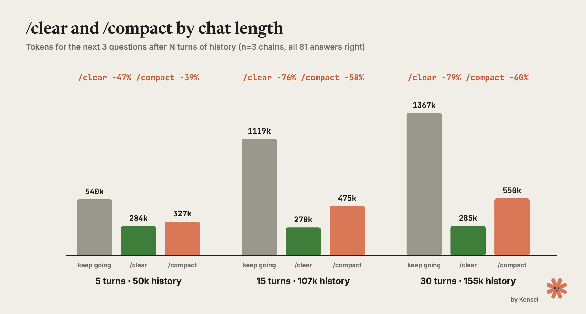

# Claude-Code-Verbrauch: Kontext reduzieren und richtige Antworten mitmessen

Kenseis Eigenbenchmark legt nahe: Wiederholt mitgesendeter Kontext bietet mehr Einsparpotenzial als kurze Antworten. Die `945` Läufe betreffen überwiegend Code-Leseaufgaben; sie belegen weder allgemeine Entwicklungsproduktivität noch konkrete Abo-Limit-Ersparnisse.

## Was tatsächlich gemessen wurde

Eine umbenannte Flask-Kopie „Tessel“ sollte Antworten aus Trainingswissen erschweren. Verglichen wurden gleiche Fragen, frische Prozesse und Ordnerkopien, zufällige Reihenfolge sowie genaue Funktionsnamen als Antwortschlüssel. Standard war Sonnet `5.5`, Effort `medium`; Messzeitraum: `14.–16.10.2026`, Claude Code `2.1.296–2.1.301`. Insgesamt nennt der Autor `118 Mio.` Tokens und rund `72 USD` zu damaligen API-Listenpreisen. Die berichteten `95-%-Konfidenzintervalle` gelten nur für diese Versuche.

Ein bloßes „ok“ benötigte bereits `19.100` Tokens. Eine Frage umfasste durchschnittlich etwa `6` Schritte und `110.000` Tokens bei zuletzt rund `24.000` Kontexttokens: `87 %` waren Cache-Reads, etwa `1 %` Antworttext. Das Diagramm erklärt damit die wiederholte Verarbeitung von Basis und Verlauf.

## Aufgabenwechsel und fortlaufende Arbeit unterscheiden

Nach `5`, `15` und `30` Turns verbrauchten drei neue Fragen beim Weiterarbeiten `540k`, `1.119k` und `1.367k` Tokens. Mit `/clear` waren es `284k`, `270k`, `285k` (`−47/−76/−79 %`); mit `/compact` einschließlich Zusammenfassung `327k`, `475k`, `550k` (`−39/−58/−60 %`). Alle `81` Antworten waren richtig, aber die neuen Fragen benötigten die alte Historie nicht. Für `/clear` nach `30` Turns lag das Intervall bei `62–96 %` Einsparung, aus nur `3` Ketten pro Länge.

## Regeln bedarfsgerecht laden, Notizen als Wegweiser nutzen

Unpassende Regeln von `8/16 KB` in `CLAUDE.md` erhöhten den Verbrauch um `21/46 %`; dieselben `16 KB` als Skill mit kurzem Verweis nur um `1 %`. Direkt verglichen sparte der Skill `31 %` (`12–49 %`, `n=20`). Die Basiszuschläge je Aufruf betrugen `3.346/6.466` gegenüber `279` Tokens. Ein kurzer Repo-Leitfaden sparte nominell `17 %`, sein Intervall `−36 bis +2 %` erlaubte jedoch keine klare Aussage.

Ein flacher Notizindex sparte `32 %`, senkte richtige Antworten aber von `20/20` auf `18/20`: Eine unvollständige Serializer-Notiz ersetzte die Quellcodeprüfung. Im Thread schlägt der Autor Notizen als Karte mit verpflichtendem Codebeleg vor; diese Variante wurde nicht getestet. Frühere separate Versuche meldeten für Obsidian-MCP `34/42 %` Mehrverbrauch gegenüber Dateizugriff, ein verschachtelter Index brachte `+4 %`.

## Preis, Tokens und Qualität getrennt betrachten

Opus `5.5` mit `low` statt `medium` sparte `17 %`; Sonnet zeigte bei `low` keinen klaren Effekt, bei `high` `20 %` Mehrverbrauch ohne bessere Antworten. Haiku/Sonnet/Opus benötigten im Modellvergleich `155k/117k/128k` Tokens bei `19/19/20` richtigen Antworten von jeweils `20`; damalige Listenpreise je Frage: `0,007/0,081/0,179 USD`. Haiku kostete damit etwa zwölfmal weniger trotz `33 %` mehr Tokens. Bekannte Datei und Funktion im Prompt verbesserten Debugging-Antworten von `8/20` auf `20/20`, bei nominell `13 %` Mehrverbrauch.

Subagents änderten Gesamttokens nicht eindeutig (`−3/+6 %`), verkleinerten bei schweren Aufgaben aber den Hauptkontext von `32k` auf `22k`. MCP-Abschaltung reduzierte die Basis um `1.691` Tokens, ohne klaren Gesamteffekt. Vendor-Deny-Regeln änderten Gesamttokens praktisch nicht; der Caveman-Skill kürzte Antworten um `21 %`, erhöhte Gesamttokens nominell um `6 %`.

## Einordnung

Übertragbar ist aus unserer Sicht das gemeinsame Messen von Kosten und Richtigkeit bei jeweils einer geänderten Variable. `modelUsage` soll Subagents einschließen; bei `--resume` sind Differenzen statt kumulierter Werte nötig. Roh-Tokens entsprechen wegen unbekannter Cache-Gewichtung keinem Abo-Limit. Das verlinkte Testrepo war lokal nicht vorhanden; Logs und Harness wurden daher nicht unabhängig geprüft. Der werbliche Cover-Verweis auf Fable `5` widerspricht der ausdrücklichen Aussage, es nicht getestet zu haben. Codeerzeugung, Refactoring und Plan Mode bleiben außerhalb der Untersuchung.

## Kernaussagen

- [[Kontext-Hygiene-Entscheidungsbaum]]: Verlauf nach Aufgabenabhängigkeit erhalten, verdichten oder zurücksetzen.
- [[Skill-Qualitaet-durch-Trigger-und-Baseline-Evals]]: Progressive Disclosure und Qualitätsvergleich zusammen prüfen.
- [[Modell-Eskalation-von-guenstig-nach-teuer]]: Modellpreis, Effort und Antwortqualität sind getrennte Größen.

## Verbindungen

- [[2026-08-04-anthropic-docs-claude-code-best-practices]] – bestehende Praxisgrundlage.
- [[2026-08-22-promptgefluester-wenn-euch-jemand-verspricht-token-zu-sparen-bei-cloud-code-dann-vorsicht]] – Grenzen von Token-Sparversprechen.
