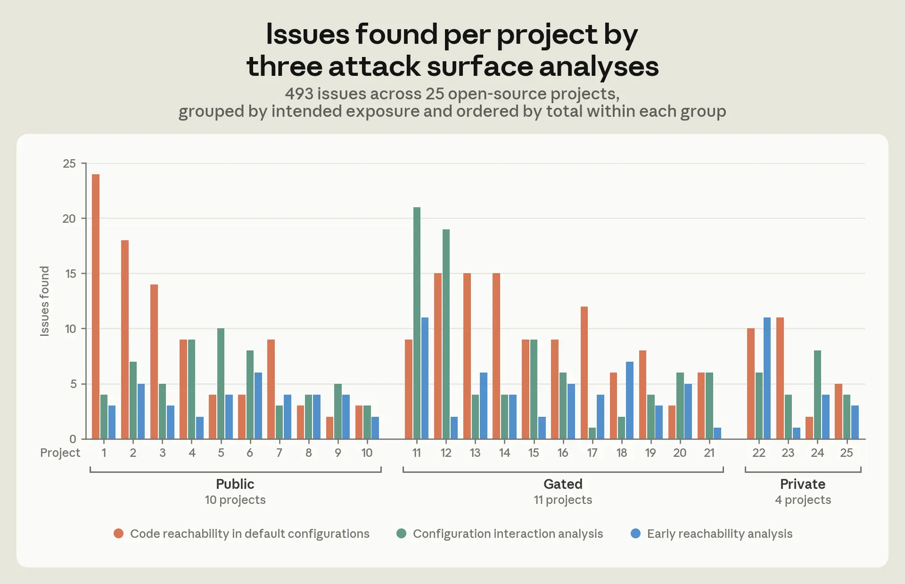

# Unnötige Codepfade vor Sicherheitsgrenzen abschirmen

Angriffsfläche lässt sich verkleinern, ohne jede darin liegende Schwachstelle zu kennen: Komplexer Code wird erst nach der passenden Authentifizierung, Konfigurationsprüfung oder Protokollphase erreichbar. Anthropic berichtet dazu eine eigene Untersuchung mit `Claude` über 25 Open-Source-Projekte und 493 Befunde. Das ist ein Herstellerbericht über Erreichbarkeit und Konfigurationsprobleme, keine Zählung nachgewiesener Exploits und keine unabhängig reproduzierte Sicherheitsmessung.

## Drei getrennte Prüfungen mit konkretem Nachweis

Der beschriebene Ablauf beginnt je Durchlauf mit frischem Kontext und übernimmt nur einen kurzen Übergabestand:

1. **Default-Erreichbarkeit:** Welche Codepfade sind standardmäßig erreichbar, obwohl keine beabsichtigte Standardfunktion sie benötigt?
2. **Frühe Erreichbarkeit:** Welche sensiblen Parser oder Zustandsänderungen laufen vor Authentifizierung, Nutzerinteraktion oder dem vorgesehenen Protokollzustand?
3. **Konfigurationskombinationen:** Welche einzeln plausiblen Optionen schalten gemeinsam eine Sicherheitskontrolle aus oder machen ihre Wirkung uneindeutig?

`Claude` inventarisiert die Einstiegspunkte und bestätigt Befunde laut Bericht durch dynamische Programm-Traces. Für Default-Befunde werden Gates entwickelt und Projekt- sowie Black-Box-Regressionstests gegen die unveränderte Baseline verglichen. Änderungen am Verhalten anderer Konfigurationen bleiben der menschlichen Entscheidung vorbehalten.

## Befunde nach beabsichtigter Exposition einordnen

Die untersuchten Projekte umfassen über fünf Millionen Codezeilen. Von über 17.000 inventarisierten Konfigurationsoptionen betrafen 3.842 sicherheitsrelevante Funktionen oder Kontrollen. Das Diagramm unterscheidet zehn öffentliche, elf authentifizierungspflichtige und vier private Projekte; dadurch wird dieselbe Erreichbarkeit je nach vorgesehenem Einsatz unterschiedlich bewertet.

Für die elf authentifizierungspflichtigen Projekte nennt Anthropic 93 unnötige Pre-Auth-Flächen in der Default-Konfiguration, 37 Stellen mit Ausführung oder Zustandsaufzeichnung vor Authentifizierung und 61 Kombinationen, die eine Pre-Auth-Kontrolle schwächten. Projektübergreifend wurden 162 problematische Konfigurationskombinationen gefunden: 94 schalteten still eine Sicherheitskontrolle ab, 68 erzeugten inkonsistente Schutzwirkungen. Diese Gruppen sind unterschiedliche Auswertungen und werden nicht zusätzlich zur Gesamtsumme addiert.

Ein Beispiel in vier voneinander unabhängigen Projekten: Hostname-basierte Deny-Regeln liefen bei deaktivierten Reverse-DNS-Abfragen gegen IP-Adresszeichenketten und griffen dadurch nicht. Der Bericht beschreibt damit einen konkreten Prüfauftrag für das Zusammenspiel von Kontrollregel und vorausgesetzter Datenerhebung.

## Gates müssen den tatsächlich geparsten Inhalt prüfen

Bei `OpenSSH 10.4` waren laut Bericht rund 4.500 Zeilen experimenteller `ML-DSA-44`-Verarbeitung ohne Authentifizierung erreichbar, obwohl der Algorithmus standardmäßig deaktiviert war: etwa 16 Prozent des eigenen Pre-Auth-Codes. `10.5` prüfte den angekündigten Algorithmus früher, ließ aber Abweichungen zwischen Ankündigung und eingebettetem Schlüsseltyp sowie einen Zertifikats-CA-Pfad offen. Die in `10.6` ausgelieferte Korrektur prüfte tatsächlichen Schlüsseltyp und CA-Signaturalgorithmus innerhalb des Parsers vor Deserialisierung beziehungsweise Verifikation. Sie entfernte laut Anthropic ungefähr ein Fünftel des zuvor erreichbaren Default-Pre-Auth-Codes; diese Zahl beschreibt einen späteren Stand als die 16 Prozent.

## Einordnung

Der übertragbare Ansatz ist die Kombination aus Expositionsmodell, nachvollzogenen Codepfaden und möglichst früh platzierten Gates. Positive Traces belegen einen beobachteten erreichbaren Pfad; ein ausgebliebener Trace beweist dessen allgemeine Unerreichbarkeit nicht. Identische Regressionsergebnisse belegen Verhaltenserhalt im geprüften Umfang und ersetzen keine Sicherheitsgarantie. Instrumentierung, geeignete Testeingaben und die Entscheidung über nichtstandardmäßige Konfigurationen verursachen zusätzlichen Aufwand. Die berichteten Befunde und Maintainer-Korrekturen wurden hier am archivierten Artikel ausgewertet, weder am Quellcode nachgeprüft noch selbst reproduziert.

## Kernaussagen

- Beabsichtigte Exposition und tatsächliche Erreichbarkeit müssen pro Eingangspfad verglichen werden. → [[Codepfad-vor-Aenderung-nachvollziehen]]
- Gates brauchen Prüfungen des tatsächlichen Payloads und seiner verschachtelten Verarbeitungspfade. → [[Codepfad-vor-Aenderung-nachvollziehen]]
- Baseline-Vergleiche begrenzen Verhaltensänderungen; abweichende Konfigurationen brauchen gesonderte Entscheidungen. → [[Refactoring-mit-Verhaltensvergleich]]

## Verbindungen

- [[Codepfad-vor-Aenderung-nachvollziehen]]
- [[Refactoring-mit-Verhaltensvergleich]]
- [[Sandbox-Komposition-aus-OS-Primitiven]]
- [[Angriffsflaeche-durch-Erreichbarkeitsanalyse-reduzieren]]
