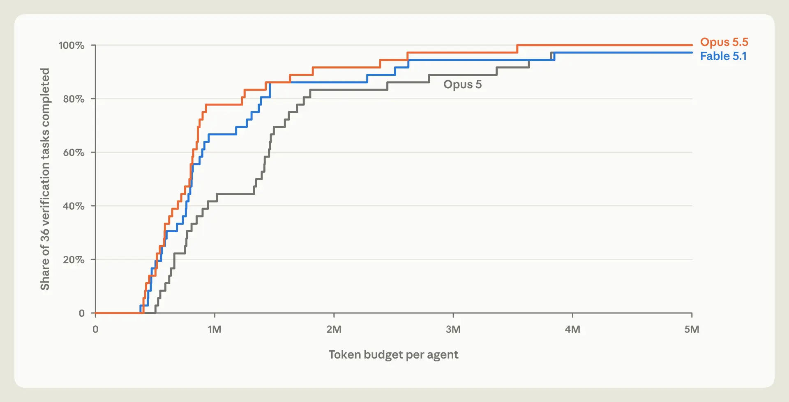
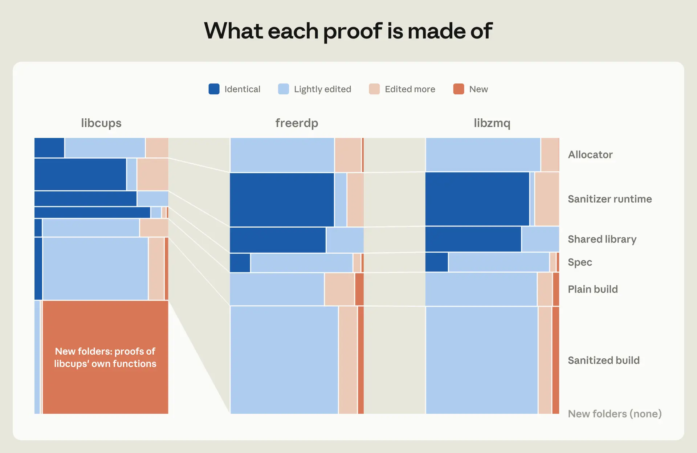

# Formale Verifikation: Agenten erzeugen Beweise, Checker prüfen begrenzte Eigenschaften

Anthropic und Theorem berichten am 22.10.2026, vorhandene Fuzz-Tests mit `Claude` in formal geprüfte Aussagen über kompilierte Programme überführt zu haben. Übertragbar ist die Trennung zwischen teurer Beweissuche durch ein Modell und deterministischer Prüfung durch einen externen Checker. Entscheidend bleibt, was die Spezifikation tatsächlich umfasst.

## Vom Fuzz-Test zur überprüfbaren Aussage

Fuzzing sucht Gegenbeispiele anhand vieler konkreter Eingaben. Der vorgestellte Ablauf formuliert stattdessen: Dieser instrumentierte Test-Einstieg löst für alle Eingaben innerhalb der festgelegten Größenbegrenzung keinen Crash aus. Das umfasst etwa Assertions zu Encode-Decode-Roundtrips und durch `AddressSanitizer` erfasste Speicherfehler.

1. Test-Einstieg, Eigenschaften und Laufzeitannahmen festlegen; kompiliertes `RISC-V`-Programm mathematisch modellieren.
2. Den Agenten einen `Rocq`-Beweis erzeugen lassen; bei Gegenbeispielen Fehler untersuchen, gegebenenfalls patchen und die Aussage neu beweisen.
3. Den Beweis mit `Rocq` prüfen; Spezifikation, CPU-/Linux-Semantik und Checker einschließlich ihrer Laufzeitbasis separat beurteilen.
4. Patches auf unerlaubte Verhaltensänderungen kontrollieren: Ein wirkungsloses Programm könnte ebenfalls nie abstürzen. Der Bericht nennt Patch-Strafen, Anreize für minimale Verhaltensänderungen und Audits gegen dieses Reward Hacking.

Ein gescheiterter Beweis allein beweist keinen Programmfehler: Auch Modellierung oder Beweissuche können scheitern.

## Ergebnisse und Reichweite am 22.10.2026

Laut Forschungsbericht entstanden innerhalb weniger Wochen Beweise für **239 Test-Einstiege in 123 OSS-Fuzz-Bibliotheken**, teilweise nach Patches. Rund **180 Millionen Zeilen Beweiscode**, typischerweise **600.000 Zeilen**, standen Binärprogrammen mit median **18.000 Instruktionen** gegenüber. Das untersuchte Setup umfasst Eingaben bis zur angegebenen **64-MB-Grenze**, ein Single-Thread-Programm, statische Bindung gegen `musl`, festes Speicherbudget und modellierte `RISC-V`-/Linux-Ausführung.

Der Ansatz fand laut Autoren unter anderem Fehler bei selten strukturierten Eingaben um 20 MB sowie einen Fehler mit 64 MB Eingabe und über 2 GB Speicherbedarf. Das erklärt einen Zusatznutzen gegenüber Fuzzern, deren Eingaben häufig auf 1 MB begrenzt sind. Ein weiterer Versuch mit einem `Rust`-Interpreter ergab bei über 1,7 Millionen generierten `Python`-Programmen **99,95 %** Übereinstimmung mit `CPython`; diese empirische Quote ersetzt keinen umfassenden Äquivalenzbeweis.

## Kosten senken durch Modellwahl und gemeinsame Beweise

Für einzelne Beweise können laut Bericht Hunderte Millionen Tokens nötig werden; konkrete Geldkosten fehlen. Auf **36 kleinen Verifikationsaufgaben** benötigte `Opus 5.5` zum Lösen der Hälfte etwa **40 % weniger Tokens** als `Opus 5`. Der Plot zeigt Aufgabenabdeckung gegen **0–5 Millionen Tokens pro Agent**; er misst weder Produktionssoftware-Abdeckung noch Eurokosten.

Ein gemeinsamer Arbeitsbereich zum Wiederverwenden fremder Beweise reduzierte den Tokenbedarf im berichteten Versuch um **17 %**; einzelne zuvor erfolglose Aufgaben gelangen anschließend. Die Strukturabbildung zu `libcups`, `freerdp` und `libzmq` zeigt qualitativ, dass Laufzeit-, Sanitizer- und Bibliotheksbeweise wiederverwendbar sind; sie enthält keine numerisch beschrifteten Prozentwerte.

## Einordnung

Dies ist ein Forschungsbericht beteiligter Hersteller und Partner; Ergebnisse und Beweise wurden hier nicht unabhängig reproduziert. Formal geprüft heißt, dass eine bestimmte Aussage unter bestimmten Modellannahmen folgt. Ungeprüfte Einstiege, nicht von `AddressSanitizer` erkannte Fehler, falsche Aufrufernutzung sowie andere Architekturen, Threading- und Linkage-Verhältnisse bleiben mögliche Lücken. Fachlich sinnvoll erscheint ein eng begrenzter Pilot an kritischen Abhängigkeiten mit überprüfbarer Semantik und geschützten Soll-Eigenschaften. Die erwartete allgemeine Verbreitung formaler Verifikation bleibt eine Prognose.

## Kernaussagen

- [[Testharness-als-staerkster-Hebel]]: Auch ein mathematisch korrekter Nachweis schützt nur die richtig formulierte Eigenschaft; veränderte Programme benötigen Verhaltensprüfung.
- [[Kontrollierte-Agent-Parallelisierung]]: Gemeinsame wiederverwendbare Artefakte können Doppelarbeit verringern; die gemeldeten 17 % sind versuchsspezifisch.

## Verbindungen

- [[TDD-als-Verifikationshebel]] – vorhandene Tests liefern Ansatzpunkte für explizite Eigenschaften.
- [[Refactoring-mit-Verhaltensvergleich]] – Patches müssen erwünschtes Verhalten bewahren, auch wenn anschließend ein Beweis gelingt.
- [[Formale-Verifikation-mit-unabhaengigem-Proof-Checker]]
