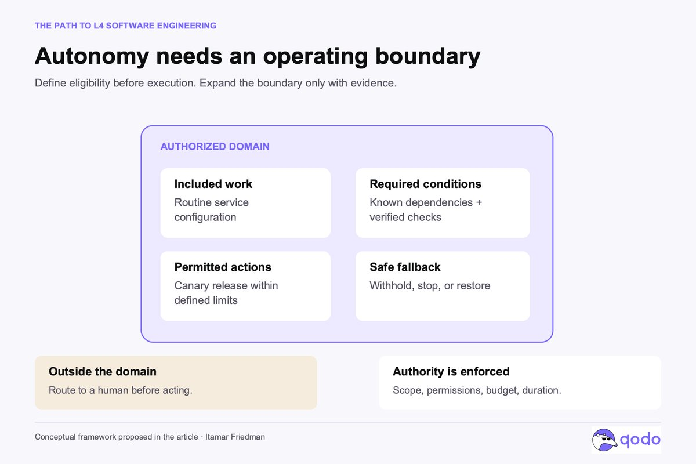
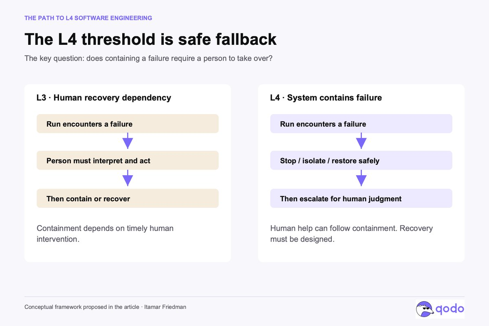

# Begrenzte Software-Autonomie braucht überprüfbare Verantwortung und sicheren Fallback

Itamar Friedman unterscheidet agentische Beteiligung am Software Development Lifecycle von einer Software Factory, die einen autorisierten Arbeitsablauf einschließlich Fehlerbegrenzung tragen kann. Sein Beitrag vom 22.10.2026 beschreibt ein Zielbild für Engineering-Teams, keine nachgewiesene autonome Produktionsanlage.

## Den Arbeitsbereich statt die Organisation einstufen

Im vorgeschlagenen Raster bedeutet **L3**, dass ein System unter definierten Bedingungen einen Delivery-Workflow ausführt, aber menschliche Freigabe oder Übernahme benötigt. **L4** umfasst einen begrenzten Bereich von Änderungen samt Verifikation, erlaubten Release-Aktionen und sicherem Fallback, ohne für die unmittelbare Fehlerbegrenzung rechtzeitige menschliche Hilfe zu brauchen. **L5** wäre die Ausweitung auf das gesamte Spektrum von Engineering-Arbeit.

Diese Software-Stufen sind ausdrücklich kein Industriestandard. Ein Team könnte Routineänderungen eines internen Dienstes stärker automatisieren und Berechtigungs- oder Zahlungsänderungen weiterhin eng beaufsichtigen. Viele Agenten, ein hoher Anteil generierten Codes oder ein unbeaufsichtigter Nachtlauf bestimmen die Stufe nicht.

## Vor dem Lauf den autorisierten Bereich festlegen

Der Beitrag konkretisiert vier zusammengehörende Bedingungen:

- **Enthaltene Arbeit:** Repositories, Änderungstypen, Abhängigkeiten und Umgebungen festlegen; Ausschlusskriterien ausdrücklich nennen.
- **Voraussetzungen:** Anforderungen, Architekturentscheidungen, bekannte Vorfälle und überprüfbare Checks verfügbar machen; Mehrdeutigkeit vor der Umsetzung behandeln.
- **Erlaubte Aktionen:** Rechte, Budget, Dauer und Release-Spielraum technisch begrenzen. Außerhalb des Bereichs vor Ausführung eskalieren.
- **Sicherer Fallback:** Vorher entscheiden, ob Release zurückhalten, Rollout stoppen, Feature deaktivieren oder Zustand wiederherstellen möglich ist. Eine destruktive Migration kann Rollback ausschließen.

Der entscheidende Fehlerpfad lautet: **Fehler → stoppen, isolieren oder sicher wiederherstellen → menschliches Urteil einholen**. L3 benötigt dagegen die menschliche Handlung bereits, um den Fehler einzudämmen. Die Abbildung beschreibt eine Zuständigkeitsgrenze, keine gemessene Zuverlässigkeit.

## Die produzierende Instanz darf die Abnahme nicht umdefinieren

Friedman fordert getrennte Zuständigkeiten für Generierung, geschützte Verifikation und Release-Autorisierung. Akzeptanzbedingungen, zurückgehaltene Szenarien und Richtlinienchecks gehören in einen separat verwalteten Abnahmevertrag. Ein zweiter Agent ist nicht schon deshalb unabhängig, weil seine Rolle Reviewer heißt: Beide können dieselbe falsche Annahme teilen.

Auch gute Tests belegen keine langfristige Wartbarkeit. Pro Lauf sollen Anforderung, Prüfungen, Architekturgrenzen, Release-Ergebnis und Restunsicherheit nachvollziehbar bleiben. Sinnvolle Betriebsgrößen sind korrekte Abschlüsse zulässiger Aufgaben, verbleibender menschlicher Aufwand, entkommene Fehler, Schadenskosten und Notfalleingriffe; auch abgewiesene Aufgaben gehören dazu. Der Artikel liefert dafür keine Messergebnisse oder Schwellenwerte.

## Verantwortung aus belegtem Verhalten erweitern

Der vorgeschlagene Einstieg ist eine wertvolle, gut verstandene Arbeitsklasse unter menschlicher Aufsicht. Wiederkehrende Interventionen zeigen fehlenden Kontext, unzureichende Checks oder zu weit gezogene Grenzen. Explizierbare Urteile werden Regeln, Tests oder dauerhaftem Wissen hinzugefügt; manche Aufgaben bleiben ausgeschlossen. Gekaufte Spezialagenten und Plattformen entbinden das Team nicht davon, Gesamtsystem, Nachweise und Wiederherstellung zu gestalten.

## Einordnung

Die stärkste übertragbare Idee ist aus fachlicher Sicht die Fehlerbegrenzung vor Eskalation als überprüfbare Autonomiebedingung. Die L4-Bezeichnung ist Friedmans Analogie und kein Zertifikat. Seine Rangfolge System vor Agent vor Modell ist eine Entwurfsposition; Modellfähigkeit bleibt eine notwendige Einflussgröße. Im Antwortthread empfiehlt er klassische Tests nur für missionskritische Abläufe und nennt dynamisches Agententesten als Alternative; diese Meinung ist kein Nachweis, dass andere Regressionstests entbehrlich wären. Auch formale Nachweise gelten nur für ihre Spezifikation und Modellannahmen.

## Kernaussagen

- [[Domaenen-Harness-mit-Daten-Evals-Rechten-und-Review]]: Autorisierter Bereich und sicherer Fehlerpfad ergänzen Daten, Prüfungen und Rechte.
- [[Testharness-als-staerkster-Hebel]]: Die produzierende Instanz darf Abnahmebedingungen nicht stillschweigend verschieben.
- [[Review-Autonomie-mit-Shadow-Mode-und-Stichproben]]: Aufsicht zuerst, Verantwortung anhand beobachteter Eingriffe erweitern.

## Verbindungen

- [[Freigaben-und-Isolation-getrennt-steuern]] – erlaubte Aktionen und technische Begrenzung separat ausweisen.
- [[2026-10-22-anthropic-llms-are-making-formal-software-verification-fea]] – auch stärkere Verifikation braucht explizite Reichweite.
- [[Sicherer-Fallback-vor-menschlicher-Eskalation]]
