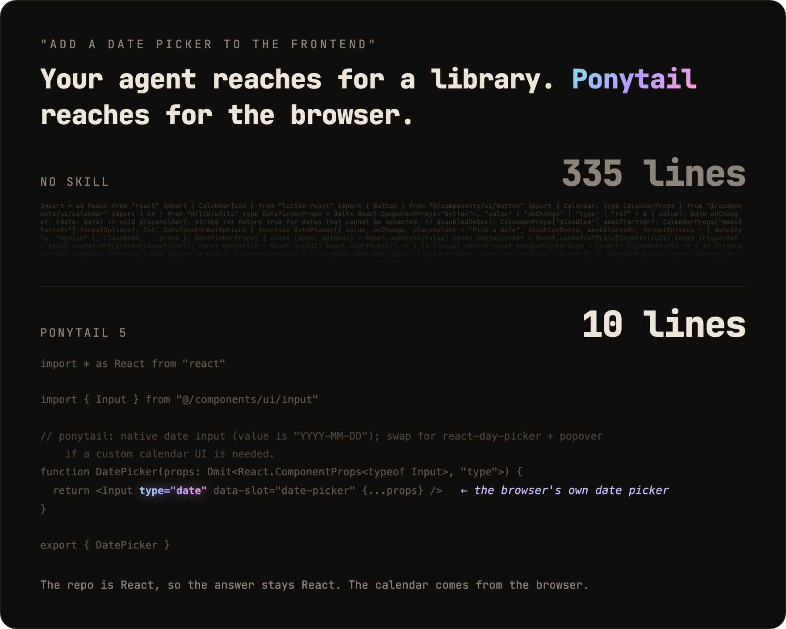

# Ponytail 5 priorisiert Wiederverwendung vor neuem Code

Vox beschreibt am 22.10.2026 die neue Wiederverwendungslogik von `Ponytail 5` und berichtet über Tests des Herstellers.

## Einordnung

Sekundärer Bericht über einen Hersteller-Selbstbenchmark: 39 Aufgaben mit `Claude Code` und `Opus 5.5`. Weder unabhängige Replikation noch allgemeine Einspargarantie. Testauswahl und Qualitätsgleichwertigkeit lassen sich aus dem Post nicht vollständig beurteilen.

## Kernaussagen

- Vor Codegenerierung prüfen: überhaupt nötig, im Repo vorhanden, Standardbibliothek, Browser/OS, installierte Dependency, Einzeiler; erst danach die kleinste funktionierende Implementierung.
- Im berichteten Selbstbenchmark: 53 % weniger Code, 41 % weniger Laufzeit, 26 % weniger Kosten. Die 53 % beziehen sich auf Codeumfang.
- 98 % statt 68 % der als riskant eingeordneten Logik wurden mit Test geliefert. Bei Fehlern außerhalb des Diffs meldet der Autor 100 % statt 78 % Erkennung; Umfang und Definition dieser Teiltests bleiben offen.
- Das Bild zeigt den Date-Picker mit 10 statt 335 Zeilen durch vorhandenes `Input` und `type="date"`. Browserfunktionalität und eine individuelle Kalenderoberfläche sind nicht in jedem Projekt austauschbar.
- `/ponytail-review` soll auch betroffene Bestandsdateien prüfen; `/ponytail-audit` das gesamte Repo priorisieren. Installation und Hook-Vertrauen sind keine hier ausgeführten Schritte.

## Verbindungen

- [[Klein-und-komposierbar]] — minimale Implementierungen durch Wiederverwendung.
- [[Codepfad-vor-Aenderung-nachvollziehen]] — Auswirkungen außerhalb des Diffs mitlesen.
- [[Testharness-als-staerkster-Hebel]] — Qualität und Aufwand am konkreten Harness prüfen.

