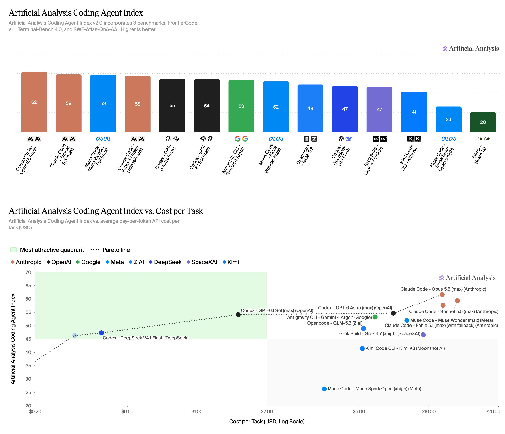

# Coding Agent Index v2.0 misst Modell und Harness gemeinsam

Artificial Analysis veröffentlicht am 23.10.2026 einen überarbeiteten Coding-Agent-Vergleich.

## Einordnung

Primärbericht des Evaluators über eigene Messungen. Gegenstand sind Modell, Agent-Harness und Effort-Konfiguration gemeinsam; dies ist der Coding Agent Index v2.0, nicht der allgemeine Intelligence Index. API-Tokenkosten sind keine Abopreise.

## Kernaussagen

- 290 Aufgaben aus drei gleich gewichteten Benchmarks: `FrontierCode v1.1`, `Terminal-Bench 4.0` und `SWE-Atlas-QnA-AA`.
- `FrontierCode` ersetzt `DeepSWE`: 100 private Softwareaufgaben; blockierende Fehler oder erkannter Zugriff auf Lösungsmaterial ergeben null Punkte.
- Für Repository-Q&A bleiben 124 Aufgaben bestehen; 127 von 1.306 Rubrikkriterien wurden umformuliert. Judge: `GPT-6 Luna (xhigh)`, fünf Stimmen je Kriterium.
- `Claude Code + Opus 5.5 (max)` führt mit 61,7 Punkten bei `11,42 USD/Aufgabe`; `Codex + GPT-6.1 Sol (max)` erreicht 54,1 bei `1,50 USD`, `GPT-6 Astra (max)` 54,7 bei `7,04 USD`; `DeepSeek V4.1 Flash (max)` 47,3 bei `0,39 USD`.
- `Opus 5.5` erreicht auf `FrontierCode` 56,0 %, `DeepSeek` 52,6 %. Repository-Q&A führt dagegen `Muse Code + Muse Wonder Full (max)` mit 68,8 % an.
- Über 21 gemeinsame Konfigurationen sinkt der Indexmittelwert von 54,8 auf 47,4; 20 fallen. Das ist ein Methodenwechsel, kein Beleg für Modellverschlechterung.

[FrontierCode-Einzelwerte](../../00_Inbox/Quellen/X/medien/2026-10-23-artificialanlys-2113424551396934134/thread-2113424556069372203/01-photo.jpg) · [Q&A-Einzelwerte](../../00_Inbox/Quellen/X/medien/2026-10-23-artificialanlys-2113424551396934134/thread-2113424559684870621/01-photo.jpg) · [Versionsvergleich, gerundete Balkenwerte](../../00_Inbox/Quellen/X/medien/2026-10-23-artificialanlys-2113424551396934134/thread-2113424563774312931/01-photo.jpg)

## Verbindungen

- [[Testharness-als-staerkster-Hebel]] — Harness und Bewertungsregeln verändern Ergebnisse.
- [[Modell-Eskalation-von-guenstig-nach-teuer]] — Kostenfrontier als Ausgangspunkt eigener Tests.

