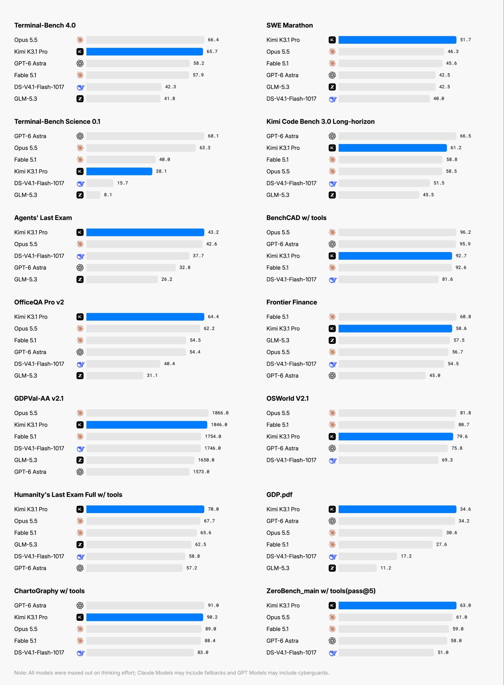

# Kimi K3.1 Pro: Herstellervergleich und angekündigte Gewichte

Chubby kommentiert am 23.10.2026 die Ankündigung von `Kimi K3.1 Pro` und teilt einen Benchmarkvergleich von Moonshot.

## Einordnung

Sekundärer, enthusiastischer Bericht über Herstellerclaims. Das geteilte Diagramm ist keine unabhängige Bestätigung. Es vergleicht konkrete Modellkonfigurationen mit maximalem Thinking-Effort; die Fußnote erlaubt Claude-Fallbacks und GPT-Cyberguards. Vollständige Harnessdetails fehlen im archivierten Post.

## Kernaussagen

- Angekündigt werden ein multimodales Modell mit 2,8 Billionen Parametern und einer Million Kontexttokens sowie offene Gewichte bis 04.11.2026. Zum Quelldatum ist dies ein Versprechen, keine belegte Veröffentlichung.
- Moonshots Chart zeigt sechs erste Plätze unter 14 dargestellten Benchmarks, etwa `SWE Marathon`: 51,7 gegenüber 46,3 bei `Opus 5.5`, sowie `OfficeQA Pro v2`: 64,4 gegenüber 62,2.
- Die Rangfolge ist aufgabenabhängig: `Terminal-Bench 4.0` zeigt 65,7 für `Kimi` und 66,4 für `Opus 5.5`; `Terminal-Bench Science 0.1` 38,1 für `Kimi` gegenüber 68,1 für `GPT-6 Astra`.
- Das Herstellerbild nennt bei `Humanity’s Last Exam Full w/ tools` 70,0. Das ist nicht ohne Weiteres mit anderen HLE-Setups oder dem AA-Gesamtindex vergleichbar.
- Übertragbar ist die Prüfregel: Benchmark, Tools, Effort, Fallbacks und Veröffentlichungsstatus vor einer Modellentscheidung gemeinsam erfassen. Die Aussage „China ist zurück“ bleibt Autorenwertung.

## Verbindungen

- [[Testharness-als-staerkster-Hebel]] — Rangfolgen benötigen den vollständigen Messkontext.
- [[Modell-Eskalation-von-guenstig-nach-teuer]] — Stärken je Aufgabenklasse prüfen.

