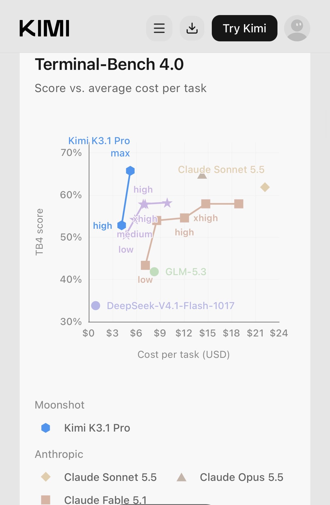

# Kimi K3.1 Pro: Tokenpreise und Hersteller-Kostenkurve einordnen

Chubby vergleicht am 23.10.2026 die gemeldeten Tokenpreise von `Kimi K3.1 Pro` mit US-Frontiermodellen.

## Einordnung

Sekundärer Bericht mit Herstellerdiagramm von Moonshot. Die Grafik zeigt `Terminal-Bench 4.0` gegen durchschnittliche Kosten je Aufgabe, kein allgemeines Leistungs- oder Preisversprechen. Konkrete Harnessdetails sind im Post nicht dokumentiert; die Aussage zum lokalen Betrieb ist zum Quelldatum eine Zukunftsaussicht wegen noch angekündigter Gewichte.

## Kernaussagen

- Berichtete Standardtarife je Million Input/Outputtokens: `Kimi K3.1 Pro 2/10 USD`, `Opus 5.5 4/20 USD`, `GPT-6 Astra 10/50 USD`.
- Die genannten 50 % beziehungsweise 80 % Preisabstand folgen aus diesen Tokenraten. Sie bedeuten keine entsprechenden Einsparungen pro erfolgreich erledigter Aufgabe; Tokenmenge, Effort, Wiederholungen und Cache beeinflussen die Rechnung.
- Der Verweis auf sechs Siege unter 14 Benchmarks stammt aus Moonshots Evaluationsübersicht. Dieses geteilte Herstellerbild und der vorherige Chubby-Post sind keine voneinander unabhängigen Messungen.
- Das Bild ergänzt einen Effort-Vergleich: `Kimi` erreicht bei `high` ungefähr 53 % und bei `max` ungefähr 66 % im dargestellten Terminal-Benchmark. Die Kosten liegen grafisch grob bei `4–5 USD/Aufgabe`; es fehlen exakte Punktbeschriftungen. Das sind abgelesene Näherungen, keine AA-Intelligence-Index-Kosten.
- Eine brauchbare Modellwahl vergleicht Aufgabenerfolg und Gesamtkosten im eigenen Harness, bevor „SOTA günstiger“ als allgemeines Urteil übernommen wird.

## Verbindungen

- [[Modell-Eskalation-von-guenstig-nach-teuer]] — Aufgabenkosten statt reiner Tokenpreise vergleichen.
- [[Testharness-als-staerkster-Hebel]] — Effort und Harness als Teil des Messgegenstands.

