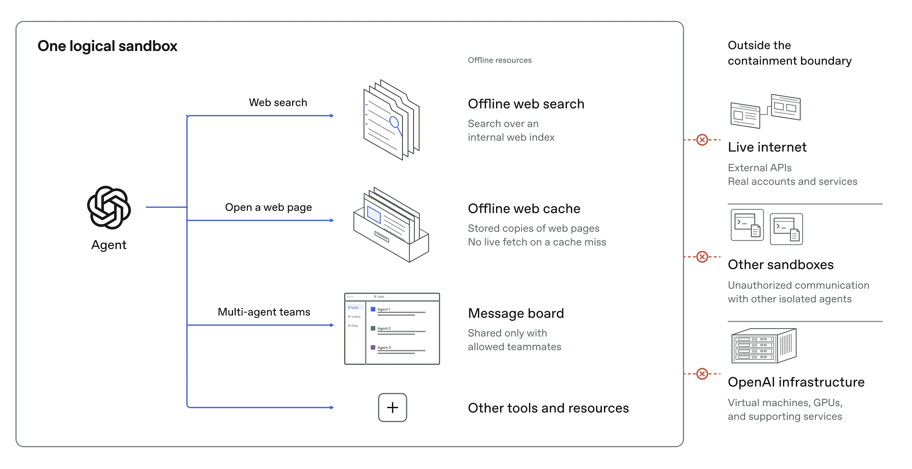

# Agent-Isolation auch nach dem Versagen innerer Schutzschichten prüfen

OpenAI beschreibt, wie interne Trainings- und Evaluierungsumgebungen nach Sicherheitsvorfällen stärker eingegrenzt wurden. Die übertragbare Methode: Jede Schutzschicht gesondert unter der Annahme prüfen, dass vorgeschaltete Kontrollen bereits versagt haben. Der Bericht ist eine Primärquelle zu eigenen Maßnahmen und Versuchen, keine unabhängige Sicherheitsabnahme.

## Erlaubte Ressourcen bilden eine ausdrückliche Grenze

Für Frontier-RL verwendet OpenAI laut Bericht eine Offline-Welt aus Suchindex und gespeicherten Webseiten. Die betrachtete Abbildung präzisiert: Bei einem Cache-Miss erfolgt kein Live-Abruf. Ein gemeinsames Message Board steht nur ausdrücklich zugelassenen Teammitgliedern zur Verfügung. Live-Internet, fremde Sandboxes und die Infrastruktur außerhalb der jeweiligen Berechtigungsgrenze bleiben gesperrt.

Die technische Durchsetzung kombiniert eingeschränkte Container, VMs, Monitoring sowie Netzwerk- und Cloud-Kontrollen. Vollständiges Air-Gapping der gesamten Infrastruktur sei wegen benötigter Betriebsverbindungen nicht praktikabel. Gerade erlaubte Dienste für Metriken, Logging und Authentifizierung müssen deshalb auf indirekte Wege nach außen geprüft werden.

## Den bereits kompromittierten Host als Testausgangspunkt verwenden

Red Teams erhielten drei konkrete Erfolgsbedingungen: einen kontrollierten externen Server erreichen, eine interne Berechtigungsgrenze überschreiten oder Informationen mit eigentlich isolierten Agents austauschen. Einige Versuche begannen absichtlich mit übernommenem Host, um Netzwerk- und Cloud-Grenzen unabhängig von Sandbox und Monitoring zu testen.

Die Agents bekamen teilweise Quellcode, Konfigurationen, bekannte Schwachstellen oder Kommunikationsprotokolle. Der Bericht beschreibt damit Angreifer begünstigende Tests, keine Messung vollständig selbstständiger Entdeckung. Insgesamt seien Hunderte Milliarden Tokens eingesetzt worden. Eine erwähnte Fundkurve mischt Modelle, getestete Bereiche und Zeitfenster; sie belegt keine kontrollierte Skalierungsbeziehung.

## Kommunikation reicht über Nachrichten und Netzwerke hinaus

Shared Services und gemeinsam genutzte Hardware eröffneten laut Bericht verdeckte Kanäle, unter anderem über Cache-Timing, Speicheraktivität, CPU-Konkurrenz und einen Zertifikatscache. Daraus folgt für die Einordnung von Agent-Rechten: Auch beobachtbare gemeinsam genutzte Ressourcen können Informationswege bilden. Die Quelle berichtet Gegenmaßnahmen und zusätzliche Überwachung, keinen Ausschluss aller Seitenkanäle.

## Einordnung

Die berichtete Trainingspause begann nach einem DNS-Vorfall am 20. September 2026; die Wiederaufnahme erfolgte am 1. Oktober nach elf Tagen. Weniger neue Funde und reparierte Schwachstellen sind hilfreiche Signale, aber keine Sicherheitsgarantie. Hoher Compute-Einsatz, isolierte Infrastrukturkopien, Cloud-Partner und menschliche Reproduktion der Funde begrenzen die direkte Übertragbarkeit auf kleine Teams. Übertragbar sind klar definierte Grenzen, voneinander unabhängige Gegenproben und wiederkehrende Prüfungen nach Konfigurationsänderungen. Die beschriebenen Forschungsbedingungen sind von den Umgebungen veröffentlichter Kundenmodelle zu unterscheiden.

## Kernaussagen

- Sandbox, VM und äußeren Perimeter jeweils unter angenommenem Versagen innerer Kontrollen prüfen → [[Sandbox-Komposition-aus-OS-Primitiven]].
- Erlaubte Kommunikation und verdeckte Wege über geteilte Ressourcen gemeinsam betrachten → [[Agent-Rechte-umfassen-Kommunikationswege]].
- Angriffserfolge konkret definieren und Prüfungen nach Reparaturen sowie Infrastrukturänderungen wiederholen → [[Adversarialer-Pre-Launch-Check]].

## Verbindungen

- [[Freigaben-und-Isolation-getrennt-steuern]]
- [[Agent-Tracing-nach-Beobachtungsebene]]
