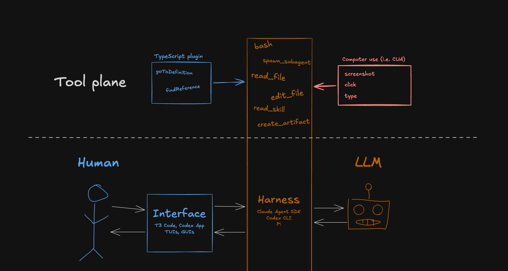
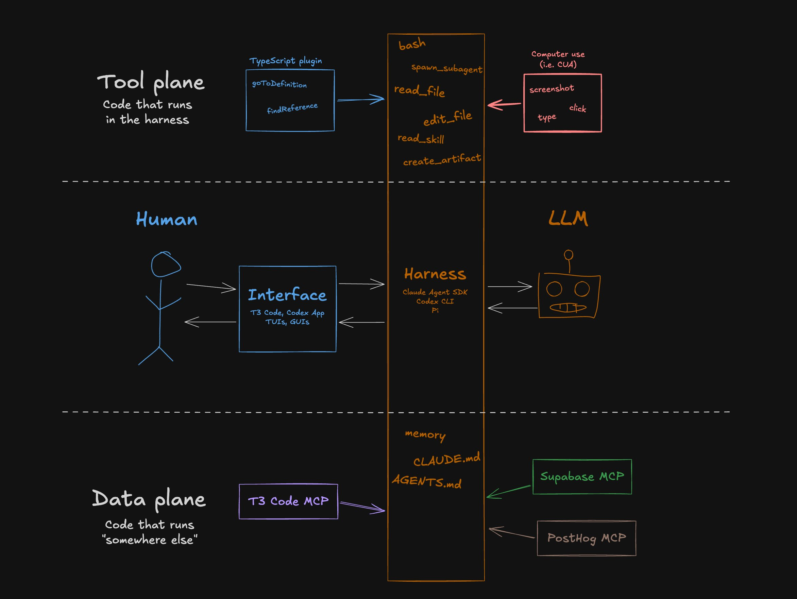

# Modell, Harness und Oberfläche getrennt verstehen

Theo erklärt am 23.10.2026, warum Oberfläche, Modell und ausführende Agenten-Laufzeit unterschiedliche Aufgaben erfüllen. Sein Lernbild: Der Koch entspricht dem Modell, die Küche dem Harness und das Restaurant einer Oberfläche beziehungsweise Orchestrierungsanwendung wie `T3 Code`. Für technische Entscheidungen zählt die konkrete Aufgabenverteilung hinter dieser Analogie.

## Welche Schicht führt tatsächlich etwas aus?

| Schicht | Aufgabe |
|---|---|
| Modell | Aus Kontext Antworten und strukturierte Aufrufwünsche erzeugen. |
| Harness | Tool-Angebot vermitteln, Aufrufe verarbeiten, Ausführung organisieren und Ergebnisse ins Gespräch zurückgeben. |
| Oberfläche | Menschen Aufgaben, Fortschritt, Ergebnisse und Eingriffsmöglichkeiten zeigen. |
| Tool-Implementierung | Die konkrete Aktion ausführen, beispielsweise Dateien lesen oder einen Prozess starten. |

Das Modell greift nicht unmittelbar auf eine Datei zu, nur weil es `read_file` anfordert. Die Laufzeit muss den Aufruf erkennen und ausführen lassen; anschließend erhält das Modell das Ergebnis für den nächsten Schritt. Der Artikel nennt fünf Bausteine: Tools, Aufrufformat, Verarbeitung und Ausführung, Ergebnisrückgabe sowie Tool-Liste mit Beschreibungen.

Die Skizze ordnet `bash`, Dateioperationen und Subagents dem Harness zu; `TypeScript`-Navigation und Computersteuerung sind ergänzende Fähigkeiten. Sie ist eine Funktionskarte, kein Nachweis über Rechte, Isolation oder tatsächliche Verfügbarkeit einzelner Tools.

## Ein Produkt kann mehrere Schichten bündeln

Theo beschreibt `Claude Code` und `Codex` als Produkte, in denen Oberfläche und Harness zusammenkommen. Andere Anwendungen können diese Laufzeiten wiederverwenden. Nach seiner Darstellung verwendet `T3 Code` vorhandene Harnesses und ergänzt unter anderem modellübergreifende Subagents.

Für eine Architekturentscheidung sollte deshalb getrennt gefragt werden: Welche Oberfläche bediene ich, welches Harness organisiert die Aktionen, welches Modell entscheidet über nächste Schritte und wer setzt Rechte durch? Dass mehrere Produkte dieselbe Laufzeit einbetten, bedeutet noch keine identische Konfiguration oder Fähigkeit.

## MCP beschreibt eine Integrationsschnittstelle

Der Artikel unterscheidet direkt eingebaute Tools von Fähigkeiten, die über `MCP` angebunden sind. `T3 Code` stellt eigene Funktionen laut Theo über einen `MCP`-Server bereit, damit mehrere Harnesses dieselbe Implementierung nutzen können. Eine solche Anbindung macht ein Angebot verfügbar; sie garantiert nicht dessen sinnvolle Auswahl oder sichere Nutzung.

Die Bezeichnung einer Data Plane in der Skizze ist eine didaktische Zuordnung. `MCP` ist nicht auf Datenabfragen oder entfernte Web-APIs beschränkt: Server können auch lokale Werkzeuge und Aktionen anbieten, wie die [offizielle MCP-Architektur, Version 2026-07-28](https://modelcontextprotocol.io/docs/2026-07-28/learn/architecture) bestätigt (geprüft am 24.10.2026). Entscheidend sind Schnittstelle, Ausführungsort und Berechtigungen jeweils für sich.

## Konfiguration gehört zum Vergleich

Theos Kurzform Modell plus Harness ergibt Agent ist ein hilfreicher Einstieg. Praktisch prägen zusätzlich Instruktionen, verfügbarer Kontext, Tools, Berechtigungen und die Ausführungsschleife das Verhalten. Ein Vergleich von Coding-Agenten misst deshalb häufig ein konfiguriertes Gesamtsystem; ein Ergebnis lässt sich nicht automatisch dem Modell allein oder einer anderen Oberfläche zuschreiben. Der Beitrag selbst liefert keine Benchmarkwerte.

## Einordnung

Die Schichtentrennung hilft aus fachlicher Sicht bei Fehlersuche, Tool-Auswahl und fairen Leistungsvergleichen. Die Darstellung enthält Produktperspektive und Werbung für Theos Angebot; genannte interne Integrationen wurden hier nicht separat verifiziert. Sein XML-artiges Aufrufbeispiel ist eine Illustration, kein universelles Tool-Protokoll: APIs können strukturierte Aufrufe über eigene Nachrichtenfelder vermitteln; ein aktuelles Beispiel dokumentiert [Anthropic mit tool_use und tool_result](https://platform.claude.com/docs/en/agents-and-tools/tool-use/overview) (geprüft am 24.10.2026). Die Gleichsetzung von `MCP` mit entfernt laufendem Code ist zu eng. Die Koch-Küche-Analogie beschreibt auch keine vollständige Architektur für Speicher, Planung und Sicherheitskontrollen.

## Kernaussagen

- [[Domaenen-Harness-mit-Daten-Evals-Rechten-und-Review]]: Modellwahl ersetzt keine Gestaltung von Datenzugang, Erfolgskriterien und Handlungsgrenzen.
- [[Erweiterungs-Ebenen-Zuordnung]]: Eingebaute Tools, Kontextregeln und Protokollintegrationen haben unterschiedliche Zuständigkeiten.

## Verbindungen

- [[MCP-Code-Execution-statt-Tool-Definitionen]] – Integrationsschnittstelle und konkrete Tool-Nutzung getrennt beurteilen.
- [[2026-10-23-artificialanlys-2113424551396934134]] – Coding-Agent-Benchmarks verbinden Modell und Harness.
