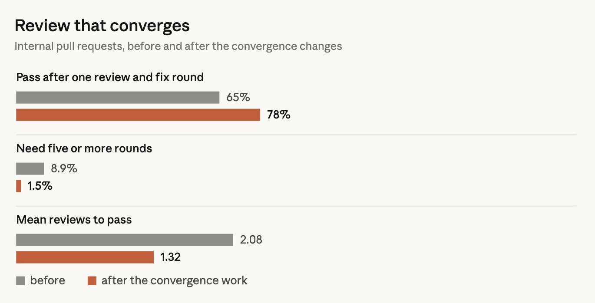
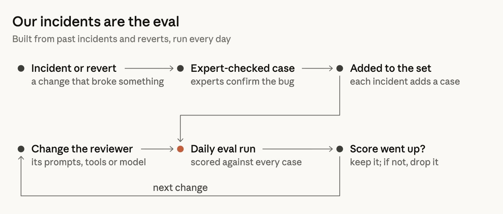

# Review-Schleifen begrenzen und mit Incidents sowie Fehlalarmen bewerten

Addy Osmani veröffentlicht eine überarbeitete Fassung des bereits erfassten [[2026-10-15-claude-how-the-claude-code-team-does-code-review-claude|Herstellerberichts zum Claude-Code-Review]]. Sie gehört zur selben Herkunftsfamilie. Zusätzlichen Wert liefern die hier lokal geprüften Diagramme zu Review-Konvergenz und Freigabestufen; ihre Zahlen bleiben interne Selbstberichte.

## Review muss zu einer Entscheidung führen

Agent-Autor und Agent-Reviewer können einander unbegrenzt beschäftigen. Der Artikel nennt einen PR mit mehr als fünfzig Runden über Nacht; rund 59 Prozent des wiederholt beanstandeten Codes seien bereits seit der ersten Runde vorhanden gewesen. Deshalb soll nach drei Runden der Ansatz neu bewertet werden. Spätere Prüfungen begrenzen sich auf den neuen Diff, melden Fehlerklassen gemeinsam und wiederholen bekannte Befunde nicht. Nächtliche Bestandsprüfungen finden separat statt.

Die Grafik liefert dazu Werte, die im Fließtext fehlen:

| Interne PR-Messgröße | Vorher | Nach Konvergenzänderungen |
|---|---:|---:|
| Abschluss nach einer Review-/Fix-Runde | 65 % | 78 % |
| Mindestens fünf Runden nötig | 8,9 % | 1,5 % |
| Durchschnittliche Reviews bis zum Abschluss | 2,08 | 1,32 |

Stichprobengröße, Messzeitraum und kontrollierte Vergleichsbedingungen fehlen. Der Text zur Grafik spricht von durchschnittlichen Runden, während die Grafik zusätzlich Anteile ausweist. Daraus folgt keine universelle Erfolgsquote oder Empfehlung, immer drei Reviews auszuführen.

## Erkennungsleistung und Noise gemeinsam prüfen

Das Team beschreibt tägliche Evals aus Incident-PRs, Fixes und Reverts mit fachlich bestätigten Fehlerstellen. Jede Änderung an Prompts, Tools oder Modell wird gegen den Gesamtbestand bewertet. Bekannt saubere PRs prüfen schädliche Fehlalarme; Reaktionen auf Kommentare unterscheiden behobene Fehler, Zurückweisungen, beabsichtigtes Verhalten und als unwichtig eingestufte Befunde. Zusätzliche Findings können bei Agent-Autoren weitere Commits und Reviewrunden verursachen.

## Freigaben bleiben eine eigene Entscheidung

Die Risikotabelle unterscheidet niedrige Risiken ohne vorgeschriebene menschliche Freigabe nach grünen automatischen Prüfungen, mittlere Risiken mit einer und höchste Risiken mit zwei Personen. Der Text begrenzt erleichterte Wege auf vertrauenswürdige Autoren; sensible Pfade und CI-Dateien brauchen zusätzliche Menschen. Die Tabelle nennt unter anderem Auto-Updater als mittleres Risiko, während der Text solche gefährlichen Bereiche ausdrücklich menschlich prüfen lässt. Die Zahl der verlangten Personen ersetzt deshalb keine pfadspezifische Policy. Agent-Freigaben zählen nicht als Menschen; unvertraute Folgecommits entwerten eine vorherige Freigabe.

## Einordnung

Die Zweitfassung bestätigt den bestehenden Beleg nicht unabhängig und hebt keine Pattern-Konfidenz. Die lokale Plugin-Stichprobe unter `external_repos/anthropics/claude-code/plugins/code-review/commands/code-review.md` bestätigt getrennte Fehlersuche und Befundvalidierung, aber weder die gehosteten Abstimmungen noch die internen Konvergenzwerte. Der Aufwand umfasst CI, zusätzliche Modellaufrufe, Evalpflege und menschliche Befundbehandlung. Zweckmäßig ist die gemeinsame Betrachtung von menschlichem Gesamtaufwand, Reviewrunden, Reverts und Incidents; eine kausale Wirkung einzelner Maßnahmen wurde hier nicht geprüft.

## Kernaussagen

- Review-Gates brauchen begrenzte Nacharbeit und einen getrennten Pfad für Altfehler → [[CI-Agent-mit-Review-Gate]].
- Incident-Evals, saubere Kontrollfälle und Noise-Messung ergänzen Erfolgsmetriken → [[Testharness-als-staerkster-Hebel]].
- Freigaben nach Risiko und konkretem Commit begrenzen → [[Review-Autonomie-mit-Shadow-Mode-und-Stichproben]].

## Verbindungen

- [[2026-10-15-claude-how-the-claude-code-team-does-code-review-claude]] bleibt die bestehende Aufarbeitung derselben Herkunft.
- [[Plan-first-mit-getrenntem-Review]] trennt Arbeitsauftrag, Umsetzung und Prüfung.
